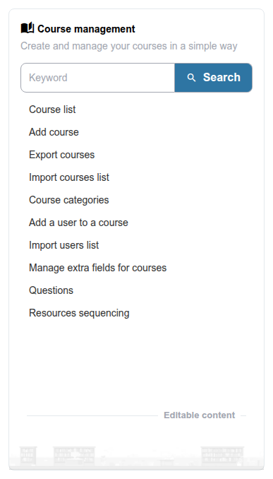

# Kurse

Dieser Abschnitt behandelt die Kursverwaltung aus der Sicht eines Administrators: die Überwachung des Kurskatalogs, die Verwaltung von Kategorien sowie den Umgang mit Importen und Exporten.

* **[Kurse verwalten](managing-courses.md)** — Kurse anzeigen, erstellen, bearbeiten und löschen
* **[Kurskategorien](course-categories.md)** — Den Kurskatalog mit Kategorien organisieren
* **[Kursimport und -export](course-import-export.md)** — Kurse zwischen Plattformen importieren und exportieren
* **[Demokurse](demo-courses.md)** — Die Kurse „The AI Act“ und „Using Chamilo“, die mit jeder neuen Installation ausgeliefert werden