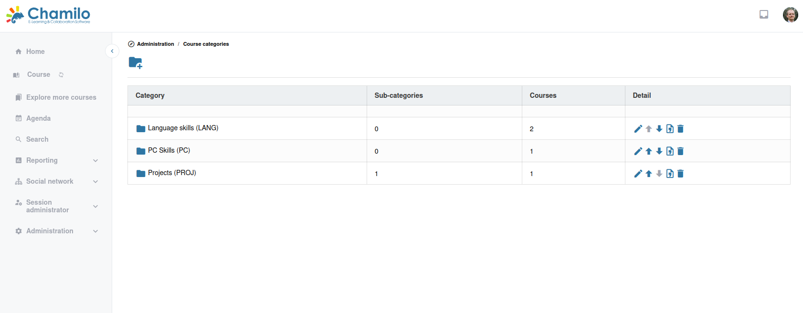

# Kurskategorien

Kurskategorien helfen dabei, Ihren Kurskatalog zu organisieren, sodass Lernende relevante Kurse leichter finden können.

## Eine Kategorie erstellen

1. Navigieren Sie im Administrationsbereich zu **Kurskategorien**
2. Klicken Sie auf **Kategorie hinzufügen**
3. Geben Sie Folgendes ein:
   * **Kategoriecode** — Eine kurze eindeutige Kennung
   * **Kategoriename** — Der Anzeigename (z. B. „Informationstechnologie“, „Führungskompetenzen“)
   * **Hinzufügen von Kursen in dieser Kategorie zulassen?** — Ob Kurse diese Kategorie als Kategorie festlegen dürfen oder ob sie lediglich als Zwischenebene in einer Hierarchie dient
   * **Übergeordnete Kategorie** — (Optional) Ordnen Sie diese Kategorie einer anderen Kategorie unter, um eine Hierarchie zu erstellen
   * **Beschreibung** — (Optional)
   * **Bild** — (Optional) Stellt diese Kategorie dar, wird jedoch fast nirgends angezeigt
4. Drücken Sie auf *Kategorie hinzufügen*

Chamilo erstellt standardmäßig 3 Kategorien: *Sprachkenntnisse*, *PC-Kenntnisse* und *Projekte*. Diese können je nach Bedarf umbenannt, entfernt oder beibehalten werden.

## Kategoriehierarchie

Kategorien können verschachtelt werden, um eine Baumstruktur zu erstellen:

* Wirtschaft
  * Management
  * Marketing
  * Finanzen
* Technologie
  * Programmierung
  * Netzwerktechnik
  * Cybersicherheit

Lernende, die den Kurskatalog durchsuchen, können durch diese Hierarchie navigieren, um Kurse zu finden.

## Kategorien verwalten

* **Bearbeiten** — Ändern Sie den Kategorienamen, den Code oder die übergeordnete Kategorie
* **Verschieben** — Ändern Sie die Position einer Kategorie in der Liste
* **Löschen** — Entfernen Sie eine Kategorie. Kurse in einer gelöschten Kategorie werden nach „Nicht kategorisiert“ verschoben.

## Tipps

* **Halten Sie es einfach** — Verwenden Sie breite Kategorien, die Lernende auf einen Blick verstehen
* **Begrenzen Sie die Tiefe** — Vermeiden Sie tief verschachtelte Kategorien. Zwei oder drei Ebenen sind in der Regel ausreichend.
* **Kategorien bei der Kurserstellung zuweisen** — Ermutigen Sie Lehrkräfte, beim Erstellen von Kursen eine Kategorie auszuwählen, damit der Katalog organisiert bleibt