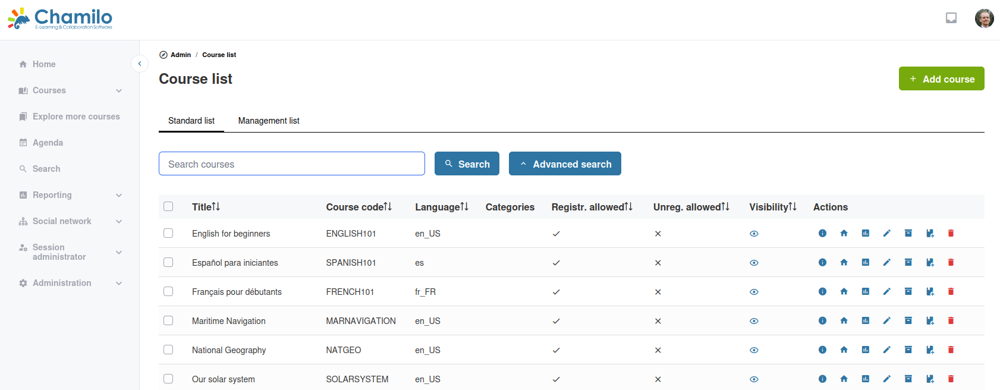

# Kurse verwalten

Als Administrator können Sie alle Kurse auf der Plattform verwalten, unabhängig davon, wer sie erstellt hat.

## Kursliste

Klicken Sie im Administrationsbereich auf **Kursliste**, um alle Kurse anzuzeigen. Die Liste zeigt:

* Kurstitel und -code
* Sprache
* Kategorien
* Sichtbarkeitsstatus

Verwenden Sie das Werkzeug **Erweiterte Suche**, um bestimmte Kurse zu finden.

## Einen Kurs erstellen

Als Administrator können Sie Kurse erstellen und sie beliebigen Lehrkräften zuweisen:

1. Klicken Sie im Administrationsbereich auf **Kurs hinzufügen**
2. Füllen Sie die Kursdetails aus (Titel, Code, Kategorie, Sprache)
3. Weisen Sie dem Kurs eine Lehrkraft zu
4. Speichern

Hinweis: In Chamilo 1.11.x wurde der Kurscode als Teil der Kurs-URL angezeigt und konnte nach der Erstellung des Kurses nicht mehr geändert werden. Dieses Verhalten hat sich ab Version 2.x geändert. Der Kurscode ist in der URL nicht mehr sichtbar, und künftige Versionen könnten es Lehrkräften ermöglichen, den Kurscode nachträglich zu ändern, da er für die Plattform weniger wesentlich wird.

## Einen bestehenden Kurs verwalten

Suchen Sie einen Kurs in der Liste, um die Verwaltungsoptionen in der Spalte *Aktionen* aufzurufen:

* **Informationen** — Informationen zum Kurs anzeigen 
* **Kursstartseite** — Führt Sie direkt zur Startseite des Kurses 
* **Berichte** — Engagement- und Leistungsdaten anzeigen
* **Bearbeiten** — Kurstitel, Kategorie, Sichtbarkeit und weitere Einstellungen ändern
* **Sicherung erstellen** — Zum Wartungsbereich des Kurses wechseln, in dem Sie Kopien erstellen und weitere Aktionen ausführen können
* **Zum Katalog hinzufügen** — Diesen Kurs zum Kurskatalog hinzufügen
* **Löschen** — Den Kurs und alle seine Inhalte dauerhaft entfernen

> Das Löschen eines Kurses entfernt dauerhaft alle Inhalte, Lernerdaten, Noten und Tracking-Informationen. Erwägen Sie, den Kurs zuvor als Sicherung zu exportieren.

## Administratorintegrationen

Administratoren können ausgewählte Kursmetadaten auch mit `PATCH /api/courses/{id}` synchronisieren oder das Löschen eines Kurses mit `DELETE /api/courses/{id}` anfordern. Diese API-Operationen erfordern einen Plattformadministrator; eine Lehrkraft kann sie nicht verwenden, um die Oberfläche für Kurseinstellungen zu umgehen. Das Löschen von Kursen über die API kann sich in Installationen mit mehreren URLs anders verhalten und verwendet nicht das optionale Löschen exklusiver Dokumente des Wartungsbildschirms. Siehe [API zur Kursadministration](../../developer-guide/api/course-administration.md), bevor Sie destruktive Vorgänge automatisieren.

## Massenoperationen

Wählen Sie mehrere Kurse in der Liste aus, um Stapelaktionen wie das Löschen auszuführen. Um einen Kurs zu exportieren, öffnen Sie den Kurs und verwenden Sie das Werkzeug **Wartung** — in der administrativen Kursliste gibt es keine Massenexportaktion.

## Einstellungen zur Kurssichtbarkeit

Administratoren können die von Lehrkräften festgelegte Sichtbarkeit überschreiben:

| Sichtbarkeit | Wirkung |
|-----------|--------|
| **Öffentlich** | Für alle zugänglich, einschließlich anonymer Besucher |
| **Offen** | Für alle angemeldeten Benutzer zugänglich |
| **Privat** | Nur eingeschriebene Benutzer können auf den Kurs zugreifen |
| **Geschlossen** | Niemand kann auf den Kurs zugreifen (außer der Lehrkraft und Administratoren) |
| **Verborgen** | Niemand kann den Kurs anzeigen oder darauf zugreifen (außer den Administratoren) |