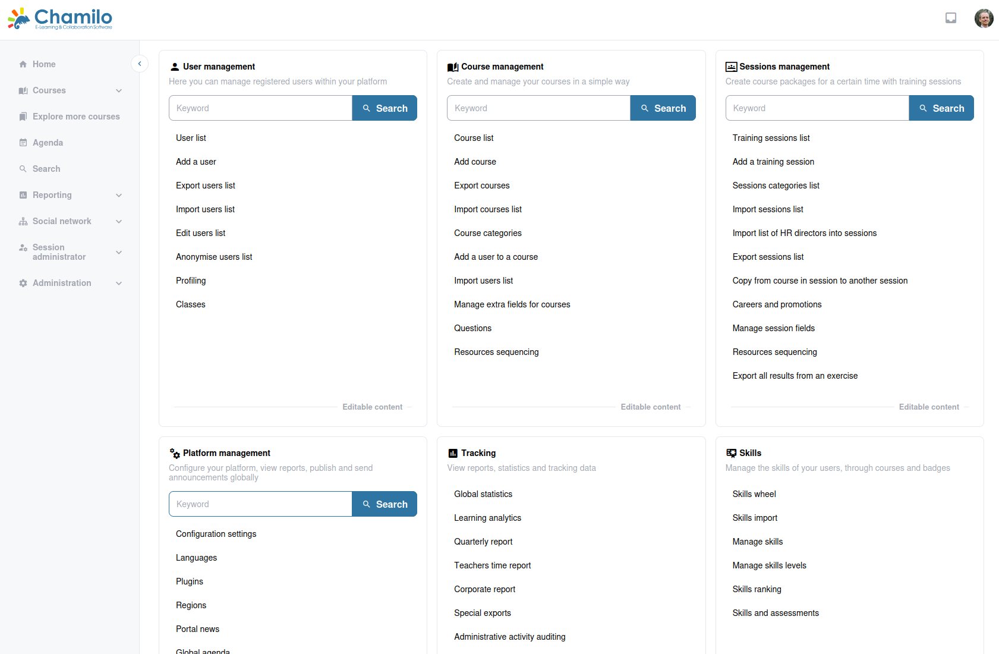

# Überblick über die Administrationsoberfläche

Der Administrationsbereich ist Ihre Kommandozentrale für die Verwaltung der Chamilo-Plattform. Sie erreichen ihn, indem Sie in der Seitenleiste auf **Administration**  klicken.

## Administrations-Dashboard

Das Administrations-Dashboard ist in Funktionsblöcke gegliedert. Jeder Block fasst zusammengehörige Verwaltungswerkzeuge zusammen:

### Benutzer

* **Benutzerliste** — Alle Benutzer der Plattform anzeigen, suchen, bearbeiten und verwalten
* **Benutzer hinzufügen** — Einzelne Benutzerkonten erstellen
* **Klassen** — Benutzerklassen für die Masseneinschreibung in Sitzungen verwalten

Einzelheiten finden Sie im Kapitel [Benutzer](../users/README.md).

### Kurse

* **Kursliste** — Alle Kurse der Plattform anzeigen und verwalten
* **Kurs erstellen** — Einen neuen Kurs erstellen
* **Kurskategorien** — Kurse für den Katalog in Kategorien organisieren

Einzelheiten finden Sie im Kapitel [Kurse](../courses/README.md).

### Sitzungen

* **Sitzungsliste** — Schulungssitzungen anzeigen und verwalten
* **Sitzung erstellen** — Eine neue Sitzung mit Kursen und Einschreibung einrichten
* **Sitzungskategorien** — Sitzungen in Kategorien organisieren
* **Karrieren und Promotionen** — Karrierepfade und Promotionsabläufe verwalten

Einzelheiten finden Sie im Kapitel [Sitzungen](../sessions/README.md).

### Plattform

* **Konfigurationseinstellungen**, **Sprachen**, **Portalnachrichten**, **Globale Agenda**, **Seiten**, **Zusatzfelder**, **E-Mail-Vorlagen**, **Kontaktformularkategorien** und weitere — Einzelheiten finden Sie im Kapitel [Plattform](../platform/README.md). Der Link „Konfigurationseinstellungen“ ist der Einstieg in das separate Kapitel [Plattformeinstellungen](../platform-settings/README.md).

### Analysen

* **Globale Statistiken**, **Berichtskatalog**, **Learning Analytics**, **Quartalsbericht**, **Zeitbericht der Lehrkräfte**, **Unternehmensbericht**, **Spezielle Exporte**, **Tickets** — Plattformstatistiken und Berichte; Einzelheiten finden Sie im Kapitel [Analysen](../analytics/README.md)

### Kompetenzen

* **Kompetenzrad**, **Kompetenzimport**, **Kompetenzen verwalten**, **Kompetenzstufen verwalten**, **Kompetenzranking**, **Kompetenzen und Bewertungen** — Kompetenzabzeichen, die mit Ergebnissen des Notenbuchs verknüpft sind; Einzelheiten finden Sie im Kapitel [Kompetenzen](../skills/README.md)

### System

* **Temporäre Dateien bereinigen**, **Systemstatus**, **Systemaktualisierung**, **Farben**, **Dateiinformationen**, **Ressourcen nach Typ**, **Symbole auflisten** — Serverwartung, Selbstaktualisierung und Branding; Einzelheiten finden Sie im Kapitel [System](../system/README.md)

### Räume

* **Standorte**, **Räume**, **Raumverfügbarkeitssuche** — Physische Standorte und buchbare Schulungsräume; Einzelheiten finden Sie im Kapitel [Räume](../rooms/README.md)

### Sicherheit

* **Aktivitätsaudit**, **Anmeldeversuche**, **Simple IDS**, **Passwortstärkeprüfung**, **Dateiintegrität** — Werkzeuge zur Sicherheitsüberwachung und -prüfung; Einzelheiten finden Sie im Kapitel [Sicherheit](../security/README.md)

### Plugins

* Verknüpfungen zu installierten Plugins, die eine Administrationsmenüseite bereitstellen, sowie die allgemeine Plugin-Verwaltung — Einzelheiten finden Sie im Kapitel [Plugins](../plugins/README.md)

### Integritätsprüfung

* Live-Prüfungen mit bestanden/nicht bestanden (E-Mail-Einstellungen, Zuweisung der Admin-URL, Dateiberechtigungen) — Einzelheiten finden Sie auf der Seite [Integritätsprüfung](../health-check.md)

### Weitere Blöcke

* **Chamilo.org**, **Versionsprüfung**, **Professioneller Support**, **Neuigkeiten von Chamilo** — Links und Statusbereiche, die Inhalte aus dem Chamilo-Projekt beziehen; Einzelheiten finden Sie unter [Weitere Administrationsblöcke](../other-admin-blocks/README.md)

Jeder Abschnitt wird im entsprechenden Kapitel dieses Leitfadens ausführlich behandelt.

Authentifizierungsmethoden wie OAuth2, LDAP, CAS und andere externe Authentifizierungsanbieter werden nicht im Administrations-Dashboard konfiguriert, sondern in `config/authentication.yaml`.