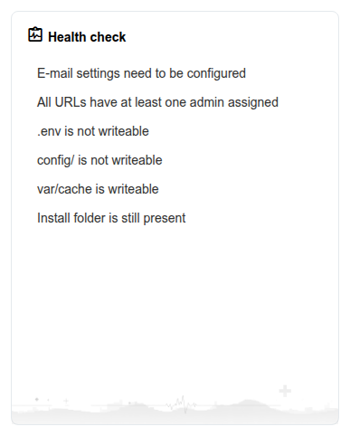

# Zustandsprüfung

Die Zustandsprüfung ist ein kleiner Block im Administrations-Dashboard, der einige Live-Prüfungen Ihrer Installation durchführt und alles markiert, was Aufmerksamkeit erfordert — Sie müssen nicht in Konfigurationsdateien suchen, um häufige Fehlkonfigurationen zu erkennen.

## Zugriff auf die Zustandsprüfung

Im Administrationsbereich erscheint der Block **Zustandsprüfung** neben den anderen Dashboard-Blöcken — kein Klick erforderlich, die Ergebnisse werden direkt angezeigt.

## Die Prüfungen

* **E-Mail-Einstellungen** — Prüft, ob eine Mailer-Verbindungszeichenfolge sowie eine Absender-E-Mail und ein Absendername konfiguriert sind. Andernfalls wird auf die E-Mail-Einstellungen verlinkt, um dies zu beheben.
* **Allen URLs ist mindestens ein Administrator zugewiesen** — Bei einer Installation mit mehreren URLs wird geprüft, ob jede Zugriffs-URL mindestens einen Administrator hat, der sie verwalten kann. Falls nicht, wird auf die Seite zur Zuweisung von Zugriffs-URL und Benutzer verlinkt.
* **`.env` ist nicht beschreibbar** — `.env` enthält Geheimnisse und sollte nach der Installation vom Webserver nicht beschreibbar sein. Wird als Fehler markiert, wenn sie es ist; verlinkt auf den Sicherheitsleitfaden.
* **`config/` ist nicht beschreibbar** — Dieselbe Begründung wie bei `.env`: Dieses Verzeichnis sollte im normalen Betrieb nicht vom Web beschreibbar sein. Da dieser Ordner historisch ein Angriffsziel war, entfernen Sie ihn mit `rm -rf public/main/install`. Verlinkt auf den [Sicherheitsleitfaden](appendix/security-guide.md#remove-the-install-folder).
* **`var/cache` ist beschreibbar** — Die gegenteilige Prüfung: Symfony muss in sein Cache-Verzeichnis schreiben können, daher wird dies als Fehler markiert, wenn es *nicht* beschreibbar ist. Verlinkt auf den Leitfaden zur Leistungsoptimierung.
* **Installationsordner ist nicht vorhanden** — Der Ordner `public/main/install` wird nur während der Installation benötigt und sollte danach entfernt werden. Dies wird als Warnung (nicht als harter Fehler) markiert, wenn er noch vorhanden ist, da das Risiko geringer ist als bei den beiden oben genannten Schreibbarkeitsprüfungen. Da dieser Ordner historisch ein Angriffsziel war, entfernen Sie ihn mit `rm -rf public/main/install`. Verlinkt auf den [Sicherheitsleitfaden](appendix/security-guide.md#remove-the-install-folder).

## Was Sie dagegen tun können

Jede Prüfung verlinkt direkt dorthin, wo Sie das zugrunde liegende Problem beheben würden — entweder eine Einstellungsseite oder den entsprechenden Leitfaden. Gehen Sie diese Liste direkt nach der Installation und danach regelmäßig durch (zum Beispiel nach einer manuellen Dateiübertragung oder einer Änderung der Berechtigungen), da eine heute bestandene Prüfung nicht garantiert, dass dies so bleibt. Eine umfassendere Checkliste zur Härtung von Produktivsystemen, die über diese sechs Prüfungen hinausgeht, finden Sie im [Sicherheitsleitfaden](appendix/security-guide.md).