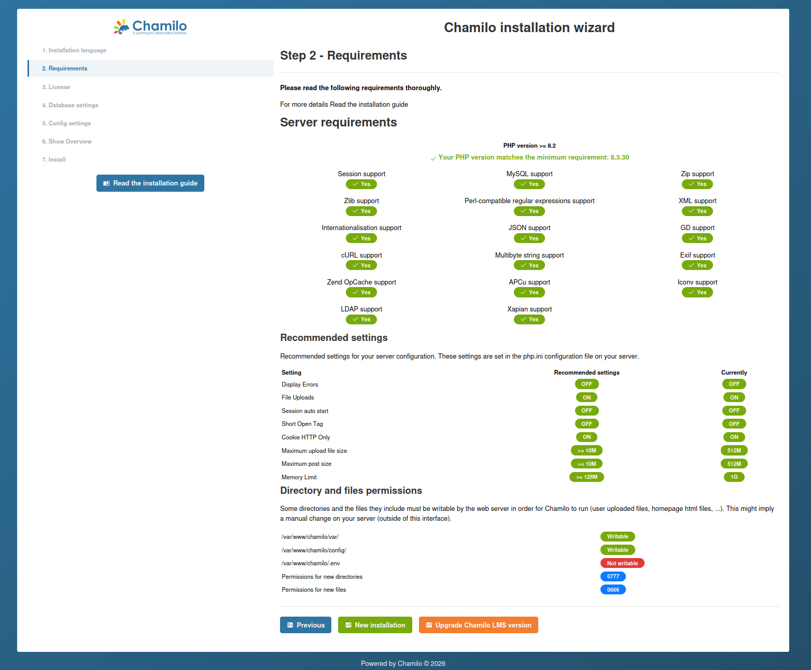
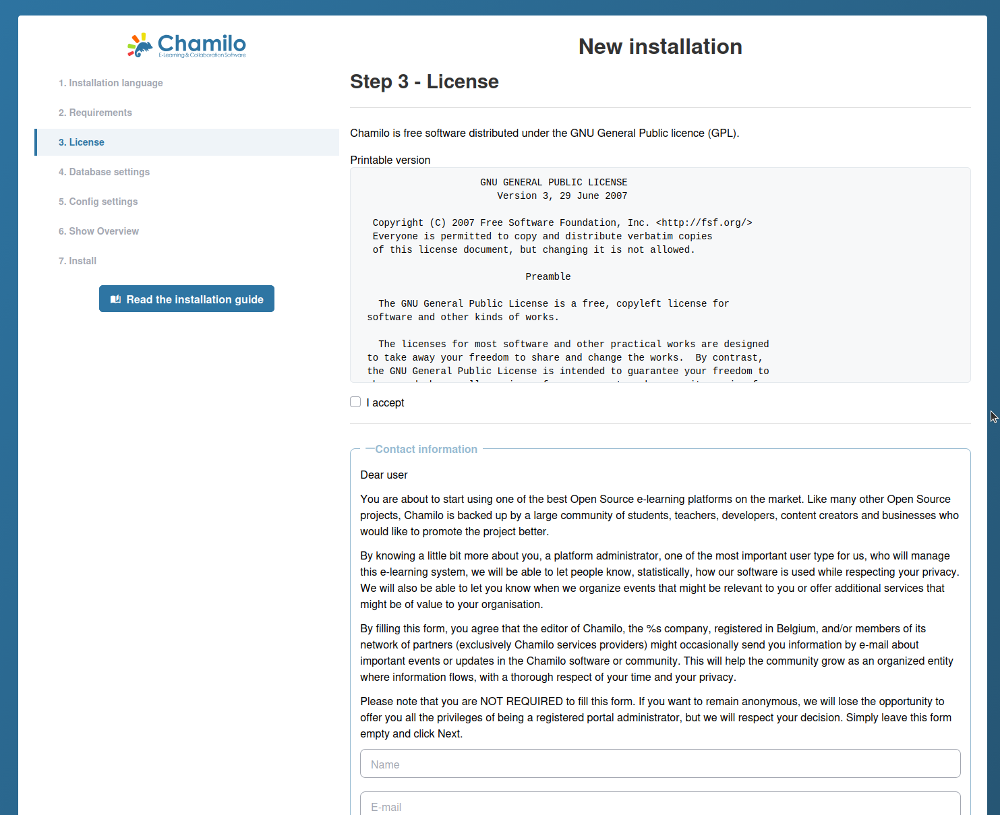
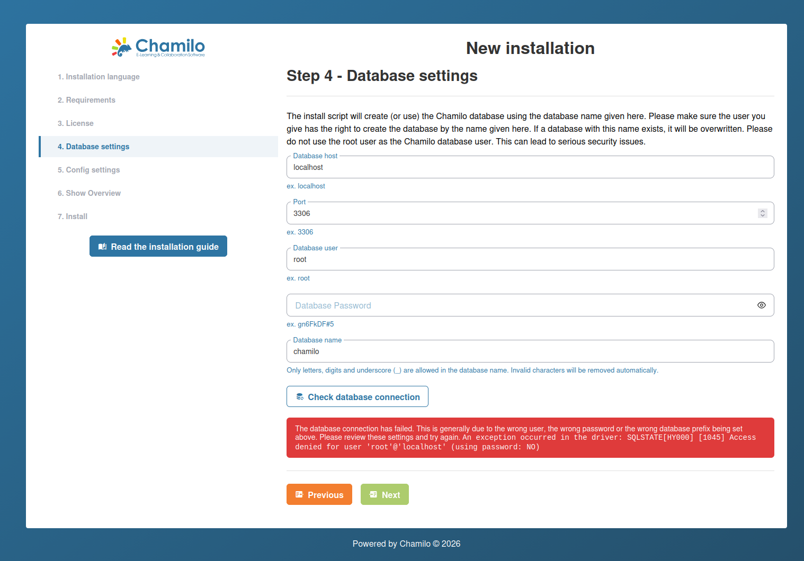
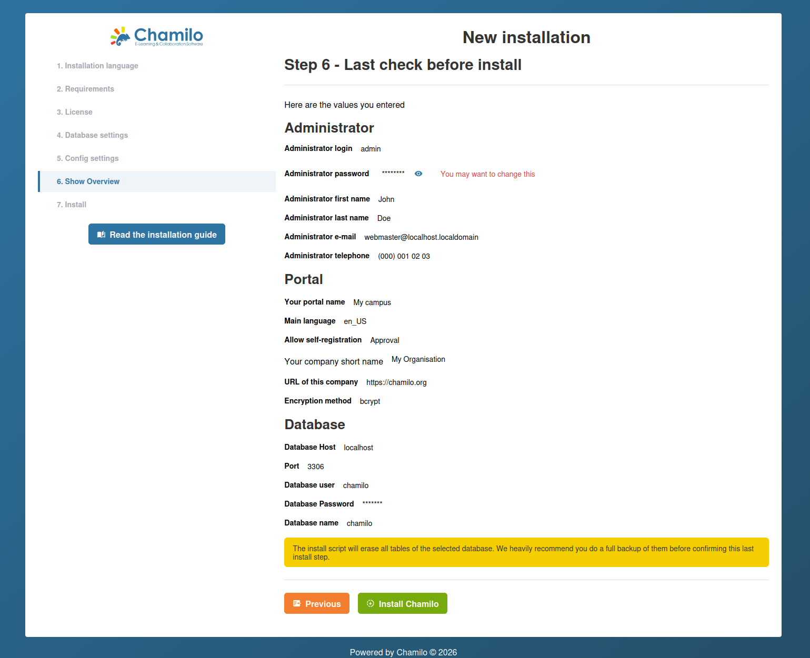
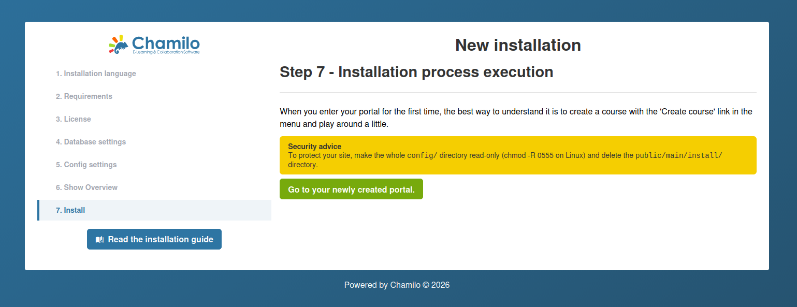

# Installationsassistent

Chamilo 3.0 enthält einen webbasierten Installationsassistenten, der Sie durch die Ersteinrichtung führt. Der Assistent startet automatisch, wenn Sie die Plattform zum ersten Mal aufrufen.

## Bevor Sie beginnen

Stellen Sie sicher, dass die folgenden Voraussetzungen erfüllt sind:

1. Ihr Server erfüllt alle [Serveranforderungen](server-requirements.md).
2. Sie haben eine gepackte Version (zip oder tar.gz) von Chamilo heruntergeladen.
3. Ihr Webserver ist so konfiguriert, dass das Verzeichnis `public/` als Document Root ausgeliefert wird.
4. Ihre Datei `.env` ist vorhanden und leer (der Assistent führt Sie durch die Datenbankeinrichtung).

## Schritt 1: Installationssprache

Im ersten Schritt wählen Sie die Sprache für den Installationsvorgang. Wählen Sie Ihre bevorzugte Sprache aus der Dropdown-Liste.

Wenn Chamilo eine bestehende Installation erkennt (für ein Upgrade), wird der Migrationsstatus angezeigt und statt einer Neuinstallation ein Upgrade-Pfad angeboten.

## Schritt 2: Anforderungsprüfung

Der Assistent prüft Ihre Serverumgebung:

* **PHP-Version** ist 8.3, 8.4 oder 8.5
* **Erforderliche PHP-Erweiterungen** sind installiert (intl, gd, curl, zip, mbstring, xml usw.)
* **Empfohlene PHP-Einstellungen** — `date.timezone` ist konfiguriert, ausreichende Upload-/Speicherlimits
* **Verzeichnis- und Dateiberechtigungen** — `var/`, `config/` und `public/upload/` sind für den Webserver beschreibbar

Wenn Anforderungen nicht erfüllt sind, zeigt der Assistent Warnungen oder Fehler an. Beheben Sie diese, bevor Sie fortfahren.

## Schritt 3: Lizenz

In diesem Schritt wird die GNU/GPLv3-Lizenz angezeigt. Sie müssen das Kontrollkästchen **„Ich akzeptiere“** aktivieren, um fortzufahren.

Optional können Sie den Abschnitt **Kontaktinformationen** aufklappen, um Angaben zu Ihrer Organisation zu machen (Name, E-Mail, Unternehmen, Land). Dies ist freiwillig und hilft der Chamilo-Community zu verstehen, wer die Plattform nutzt, ermöglicht es uns aber auch, Sie *sehr selten* über Veranstaltungen in Ihrer Nähe zu kontaktieren.

## Schritt 4: Datenbankeinstellungen

Geben Sie die Verbindungsdaten Ihrer Datenbank ein:

| Feld | Beschreibung |
|-------|-------------|
| **Datenbankhost** | Hostname oder IP Ihres Datenbankservers (z. B. `localhost` oder `127.0.0.1`) |
| **Datenbankport** | Standard: 3306 für MySQL/MariaDB |
| **Datenbankname** | Name der zu verwendenden Datenbank (nur alphanumerische Zeichen und Unterstriche) |
| **Datenbankbenutzer** | Ein Datenbankbenutzer mit vollständigen Rechten für die angegebene Datenbank |
| **Datenbankpasswort** | Das Passwort des Datenbankbenutzers |

Klicken Sie auf **Datenbankverbindung prüfen**, um den Test durchzuführen. Der Assistent lässt Sie erst fortfahren, wenn die Verbindung erfolgreich ist. Wenn die Datenbank bereits existiert, wird eine Warnung angezeigt.

## Schritt 5: Konfigurationseinstellungen

Dieser Schritt umfasst die Erstellung des Administratorkontos, die Portaleinstellungen und die E-Mail-Konfiguration.

### Administratorkonto

| Feld | Beschreibung |
|-------|-------------|
| **Anmeldung** | Der Benutzername des Administrators |
| **Passwort** | Wählen Sie ein starkes Passwort — dieses Konto hat vollen Zugriff auf die Plattform |
| **Vorname** | Der Vorname des Administrators |
| **Nachname** | Der Nachname des Administrators |
| **E-Mail** | Wird für Systembenachrichtigungen und das Zurücksetzen von Passwörtern verwendet |
| **Telefon** | Optionale Kontaktnummer |

Diese Administratordaten werden von Chamilo auch verwendet, um die Support-Kontaktdaten zu füllen. Stellen Sie daher sicher, dass Sie diese nach Abschluss der Installation in den Einstellungen neu konfigurieren.

### Portaleinstellungen

| Feld | Beschreibung |
|-------|-------------|
| **Sprache** | Die Standardsprache der Benutzeroberfläche |
| **Portalname** | Der Name Ihrer Plattform (z. B. „My Organization LMS“) |
| **Kurzname des Unternehmens** | Der abgekürzte Name Ihrer Organisation |
| **Unternehmens-URL** | Die Website Ihrer Organisation |
| **Verschlüsselungsmethode** | Algorithmus zum Hashen von Passwörtern — **bcrypt** wird empfohlen |
| **Selbstregistrierung zulassen** | Ja / Nein / Nach Genehmigung |
| **Selbstregistrierung als Trainer zulassen** | Ja / Nein |

### E-Mail-Konfiguration

Im Abschnitt für die E-Mail-Einstellungen können Sie den Mail-Transport (SMTP, Amazon SES, Mailjet usw.) konfigurieren und den E-Mail-Versand testen. Einzelheiten finden Sie unter [E-Mail-Konfiguration](email-configuration.md).

Alle diese Einstellungen können später im Administrationsbereich geändert werden.

## Schritt 6: Letzte Prüfung vor der Installation

Dieser Schritt zeigt eine Zusammenfassung aller eingegebenen Angaben zur Überprüfung an:

* Administratorzugangsdaten (das Passwort ist standardmäßig ausgeblendet — klicken Sie auf das Augensymbol, um es anzuzeigen)
* Portaleinstellungen
* Datenbankverbindungsdetails

Prüfen Sie alles sorgfältig und klicken Sie anschließend auf **Install Chamilo**, um die Installation auszuführen. Der Assistent erstellt alle Datenbanktabellen, füllt die Anfangsdaten und konfiguriert die Plattform.

## Schritt 7: Installation abgeschlossen

Nach erfolgreichem Abschluss der Installation zeigt der Assistent Folgendes an:

* **Hinweise für den Einstieg** — Empfiehlt, Ihren ersten Kurs zu erstellen, um die Plattform zu erkunden (als Administrator müssen Sie dies über das Administrationspanel tun)
* **Sicherheitsempfehlungen**:
  * Machen Sie das Verzeichnis `config/` schreibgeschützt (`chmod 0555`)
  * Löschen Sie das Verzeichnis `public/main/install/`
* Einen **Link zu Ihrem Portal**, um sich mit den soeben erstellten Administratorzugangsdaten anzumelden

## Nach der Installation

Nach Abschluss des Assistenten:

* **Entfernen oder beschränken Sie den Zugriff auf das Installationsprogramm** -- Der Assistent sollte nach der Installation nicht mehr zugänglich sein. Chamilo sperrt ihn in der Regel automatisch, überprüfen Sie jedoch, dass ein erneuter Aufruf der Installations-URL zur Anmeldeseite weiterleitet.
* **E-Mail-Zustellung konfigurieren** -- Siehe [E-Mail-Konfiguration](email-configuration.md).
* **Sicherungen einrichten** -- Richten Sie vor dem Hinzufügen von Inhalten automatisierte Sicherungen der Datenbank und der Dateien ein (Chamilo stellt hierfür keine Lösung bereit, das Kopieren des Ordners var/ und der Datenbank sind jedoch die beiden wichtigsten Elemente).
* **Sicherheitseinstellungen überprüfen** -- Siehe [Sicherheitseinstellungen](../platform-settings/security-settings.md).

## Fehlerbehebung

| Problem | Lösung |
|---------|----------|
| Leere Seite unter der Installations-URL | Prüfen Sie die PHP-Fehlerprotokolle. Setzen Sie vorübergehend `APP_ENV=dev` in .env, um Fehler im Browser anzuzeigen. |
| Datenbankverbindung schlägt fehl | Überprüfen Sie die Zugangsdaten, stellen Sie sicher, dass die Datenbank existiert, und prüfen Sie, ob der Datenbankserver Verbindungen vom Host des Webservers zulässt. |
| Fehler „Permission denied“ | Stellen Sie sicher, dass `var/` für den Benutzer des Webservers beschreibbar ist. |
| Assets werden nicht geladen (kein CSS/JS) | Führen Sie `yarn install && yarn build` aus, um die Frontend-Assets zu kompilieren. |