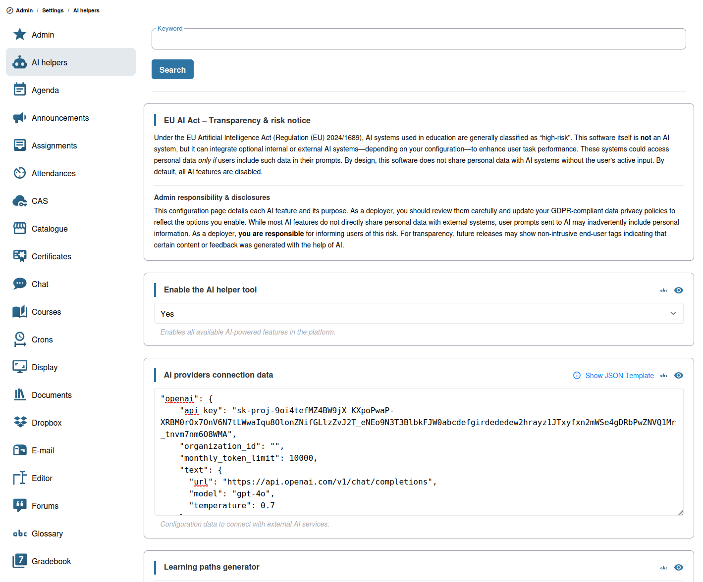

# KI-Konfiguration

Chamilo 3.0 umfasst KI-gestützte Funktionen, die konfiguriert werden müssen, bevor sie Lehrenden und Lernenden zur Verfügung stehen.

## Unterstützte KI-Anbieter

Chamilo unterstützt mehrere KI-Anbieter:

| Anbieter | Funktionen |
|----------|-------------|
| **Claude (Anthropic)** | Textgenerierung, Dokumentenanalyse |
| **DeepSeek** | Textgenerierung |
| **Google Gemini** | Text-, Bild- und Videogenerierung |
| **Grok** | Text-, Bild- und Videogenerierung |
| **Mistral** | Textgenerierung |
| **OpenAI** | Text-, Bild- und Videogenerierung |

Jeder Anbieter kann für verschiedene Arten von KI-Aufgaben konfiguriert werden:

* **Text** — Wird für die Übungsgenerierung, die Generierung von Lernpfaden, die KI-Bewertung und den KI-Tutor verwendet
* **Bild** — Wird für die KI-Bildgenerierung verwendet
* **Video** — Wird für die KI-Videogenerierung verwendet (sofern unterstützt)
* **Dokument** — Wird für die KI-Dokumentenanalyse verwendet

## Konfigurationsschritte

### 1. API-Schlüssel beschaffen

Registrieren Sie ein Konto bei Ihrem gewählten KI-Anbieter und beschaffen Sie einen API-Schlüssel:

* **Claude (Anthropic)**: [console.anthropic.com](https://console.anthropic.com/)
* **DeepSeek**: [platform.deepseek.com](https://platform.deepseek.com/)
* **Google Gemini**: Google AI Studio oder Google Cloud
* **Grok**: [console.x.ai](https://console.x.ai/)
* **Mistral**: [console.mistral.ai](https://console.mistral.ai/)
* **OpenAI**: [platform.openai.com](https://platform.openai.com/)

### 2. Anbieter in Chamilo konfigurieren



Navigieren Sie in den Plattformeinstellungen zum Abschnitt **KI-Helfer**:

1. **KI-Helfer aktivieren** — Aktivieren Sie die KI-Funktionen global
2. **KI-Anbieter konfigurieren** — Fügen Sie einen oder mehrere Anbieter hinzu mit:
   * **Anbietername** (`claude`, `deepseek`, `gemini`, `grok`, `mistral`, `openai`). `anthropic` wird als Alias von `claude` akzeptiert
   * **API-Schlüssel** — Ihr API-Schlüssel für den Anbieter
   * **Modell** — Das zu verwendende spezifische Modell (z. B. `gpt-4o`, `claude-sonnet-4-6`, `gemini-pro`, `mistral-large`)
   * **API-URL** — Die Endpunkt-URL (für Standardanbieter vorkonfiguriert)

Sie können mehrere Anbieter konfigurieren. Der erste Anbieter in der Konfiguration wird zum Standard.

### 3. Funktionen pro Kurs aktivieren

KI-Funktionen können auf Kursebene aktiviert oder deaktiviert werden. Lehrende können Folgendes umschalten:

* **KI-Tutor-Chatbot** — Der KI-Assistent für Lernende
* **Aufgabenbewerter** — KI-generierte Bewertungsempfehlung
* **Übungsgenerator** — KI-generierte Quizfragen
* **Lernpfadgenerator** — KI-generierte Lernsequenzen
* **Bild-/Videogenerator** — KI-generierte Bilder und Videos in Dokumenten

So können verschiedene Kurse je nach Bedarf unterschiedliche KI-Konfigurationen verwenden.

## Beliebiges kompatibles Modell oder beliebigen kompatiblen Endpunkt verwenden

**Sie sind nicht auf die oben aufgeführten Anbieter beschränkt.** Chamilo kommuniziert mit jedem Anbieter über eine standardisierte API-*Schnittstelle*, und die Endpunkt-URL ist konfigurierbar. Jedes Modell oder jeder Dienst, der mit einer dieser Schnittstellen kompatibel ist, kann verwendet werden, indem einfach der passende Anbieter ausgewählt und die **API-URL** (Endpunkt), der **API-Schlüssel** und der **Modell**name geändert werden.

| Wenn Ihr Modell/Dienst kompatibel ist mit... | Diesen Anbieter verwenden | Typischer Endpunktpfad |
|---|---|---|
| Der **OpenAI-API** (Chat Completions) | `openai` | `.../chat/completions` |
| Der **Anthropic-(Claude-)Messages-API** | `claude` | `.../v1/messages` |
| Der **Gemini-API** | `gemini` | anbieterspezifisch |
| Den APIs von **Mistral**, **DeepSeek** oder **Grok** | `mistral`, `deepseek`, `grok` | anbieterspezifisch |

Die mit OpenAI kompatible Schnittstelle ist bei Weitem die am weitesten verbreitete. Sie wird unter anderem von GLM (Z.ai / Zhipu), Qwen, Kimi, Together AI, Groq, OpenRouter und Perplexity sowie von selbst gehosteten Servern wie Ollama, vLLM, LM Studio oder LiteLLM verwendet. Alle können über den Anbieter `openai` in Chamilo eingebunden werden.

### Beispiel: GLM (Z.ai) über den OpenAI-Anbieter verwenden

GLM-Modelle von Z.ai stellen einen OpenAI-kompatiblen Endpunkt bereit, sodass kein eigener GLM-Anbieter erforderlich ist:

1. Holen Sie einen API-Schlüssel aus Ihrem Z.ai-Konto.
2. Fügen Sie in den Einstellungen der **AI Helpers** den Anbieter `openai` hinzu (oder bearbeiten Sie ihn).
3. Setzen Sie die **API URL** des Textdienstes auf den GLM-Endpunkt, setzen Sie das **model** auf ein GLM-Modell und fügen Sie den Z.ai-Schlüssel als **API key** ein.

```json
{
  "openai": {
    "api_key": "YOUR_ZAI_API_KEY",
    "text": {
      "url": "https://api.z.ai/api/paas/v4/chat/completions",
      "model": "glm-4.6",
      "temperature": 0.7,
      "max_tokens": 1000
    }
  }
}
```

Derselbe Ansatz funktioniert für ein lokales Modell, das von Ollama bereitgestellt wird (`"url": "http://localhost:11434/v1/chat/completions"`, `"model": "llama3.1"`), oder für jeden anderen Dienst: Prüfen Sie die Dokumentation des Anbieters auf die OpenAI-kompatible Basis-URL und die genauen Modellnamen.


Der Endpunkt muss das vollständige Anfrage-/Antwortformat der von Ihnen gewählten Schnittstelle implementieren, und das Modell muss die verwendete Funktion unterstützen (die Bildgenerierung funktioniert beispielsweise nur, wenn der Endpunkt auch die OpenAI-Image-API implementiert). Modellnamen, Endpunkt-URLs und Verfügbarkeit werden vom Anbieter festgelegt und können sich ändern: Prüfen Sie stets dessen Dokumentation. Wenn eine Funktion nicht funktioniert, testen Sie zunächst mit einer reinen Textkonfiguration.


Dasselbe Prinzip gilt für den Claude-Anbieter: Jedes Anthropic-kompatible Gateway oder jeder Anthropic-kompatible Proxy kann verwendet werden, indem die API-URL geändert wird.

## Zeitüberschreitungen bei der Generierung in der AI Toolbox

Bei der Textgenerierung in der **AI Toolbox** steuert die Einstellung `text.timeout` eines Anbieters, wie lange diese Anbieteranfrage laufen darf. Der Grok-Textanbieter verwendet einen **Standardwert von 180 Sekunden**, wenn kein numerischer Timeout konfiguriert ist (siehe [PR #9198](https://github.com/chamilo/chamilo-lms/pull/9198)). Das ist keine Garantie dafür, dass die Browseranfrage 180 Sekunden lang laufen kann: Reverse-Proxys, der Webserver oder ein anderes Gateway können ein kürzeres Limit vorgeben.

Wenn das Toolbox-Formular **HTTP 504** anzeigt, prüfen Sie das Anfrage-Timeout von Reverse-Proxy bzw. Gateway sowie die PHP- und Anwendungsprotokolle; allein das Erhöhen von `text.timeout` behebt das Problem möglicherweise nicht. Wenn die Fehlermeldung den KI-Anbieter nennt, prüfen Sie dessen `text.timeout`, Zugangsdaten, Modellverfügbarkeit und Anfragelimits. Erhöhen Sie Timeouts nicht, ohne die Serverkapazität und gleichzeitige Anfragen zu berücksichtigen.

## Kostenaspekte

KI-API-Aufrufe sind mit Kosten verbunden. Berücksichtigen Sie Folgendes:

* **Nutzungslimits festlegen** — Überwachen und begrenzen Sie die Nutzung der KI-API, um Kosten zu kontrollieren
* **Modelle sorgfältig auswählen** — Kleinere, kostengünstigere Modelle können für viele Bildungsaufgaben ausreichen
* **Nutzung nachverfolgen** — Chamilo protokolliert KI-Anfragen, damit Sie den Verbrauch überwachen können

## Tipps

* **Mit einem Anbieter beginnen** — Konfigurieren und testen Sie einen Anbieter, bevor Sie weitere hinzufügen
* **Mit einem Kurs testen** — Aktivieren Sie KI-Funktionen zunächst in einem Testkurs, um zu prüfen, ob sie wie erwartet funktionieren
* **Mit Lehrkräften kommunizieren** — Informieren Sie Lehrkräfte darüber, welche KI-Funktionen verfügbar sind und wie sie verwendet werden
* **Qualität überwachen** — Prüfen Sie regelmäßig KI-generierte Inhalte, um sicherzustellen, dass sie Ihren Bildungsstandards entsprechen