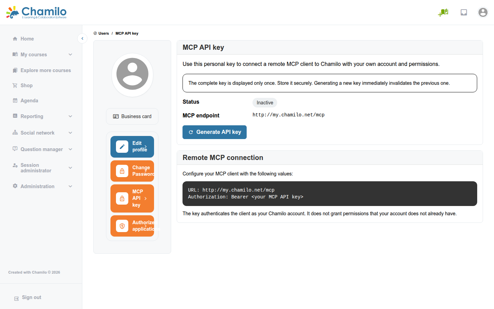

# MCP (Model Context Protocol)

Chamilo 3.0 stellt einen MCP-Server bereit, damit KI-Assistenten und Agenten (Claude, ChatGPT-Konnektoren oder jeder MCP-kompatible Client) innerhalb der Plattform im Namen eines authentifizierten Benutzers handeln können und dabei dessen eigene Berechtigungen verwenden — es gibt kein separates Dienstkonto und keinen erweiterten Zugriff.

## Was MCP zu Chamilo hinzufügt

MCP (Model Context Protocol) ist ein offener Standard, der es KI-Clients ermöglicht, einen definierten Satz von „Tools“ aufzurufen, die ein Server bereitstellt. Der MCP-Server von Chamilo ist über einen einzigen Endpunkt, `/mcp`, erreichbar und stellt eine kuratierte Auswahl lehrkraftorientierter Kursverwaltungstools bereit, nicht die gesamte API-Oberfläche.

## Verfügbare Funktionen

Jeder Aufruf wird als der verbundene Benutzer ausgeführt, sodass ein Tool stets nur Kurse sieht und ändert, die dieser Benutzer verwaltet. Der aktuelle Tool-Satz:

| Tool | Funktion |
|------|---------------|
| Current user | Gibt Identität und Rollen des authentifizierten Benutzers zurück |
| Teacher courses | Listet Kurse auf, die der Benutzer als Lehrkraft verwaltet |
| Course overview | Gibt Basisinformationen zum Kurs und Ressourcenanzahlen zurück |
| Create course | Erstellt einen neuen Kurs gemäß den Kurserstellungsregeln der Plattform |
| Create course assignment | Erstellt eine Entwurfs- oder veröffentlichte Aufgabe mit Beschreibung und Höchstpunktzahl |
| Create course test | Erstellt einen KI-gestützten Multiple-Choice-Test aus einer Themenbeschreibung oder einem vorhandenen Dokument |
| Get course test response status | Meldet, welche Lernenden einen Test beantwortet haben, sich in Bearbeitung befinden oder noch ausstehend sind |
| Get user course test score | Gibt die neuesten und besten abgeschlossenen Ergebnisse eines Lernenden in einem Test zurück |
| Create training satisfaction survey | Erstellt eine Zufriedenheitsumfrage mit sieben Fragen |
| Create course learning path | Erstellt einen Lernpfad aus Seiten, die der MCP-Client bereitstellt |
| Set learning path item prerequisite | Macht ein Lernpfadelement erst verfügbar, wenn ein früheres Element desselben Lernpfads abgeschlossen ist (mit einem Punktebereich, wenn dieses Element ein Test ist), oder entfernt die Voraussetzung; funktioniert für Lernpfade, die einer Sitzung zugeordnet sind, wenn die Sitzung angegeben wird |
| Set course introduction | Ersetzt oder löscht den Einführungsabschnitt auf der Kursstartseite, für den Basiskurs oder für eine Sitzung davon (die Sitzungseinführung ersetzt dann innerhalb dieser Sitzung die Basiseinführung) |
| Create course Toolbox application | Erzeugt eine versionierte SCORM-1.2-Anwendung in der Kurs-AI-Toolbox und veröffentlicht sie optional |
| Update course Toolbox application | Erzeugt eine neue KI-gestützte Version einer vorhandenen Toolbox-Anwendung und behält frühere Versionen bei |
| List documents | Listet die Dokumente im Dokumente-Tool eines Kurses auf |
| Read course document | Gibt HTML-Inhalt, Titel und Metadaten eines bearbeitbaren Dokuments zurück |
| Edit course document | Ersetzt den vollständigen HTML-Inhalt eines vorhandenen bearbeitbaren Dokuments |
| Create course document | Erstellt ein KI-gestütztes HTML-Dokument im Stammordner Dokumente |
| Create course illustration | Erzeugt eine KI-Illustration zu einem Thema und speichert sie als Dokument |
| Illustrate document paragraph | Fügt ein vorhandenes Bild oder Video vor oder nach einem Absatz in einem Dokument ein |
| Find recent course forum activity | Findet aktuelle, sichtbare Forenbeiträge zu einem Thema |
| Review course quality | Analysiert Lernpfade, Dokumente, Tests, Aufgaben und Umfragen eines Kurses und gibt Verbesserungsempfehlungen zurück |
| Generate Student Success feedback | Führt dieselbe datenschutzgefilterte Analyse des Student Success AI Coach aus, die in der Kursberichterstattung für einen Lernenden in einem verwalteten Kurs verfügbar ist |

Diese Liste wird vom Chamilo-Kernteam kuratiert und ist innerhalb der Plattform nicht durch Benutzer erweiterbar — Lehrkräfte können keine eigenen Tools hinzufügen.

## MCP aktivieren

MCP ist **standardmäßig deaktiviert**. Solange es nicht aktiviert ist, lehnt der Endpunkt `/mcp` jede Anmeldedaten ab, und die Schaltfläche **MCP-API-Schlüssel** erscheint nicht auf der Seite **Soziales Netzwerk** der Benutzer.

Gehen Sie zu **Administration > Konfigurationseinstellungen > Sicherheit** und setzen Sie:

* **MCP-Server aktivieren** (`mcp_enabled`) auf **Ja**.
* **MCP nach Rollen zulassen** (`mcp_allowed_roles`) auf die Rollen, die MCP verwenden dürfen. Dies ist eine JSON-Zuordnung; standardmäßig sind nur Administratoren und Lehrkräfte zugelassen:

  ```json
  {"ADMIN":true,"COURSEMANAGER":true,"STUDENT":false,"HRM":false,"SESSIONADMIN":false,"STUDENT_BOSS":false,"INVITEE":false}
  ```

  Verwenden Sie `HRM` in neuen Konfigurationen. Ein zuvor gespeicherter Eintrag `DRH` bleibt unterstützt, wenn `HRM` nicht vorhanden ist; sind beide vorhanden, hat `HRM` Vorrang.

  Ein Benutzer benötigt mindestens eine aktivierte Rolle, um die Schaltfläche **MCP-API-Schlüssel** zu sehen und MCP zu verwenden. Ungültiges JSON verweigert MCP für jede Rolle. Die Einschränkung gilt auch für früher erstellte Schlüssel und OAuth-Verbindungen, sodass das Entfernen einer Rolle deren bestehenden Zugriff unterbindet.

Siehe [Sicherheitseinstellungen](platform-settings/security-settings.md) für die vollständige Beschreibung beider Einstellungen.

## Wie Benutzer eine Verbindung herstellen

### Persönlicher MCP-API-Schlüssel

Jeder Benutzer erzeugt seinen eigenen Schlüssel unter **Soziales Netzwerk** > **MCP-API-Schlüssel**:



* Ein Klick auf **API-Schlüssel erzeugen** erstellt einen Schlüssel und zeigt ihn einmalig an — Chamilo speichert danach nur eine maskierte Version, sodass der vollständige Schlüssel sofort kopiert und sicher aufbewahrt werden muss.
* Das Erzeugen eines neuen Schlüssels widerruft den vorherigen sofort.
* Die Seite zeigt den Status des Schlüssels (aktiv/inaktiv), den im Client zu konfigurierenden MCP-Endpunkt sowie die Erstellungs- und Zuletzt-verwendet-Daten.
* Der Bereich **Remote-MCP-Verbindung** gibt genau an, was im MCP-Client einzutragen ist: die Endpunkt-URL und ein Header `Authorization: Bearer <your MCP API key>`.

Wie die Seite selbst anmerkt, authentifiziert der Schlüssel den Client als Konto dieses Benutzers — er gewährt keine Berechtigung, die das Konto nicht bereits besitzt.

### OAuth 2.1 (Remote-Clients und Konnektoren)

Für MCP-Clients, die OAuth-Discovery und dynamische Client-Registrierung unterstützen (anstelle eines manuell eingefügten Schlüssels), fungiert Chamilo ebenfalls als OAuth-2.1-Autorisierungsserver: Der Client ermittelt die Endpunkte von Chamilo, registriert sich selbst und leitet den Benutzer zu `/oauth/authorize` weiter, um den Zugriff zu genehmigen. Genehmigte Anwendungen erscheinen unter **Soziales Netzwerk** > **Autorisierte Anwendungen**, wo der Benutzer alle widerrufen kann, die er nicht mehr verwendet oder nicht erkennt.

## Sicherheitsaspekte

* **Keine Rechteausweitung.** Jeder MCP-Tool-Aufruf und jede über OAuth autorisierte Anwendung läuft mit den eigenen Chamilo-Berechtigungen des verbindenden Benutzers — ein persönlicher API-Schlüssel oder eine autorisierte Anwendung kann niemals mehr tun, als dieser Benutzer bereits manuell tun könnte.
* **Nur Bearer, ratenbegrenzt.** `/mcp` akzeptiert ausschließlich ein Bearer-Credential — einen persönlichen MCP-API-Schlüssel, ein OAuth-Zugriffstoken oder (in der Entwicklung) ein JWT. Authentifizierungsversuche werden pro IP-Adresse ratenbegrenzt, um das Erraten von Zugangsdaten zu verlangsamen.
* **Schmale öffentliche Angriffsfläche.** Der einzige unauthentifizierte Datenverkehr, den `/mcp` akzeptiert, ist der `OPTIONS`-Preflight; jeder eigentliche Aufruf erfordert `ROLE_USER`. Die Endpunkte für OAuth-Discovery, dynamische Client-Registrierung und Tokens sind absichtlich öffentlich, wie von den Spezifikationen OAuth 2.1 / MCP vorgeschrieben — dies gewährt für sich genommen keinen Zugriff, sondern ermöglicht einem Client lediglich zu erfahren, wie der Autorisierungsablauf gestartet wird.
* **Der DNS-Rebinding-Schutz ist für `/mcp` bewusst deaktiviert.** Das Bundle, das MCP implementiert, beschränkt den Endpunkt normalerweise auf `localhost`, sofern keine statische Liste zulässiger Hostnamen konfiguriert ist — eine schlechte Passform für ein Chamilo-Portal mit mehreren URLs, das unter vielen Hostnamen erreichbar ist. Chamilo deaktiviert diese Prüfung, weil sie hier redundant ist: Jede `/mcp`-Anfrage erfordert bereits ein Bearer-Credential, unabhängig vom Header `Host`/`Origin`, und ein DNS-Rebinding-Angriff (der auf umgebungsbasierter, cookie-artiger Authentifizierung beruht, die mit einem gefälschten Host mitgesendet wird) kann kein Bearer-Token fälschen, das er nicht bereits besitzt.

## Konfiguration des MCP-Servers

Über die beiden Plattformeinstellungen hinaus, die unter [MCP aktivieren](#enabling-mcp) beschrieben sind, wird der MCP-Server selbst auf Dateiebene in `config/packages/mcp.yaml` konfiguriert, wofür Shell-Zugriff auf den Server erforderlich ist:

| Schlüssel | Zweck |
|-----------|-------|
| `app`, `version`, `description` | Identität, die Chamilo verbindenden MCP-Clients meldet |
| `client_transports.stdio` / `client_transports.http` | Welche Transporte aktiv sind; Chamilo aktiviert standardmäßig beide |
| `http.path` | Der MCP-HTTP-Endpunkt (standardmäßig `/mcp`) |
| `http.allowed_hosts` | Host-Zulassungsliste gegen DNS-Rebinding — in Chamilo auf `false` gesetzt (siehe Sicherheitsaspekte oben) |
| `http.session.store`, `.directory`, `.ttl` | Wo der MCP-Sitzungszustand gespeichert wird und wie lange |

Um MCP für alle zu deaktivieren, setzen Sie **MCP-Server aktivieren** wieder auf **Nein**. Um den HTTP-Transport selbst zu entfernen, setzen Sie `client_transports.http: false` (und `stdio: false`, falls der CLI-Transport ebenfalls deaktiviert werden soll) und leeren Sie den Cache:

```bash
php bin/console cache:clear --env=prod
php bin/console cache:warmup --env=prod
```

## Tipps

* Behandeln Sie einen MCP-API-Schlüssel wie ein Passwort — wer ihn besitzt, kann über jeden MCP-Client als dieser Benutzer handeln.
* Ermutigen Sie Benutzer, **Autorisierte Anwendungen** regelmäßig zu prüfen und alles zu widerrufen, was sie nicht erkennen.
* Siehe [KI-Konfiguration](integrations/ai-configuration.md) zu den KI-Anbietern, die die oben aufgeführten Werkzeuge zur Inhaltserzeugung (Testerstellung, Dokumenterstellung, Illustrationen) unterstützen.