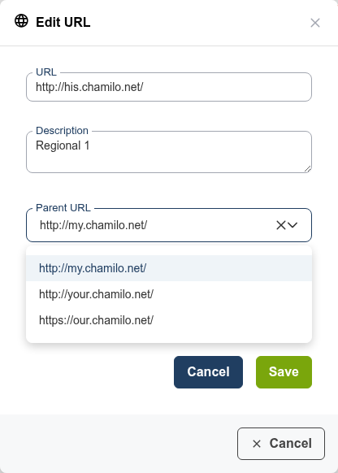
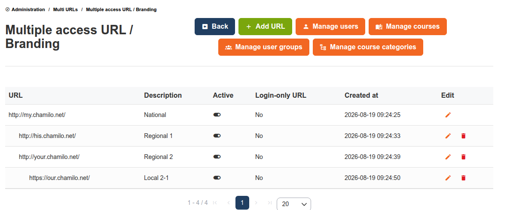

# Zugriffs-URLs

Zugriffs-URLs ermöglichen es, mit einer einzigen Chamilo-Installation mehrere getrennte Portale bereitzustellen.

Dieses Werkzeug ist auch über den Block [Plattform](../platform/README.md) im Administrations-Dashboard erreichbar, und zwar als **Mehrere Zugriffs-URLs konfigurieren**.

## Anwendungsfälle

* **Multi-Tenant-Bereitstellungen** — Getrennte Schulungsportale für verschiedene Organisationen auf einem einzigen Server betreiben
* **Abteilungsportale** — Jeder Abteilung ein eigenes, markenspezifisch gestaltetes Portal geben (z. B. `hr.training.company.com`, `it.training.company.com`)
* **Regionale Portale** — Getrennte Portale für verschiedene Regionen oder Sprachen

## Funktionsweise

Jede Zugriffs-URL ist ein separater Einstiegspunkt in dieselbe Chamilo-Installation:

* Benutzer können einer oder mehreren Zugriffs-URLs zugewiesen werden
* Kurse und Sitzungen gehören zu bestimmten Zugriffs-URLs
* Plattformeinstellungen können je Zugriffs-URL angepasst werden
* Branding und Themes können sich je URL unterscheiden
* Benutzer eines Portals können Benutzer oder Kurse eines anderen Portals nicht sehen (sofern sie nicht ausdrücklich freigegeben wurden)

## Konfiguration

### Multi-URL aktivieren

Multi-URL muss in der Chamilo-Konfiguration aktiviert werden (in der Regel in den Umgebungseinstellungen). Dies erfolgt üblicherweise während der Ersteinrichtung.

### Eine Zugriffs-URL erstellen

1. Navigieren Sie im Administrationsbereich zu **Zugriffs-URLs**
2. Klicken Sie auf **URL hinzufügen**
3. Geben Sie die URL (z. B. `https://portal2.yoursite.com`) und eine Beschreibung ein
4. Wählen Sie optional eine **Übergeordnete URL**, um diese URL einer anderen unterzuordnen — siehe [URL-Hierarchie](#url-hierarchy) unten
5. Speichern

### Benutzer und Kurse zuweisen

* **Benutzer** — Weisen Sie Benutzer bestimmten Zugriffs-URLs zu. Ein Benutzer kann mehreren URLs angehören.
* **Kurse** — Weisen Sie Kurse bestimmten Zugriffs-URLs zu
* **Sitzungen** — Weisen Sie Sitzungen bestimmten Zugriffs-URLs zu

### Einstellungen je URL

Jede Zugriffs-URL kann Folgendes besitzen:

* **Farb-Theme** — Unterschiedliches visuelles Branding
* **Plattformname und Logo** — Individuelle Identität
* **Einstellungsüberschreibungen** — Bestimmte Plattformeinstellungen können je URL angepasst werden

## URL-Hierarchie

Zugriffs-URLs können statt einer flachen Liste in einem Eltern-/Kind-Baum organisiert werden. Beim Erstellen oder Bearbeiten einer URL kann ein uneingeschränkter Globaler Administrator (siehe [Teilbaum-Administratoren](#subtree-administrators) unten) eine beliebige andere URL als **Übergeordnete URL** auswählen:

* Das Dropdown bietet niemals die gerade bearbeitete URL oder einen ihrer eigenen Nachkommen als mögliche übergeordnete URL an — dadurch wird das Entstehen eines Zyklus verhindert. Das Backend prüft dies erneut, unabhängig davon, was die Oberfläche anzeigt.
* Wird eine URL ohne Auswahl einer übergeordneten URL erstellt, wird standardmäßig die **Nur-Anmeldung-URL** verwendet, sofern eine vorhanden ist (siehe [Einstellungen je URL](#per-url-settings) oben), andernfalls die erste Zugriffs-URL — dasselbe Standardverhalten wie vor Einführung dieser Funktion.
* Die oberste URL eines Baums — die ohne übergeordnete URL — ist die **Wurzel** dieses Baums. Eine einzelne Chamilo-Installation kann mehr als einen unabhängigen Baum beherbergen.

Überall dort, wo Zugriffs-URLs aufgelistet werden — im Multi-URL-Dashboard und auf der Verwaltungsseite für Zugriffs-URLs — wird der Baum durch Einrückung dargestellt: Eine übergeordnete URL steht unmittelbar vor ihren eigenen untergeordneten URLs (Geschwister alphabetisch sortiert), anstelle einer separaten Spalte „Übergeordnet“:

## Teilbaum-Administratoren

Die URL-Hierarchie bestimmt auch, was ein [Globaler Administrator](../users/user-roles.md) verwalten kann:

* Wer auf der **Wurzel**-URL eines Baums registriert ist, ist **uneingeschränkt**: Er verwaltet jede Zugriffs-URL, genau wie vor Einführung dieser Funktion.
* Wer nur auf einer **Nicht-Wurzel**-URL registriert ist, ist **eingeschränkt**: Die Seiten Multi-URL und Zugriffs-URLs zeigen nur diese URL und ihre Nachkommen, und das Anmeldediagramm im Multi-URL-Dashboard zeigt „Anmeldungen (Ihre URLs)“ statt „Anmeldungen (alle URLs zusammen)“.

Unabhängig vom Umfang bleiben die folgenden Aktionen einem **uneingeschränkten** Globalen Administrator vorbehalten — ein eingeschränkter Administrator kann sie auch für URLs innerhalb seines eigenen Teilbaums nicht ausführen:

* Eine neue Zugriffs-URL erstellen
* Die eigene URL, die Beschreibung oder die übergeordnete URL einer Zugriffs-URL bearbeiten
* Eine Zugriffs-URL aktivieren oder deaktivieren
* Eine Zugriffs-URL löschen (die Wurzel-URL der gesamten Installation kann von niemandem gelöscht werden)
* Sich selbst gleichzeitig in jeder Zugriffs-URL registrieren

Ein eingeschränkter Administrator kann weiterhin alles verwalten, was den URLs in seinem Teilbaum *zugewiesen* ist — Benutzer, Kurse, Sitzungen, Branding und Einstellungen —, jedoch nicht die Einträge der Zugriffs-URLs selbst.

## Tipps

* **Früh entscheiden** — Wenn Sie ein Multi-URL-Setup wählen, sollten Sie dies zu Beginn Ihres Chamilo-Projekts tun, da die erste URL relativ inhaltsleer bleiben muss. Die nachträgliche Aktivierung von Multi-URL ist anspruchsvoller (erfordert manuelle Datenbankänderungen).
* **URL-Struktur planen** — Legen Sie Ihr URL-Schema fest, bevor Sie Zugriffs-URLs erstellen, da spätere URL-Änderungen alle bestehenden Links und Lesezeichen betreffen
* **DNS-Konfiguration** — Jede Zugriffs-URL muss auf denselben Chamilo-Server auflösen. Konfigurieren Sie die DNS-Einträge entsprechend.
* **Globaler Administrator** — Verwenden Sie die Rolle „Globaler Administrator“, um alle Zugriffs-URLs zu verwalten. Um stattdessen die Verwaltung nur eines Zweigs zu delegieren, registrieren Sie den Administrator auf einer Nicht-Root-URL — siehe [Subtree-Administratoren](#subtree-administrators)