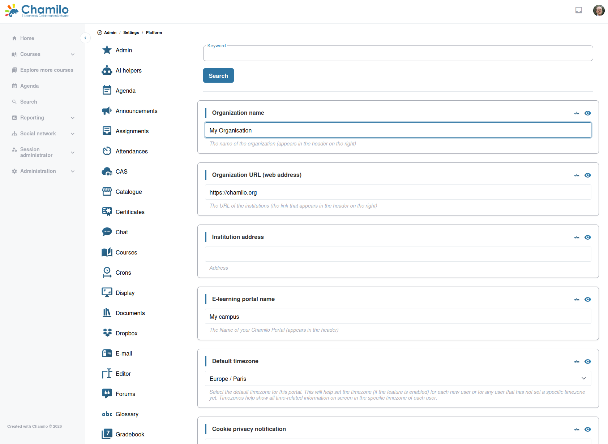

# Plattformeinstellungen

Chamilo verfügt über ein umfangreiches Konfigurationssystem, dessen Einstellungen in Kategorien organisiert sind. Die vollständige Liste der Kategorien unten entspricht der Seite **Konfigurationseinstellungen** im Administrationsbereich — und der zugrunde liegenden Datei `SettingsCurrentFixtures.php` im Quellcode, die die maßgebliche Quelle für Variablennamen, Titel und Beschreibungen ist.

Greifen Sie auf die Plattformeinstellungen zu, indem Sie im Administrationsbereich auf **Konfigurationseinstellungen** klicken.

## Alle Kategorien

Es gibt insgesamt **39 Konfigurationskategorien**, die unten alphabetisch aufgeführt sind. Die Zahl hinter jedem Link gibt die Anzahl der Einstellungen in dieser Kategorie an.

### Plattformweit

* **[Administratoridentität](admin-settings.md)** (12) — Identität und Kontaktdaten des Plattformadministrators.
* **[Plattform](platform-settings.md)** (30) — Identität auf Plattformebene, Zeitzone, Registrierungsrichtlinie, Online-Benutzer, Leistungsflags.
* **[Anzeige](display-settings.md)** (24) — Startseitenlayout, Gravatar, Menüs, Branding-Verhalten.
* **[Editor](editor-settings.md)** (26) — Symbolleisten, Plugins und KI-Hilfen des Rich-Text-Editors (TinyMCE).
* **[Sprachen](language-settings.md)** (12) — Verfügbare Sprachen, Standardsprache, Fallbacks.
* **[E-Mail](mail-settings.md)** (22) — Layout ausgehender E-Mails, Absenderidentität, Signatur.
* **[Workflows](workflows-settings.md)** (23) — Übergreifende Workflow-Schalter (Kurserstellung, Einschreibungsvalidierung …).

### Authentifizierung, Sicherheit und Datenschutz

* **[Sicherheit](security-settings.md)** (31) — Anmeldeschutz, Kennwortrichtlinie, Header, 2FA, IDS.
* **[Registrierung](registration-settings.md)** (20) — Richtlinie zur Selbstregistrierung und Weiterleitungen nach der Registrierung.
* **[Datenschutz](privacy-settings.md)** (6) — Einwilligung, Datenexport, Anträge auf Kontolöschung.
* **[CAS](cas-settings.md)** (7) — Aus 1.x übernommene Legacy-CAS-Konfiguration.

### Kurs- und Sitzungslebenszyklus

* **[Kurs](course-settings.md)** (45) — Standardwerte und Richtlinien, die plattformweit für Kurse gelten.
* **[Sitzungen](session-settings.md)** (68) — Sitzungslebenszyklus, Zugriffsfenster für Tutoren, Sichtbarkeit.
* **[Kurskatalog](catalog-settings.md)** (13) — Verhalten des öffentlichen Kurskatalogs.
* **[Profil](profile-settings.md)** (29) — Welche Felder im Benutzerprofil angezeigt werden.

### Kurswerkzeuge

* **[Agenda](agenda-settings.md)** (11)
* **[Ankündigungen](announcement-settings.md)** (9)
* **[Aufgaben (Arbeiten)](work-settings.md)** (12)
* **[Anwesenheit](attendance-settings.md)** (4)
* **[Chat](chat-settings.md)** (5)
* **[Dokumente](document-settings.md)** (29)
* **[Dropbox](dropbox-settings.md)** (10)
* **[Übungen (Tests)](exercise-settings.md)** (63)
* **[Foren](forum-settings.md)** (9)
* **[Glossar](glossary-settings.md)** (3)
* **[Gruppen](group-settings.md)** (3)
* **[Lernpfade](lp-settings.md)** (51)
* **[Umfragen](survey-settings.md)** (12)

### Bewertung und Anerkennung

* **[Notenbuch (Bewertungen)](gradebook-settings.md)** (34) — Punkteanzeige, Dezimalstellen, Zertifikatsschwellen.
* **[Zertifikate](certificate-settings.md)** (9) — Standardwerte, die angewendet werden, wenn ein Lernender ein Zertifikat erwirbt.
* **[Kompetenzen](skill-settings.md)** (13) — Kompetenzbaum, Vergaberegeln, Profilintegration.
* **[Tracking](tracking-settings.md)** (14) — Was aufgezeichnet wird und welche Berichte bereitgestellt werden.

### Kommunikation und Community

* **[Nachrichten](message-settings.md)** (7)
* **[Soziales Netzwerk](social-settings.md)** (7)

### KI

* **[KI-Hilfen](ai-helpers-settings.md)** (13) — Anbieter je Aufgabentyp (Text, Bild, Video, Tutor, Bewertung).

### Betrieb und Integration

* **[Cron-Jobs](crons-settings.md)** (3)
* **[Suche](search-settings.md)** (3) — Konfiguration der Xapian-Volltextsuche.
* **[Tickets](ticket-settings.md)** (8) — Helpdesk-System.
* **[Webdienste](webservice-settings.md)** (7) — Legacy-SOAP/REST-Endpunkte.

## Funktionsweise der Einstellungen

* Einstellungen werden in der Datenbank (Tabelle `settings`) gespeichert und über die Weboberfläche verwaltet
* Einige Einstellungen sind in Multi-URL-Setups **URL-gesperrt** (ihr Wert gilt plattformweit und kann nicht je URL überschrieben werden – siehe die Spalten `access_url_locked` und `access_url_changeable` in der Tabelle `settings`); andere (die meisten) können je Zugriffs-URL überschrieben werden
* Änderungen werden sofort wirksam (kein Neustart des Servers erforderlich), obwohl Ihre Benutzersitzung einige davon im Speicher halten kann. Wenn Änderungen nicht sofort sichtbar sind, melden Sie sich ab und wieder an, um Ihre Sitzung zu leeren.
* Einige Einstellungen haben Abhängigkeiten — die Änderung einer Einstellung kann das Verhalten anderer beeinflussen
* Die auf jeder Seite angezeigten Variablennamen (z. B. `2fa_enable`) entsprechen der Zeile in der Datenbanktabelle `settings` (Spalte `variable`) und den Schlüsseln, die in Überschreibungen (`config/settings_overrides.yaml`) verwendet werden, sofern zutreffend.

Weitere Informationen finden Sie unter [Konfigurationen](https://github.com/chamilo/chamilo-lms/wiki/Configurations) in unserem Wiki.

## Inline-Validierung für JSON-Einstellungen

Einige Einstellungen erfordern einen JSON-Wert. In diesen JSON-spezifischen Textfeldern prüft Chamilo die Syntax etwa **drei Sekunden**, nachdem Sie die Eingabe beendet haben. Ist der Wert ungültig, erscheint unter dem Feld die Meldung **Ungültige JSON-Syntax**, und das Formular kann erst übermittelt werden, wenn die Syntax korrigiert wurde.

Dasselbe Verhalten steht zur Verfügung, wenn eine JSON-Einstellung über die Suchergebnisse der Einstellungen bearbeitet wird. Gewöhnliche Textfelder und deaktivierte Einstellungen werden nicht als JSON behandelt. Diese browserseitige Prüfung hilft, Tippfehler zu erkennen; die serverseitige Validierung bleibt wirksam. Siehe [PR #9411](https://github.com/chamilo/chamilo-lms/pull/9411).

## Tipps

* **Dokumentieren Sie Ihre Einstellungen** — Führen Sie ein Protokoll der nicht standardmäßigen Einstellungen und der Gründe für deren Änderung
* **Ändern Sie jeweils nur eine Sache** — Ändern Sie bei der Fehlersuche jeweils nur eine Einstellung, damit Sie die Auswirkung zuordnen können
* **Testen Sie in einer Staging-Umgebung** — Testen Sie wesentliche Einstellungsänderungen zuerst auf einem Staging-Server