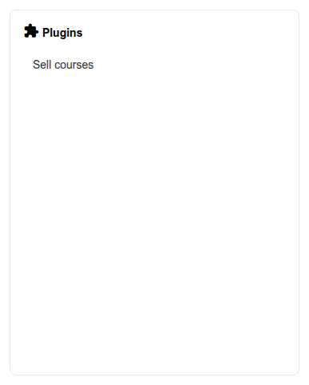

# Plugins

Plugins erweitern die Funktionalität von Chamilo, ohne den Kerncode zu verändern. Chamilo 3.0 wird mit über 50 Plugins ausgeliefert, die bei Bedarf aktiviert werden können.

## Der Plugins-Block

Das Administrations-Dashboard verfügt ebenfalls über einen eigenen **Plugins**-Block, der von der allgemeinen Plugin-Verwaltung in diesem Kapitel getrennt ist. Er listet nicht jedes installierte Plugin auf — nur diejenigen, deren Konfiguration festlegt, dass sie im Bereich des Administrationsmenüs erscheinen sollen, und bietet jedem solchen Plugin eine direkte Verknüpfung zu seiner eigenen Administrationsseite direkt auf dem Dashboard.

Wenn ein von Ihnen aktiviertes Plugin hier nicht angezeigt wird, ist das zu erwarten — es bedeutet, dass dieses Plugin sich nicht für den Bereich des Administrationsmenüs deklariert hat, und nicht, dass etwas fehlerhaft ist. Siehe [Plugins verwalten](managing-plugins.md) für die vollständige Liste der installierten Plugins, unabhängig davon, ob sie auf dem Dashboard erscheinen.

## In diesem Kapitel

* **[Plugins verwalten](managing-plugins.md)** — Plugins installieren, aktivieren, konfigurieren und deaktivieren
* **[BuyCourses-Zahlungen und wiederkehrende Dienste](buycourses.md)** — Zahlungsgateways, Verlängerungen und den Zahlungsverlauf von Diensten konfigurieren