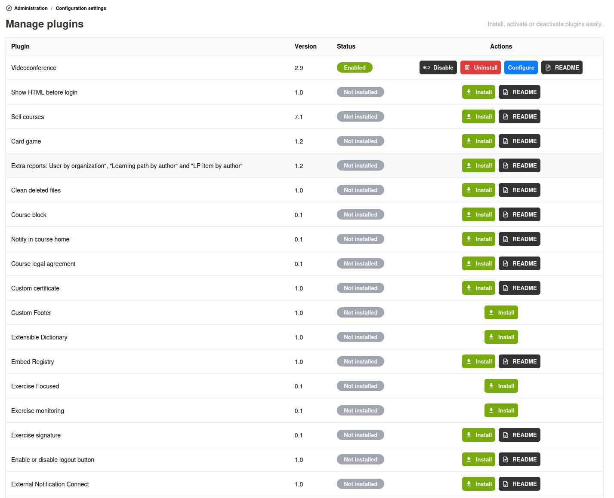

# Plugins verwalten

## Zugriff auf den Plugin-Manager

Klicken Sie im Administrationsbereich auf **Plugins verwalten**, um die Liste der verfügbaren Plugins anzuzeigen.

## Plugin-Status

Jedes Plugin hat einen von zwei Status:

* **Aktiv** — Das Plugin ist aktiviert und seine Funktionen sind auf der Plattform verfügbar
* **Inaktiv** — Das Plugin ist installiert, aber deaktiviert

## Ein Plugin aktivieren

1. Suchen Sie das Plugin in der Liste
2. Klicken Sie auf **Installieren**, dann auf **Aktivieren** oder schalten Sie es ein
3. Konfigurieren Sie die Plugin-Einstellungen (falls zutreffend, suchen Sie die Schaltfläche **Konfigurieren**)
4. Speichern
5. Falls in der README empfohlen, aktivieren Sie es in einer bestimmten **Region**

Einige Plugins fügen Kursen Werkzeuge hinzu, der Plattform neue Seiten oder bestehenden Funktionen zusätzliche Funktionalität.

## Ein Plugin konfigurieren

Viele Plugins verfügen über Konfigurationsoptionen. Nach der Aktivierung eines Plugins:

1. Klicken Sie auf die Schaltfläche **Konfigurieren** neben dem Plugin
2. Füllen Sie die erforderliche Konfiguration aus (API-Schlüssel, URLs, Optionen usw.)
3. Speichern

## Ein Plugin deaktivieren

1. Suchen Sie das Plugin in der Liste
2. Klicken Sie auf **Deaktivieren** oder schalten Sie es aus
3. Die Funktionen des Plugins werden sofort von der Plattform entfernt, das Plugin bleibt jedoch installiert und behält seine Konfiguration, bis Sie es **deinstallieren**

Das Deaktivieren eines Plugins löscht dessen Daten nicht. Wenn Sie es später wieder aktivieren, sind die Daten weiterhin verfügbar.

## Tipps

* **Aktivieren Sie nur, was Sie benötigen** — Jedes aktive Plugin verursacht einen gewissen Overhead. Lassen Sie ungenutzte Plugins deaktiviert.
* **Vor dem Produktivbetrieb testen** — Aktivieren Sie neue Plugins zunächst in einer Testumgebung
* **Kompatibilität prüfen** — Überprüfen Sie nach einem Upgrade von Chamilo, ob alle aktiven Plugins weiterhin korrekt funktionieren