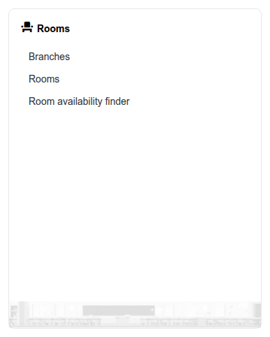

# Räume

Der Block **Räume** im Administrations-Dashboard verwaltet die physischen Standorte, die Chamilo für Präsenz- oder Blended-Learning-Schulungen erfassen kann: Zweigstellen (Standorte), die Räume darin sowie ein Werkzeug, mit dem sich ermitteln lässt, welche Räume zu einem bestimmten Zeitpunkt frei sind.

Dieses Kapitel behandelt die Verwaltung von Zweigstellen und Räumen auf Administrationsseite. Zur lehrendenseitigen Nutzung — das Zuweisen eines Raums zu einer Kurssitzung — siehe [Zweigstellen und Räume](../../teacher-guide/branches-and-rooms.md) im Leitfaden für Lehrende.

## Zugriff auf den Block Räume

Im Administrationsbereich erscheint der Block **Räume** neben den anderen Dashboard-Blöcken. Klicken Sie auf einen der Links, um das entsprechende Werkzeug zu öffnen.

## Inhalt des Blocks

* **[Räume verwalten](managing-rooms.md)** — Zweigstellen (Standorte) sowie die Räume in jeder Zweigstelle anlegen und organisieren
* **[Raumverfügbarkeitssuche](room-availability-finder.md)** — Prüfen, welche Räume für ein bestimmtes Datum und einen bestimmten Zeitraum frei sind

## Hinweis zu Multi-URL

Bei einer Multi-URL-Installation (Multi-Tenant) sind Zweigstellen und Räume jeweils einer einzelnen Zugriffs-URL zugeordnet — sie werden niemals portalübergreifend gemeinsam genutzt.