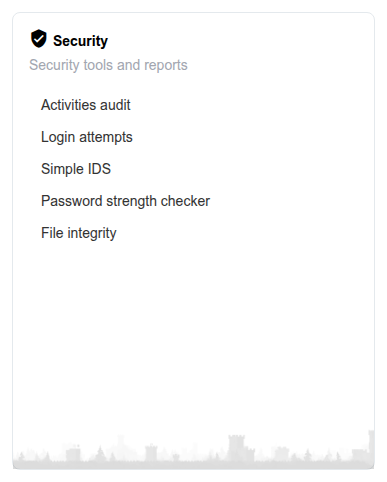

# Sicherheit

Der Block **Sicherheit** im Administrations-Dashboard fasst die integrierten Werkzeuge der Plattform zur Sicherheitsüberwachung und -prüfung zusammen. Er ist von den [Sicherheitseinstellungen](../platform-settings/security-settings.md) getrennt, in denen die Sicherheits*richtlinie* konfiguriert wird (Passwortregeln, CAPTCHA, HTTP-Sicherheitsheader und Ähnliches) — dieser Block stellt die *Berichte und Werkzeuge* bereit, mit denen die Plattform auf verdächtige Aktivitäten und unerwünschte Änderungen überwacht wird.

Der Block wurde in Chamilo 2.0 mit vier Werkzeugen eingeführt und in Chamilo 3.0 um ein fünftes erweitert: **Dateiintegrität**.

## Zugriff auf den Block Sicherheit

Im Administrationsbereich erscheint der Block **Sicherheit** neben den anderen Dashboard-Blöcken (Benutzer, Kurse, Plattformverwaltung, System und so weiter). Klicken Sie auf einen der Links, um das entsprechende Werkzeug zu öffnen.

## Inhalt des Blocks

* **[Aktivitätenprüfung](activities-audit.md)** — Wichtige administrative und plattformbezogene Ereignisse (Änderungen an Benutzern, Kursen, Sitzungen und anderen Elementen) nach Ereignistyp durchsuchen
* **[Anmeldeversuche](login-attempts.md)** — Fehlgeschlagene und erfolgreiche Anmeldeversuche mit Diagrammen und einem durchsuchbaren Protokoll prüfen
* **[Einfaches IDS](simple-ids.md)** — Anfragen anzeigen, die vom integrierten, leichtgewichtigen Intrusion-Detection-System von Chamilo markiert wurden
* **[Passwortstärke-Prüfung](password-strength-checker.md)** — Aktive Benutzer auf Passwörter prüfen, die einer Liste häufig verwendeter Passwörter entsprechen
* **[Dateiintegrität](file-integrity.md)** *(neu in Chamilo 3.0)* — Unerwartete Ergänzungen, Änderungen, Löschungen oder Berechtigungsänderungen in den installierten Dateien erkennen

## Zusätzlicher Workflow für vertrauliche Meldungen

[Vertrauliche Meldungen](confidential-reporting.md) ist eine optionale, berechtigungsgeschützte Funktion für Meldungen und Untersuchungen. Sie ist von den fünf oben aufgeführten Überwachungswerkzeugen für Administratoren getrennt.

## Wer darauf zugreifen kann

Alle fünf Werkzeuge erfordern den Zugriff als **Portaladministrator**. Die Aktionen zum Scannen, Anhalten und erneuten Festlegen der Baseline bei der Dateiintegrität erfordern zusätzlich den Zugriff als **Globaler Administrator**. Das Anhalten von Warnungen oder das Festlegen einer neuen Baseline erfordert die erneute Eingabe des eigenen Passworts — Einzelheiten finden Sie unter [Dateiintegrität](file-integrity.md#actions).