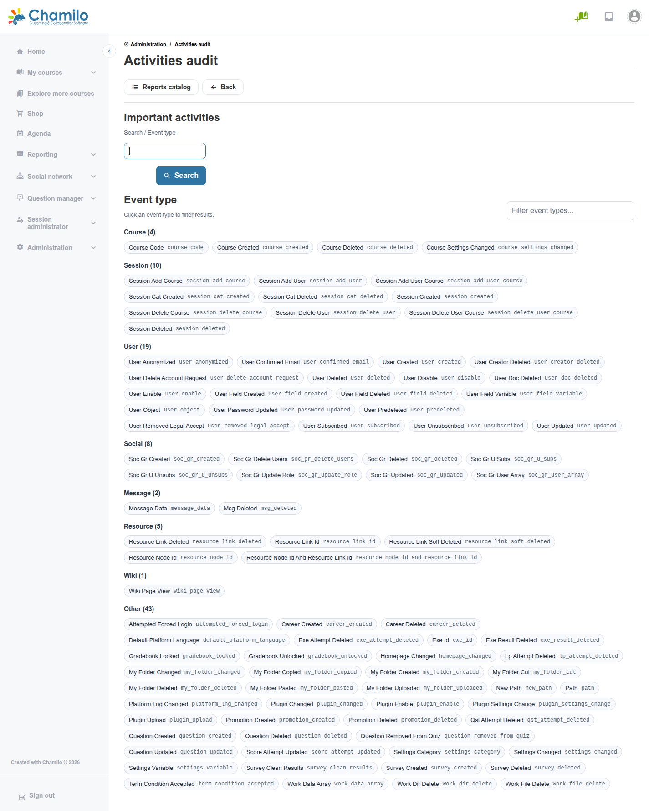

# Aktivitäten-Audit

Der Bericht Aktivitäten-Audit ermöglicht es Ihnen, wichtige administrative und plattformbezogene Aktivitäten nach Ereignistyp gefiltert zu durchsuchen. Es handelt sich um denselben zugrunde liegenden Bericht, der zuvor unter **Nachverfolgung > Audit der administrativen Aktivitäten** erreichbar war; er ist nun auch direkt aus dem Block Sicherheit verlinkt, da er in erster Linie ein Werkzeug für Sicherheit und Rechenschaftspflicht ist.

## Zugriff auf den Aktivitäten-Audit

Klicken Sie im Administrationsbereich auf **Sicherheit > Aktivitäten-Audit**.

## Was angezeigt wird

Ereignisse sind in Kategorien gruppiert:

* **Kurs** — Erstellung, Löschung und Einstellungsänderungen von Kursen
* **Sitzung** — Erstellung, Löschung und Einschreibungsänderungen von Sitzungen und Sitzungskategorien
* **Benutzer** — Kontoerstellung, Löschung, Passwortaktualisierungen, Feldänderungen und mehr
* **Sozial** — Erstellung, Löschung und Mitgliedschaftsänderungen sozialer Gruppen
* **Nachricht** — Änderungen und Löschungen von Nachrichtendaten
* **Ressource** — Erstellung und Löschung von Ressourcen und Ressourcenverknüpfungen
* **Wiki** — Aufrufe von Wiki-Seiten
* **Sonstiges** — Alles Übrige, einschließlich Plugin-Aktivitäten, Sperren des Leistungsbuchs, Löschungen von Übungsversuchen, erzwungene Anmeldeversuche und Änderungen von Einstellungen auf Plattformebene

Klicken Sie auf einen Ereignistyp-Chip (zum Beispiel **Versuchter erzwungener Login**), um den Bericht auf eine Tabelle mit den passenden Einträgen einzugrenzen. Sie können auch direkt nach einem Stichwort suchen, indem Sie das Feld **Suche** oberhalb der Ereignistypliste verwenden.

## Anwendungsfälle

* Untersuchen, wer einen Kurs, eine Sitzung oder ein Benutzerkonto gelöscht hat und wann
* Bestätigen, ob eine bestimmte administrative Änderung (eine Einstellungsaktualisierung, eine Plugin-Installation) von einem erwarteten Administrator vorgenommen wurde
* **Versuchter erzwungener Login**-Ereignisse zusammen mit dem Bericht [Anmeldeversuche](login-attempts.md) nachverfolgen