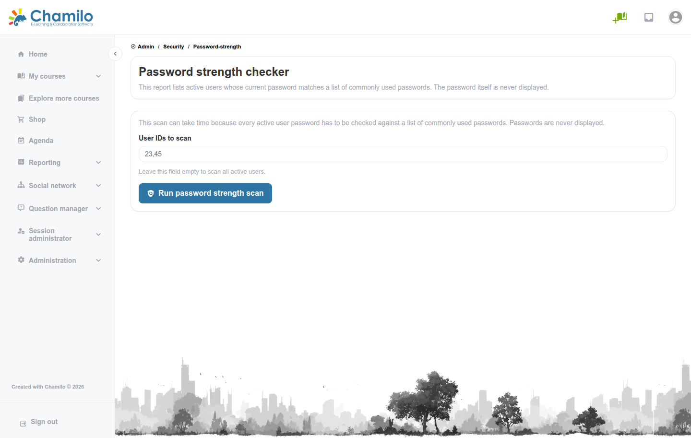
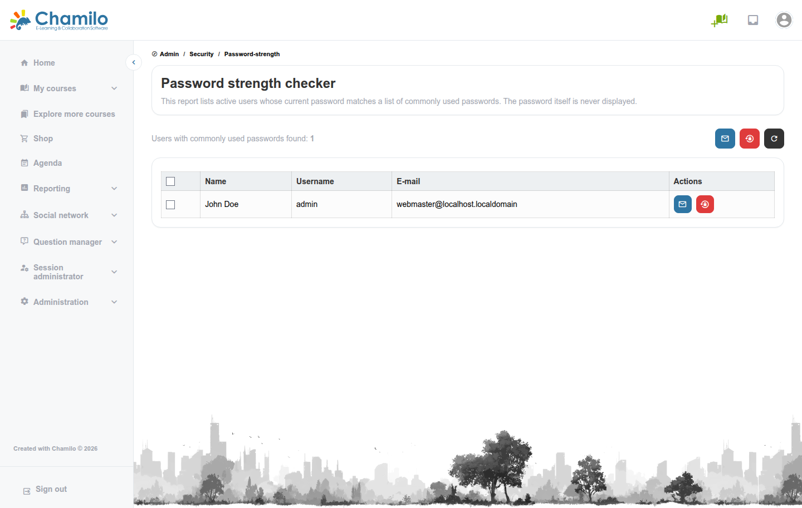

# Passwortstärke-Prüfung

Die Passwortstärke-Prüfung vergleicht die gespeicherten Passwort-Hashes aktiver Benutzer mit einer kurzen Liste häufig verwendeter Passwörter (`123456`, `password`, `qwerty123` und Ähnliches). Sie zeigt oder überträgt die Passwörter selbst niemals — lediglich, ob das aktuelle Passwort eines Benutzers mit einem der bekannten schwachen Kandidaten übereinstimmt.

## Zugriff auf die Passwortstärke-Prüfung

Klicken Sie im Administrationsbereich auf **Sicherheit > Passwortstärke-Prüfung**.

## Scan ausführen

* Lassen Sie **Zu prüfende Benutzer-IDs** leer, um alle aktiven Benutzer zu prüfen, oder geben Sie eine durch Kommas getrennte Liste von Benutzer-IDs ein, um eine Teilmenge zu prüfen
* Klicken Sie auf **Passwortstärke-Scan ausführen**

Der Scan läuft asynchron im Hintergrund, sodass die Seite nicht einfriert, und zeigt den Fortschritt live an (bisher geprüfte Benutzer von der Gesamtzahl sowie die Anzahl gefundener schwacher Passwörter). Da jedes Kandidatenpasswort mit dem Hash jedes ausgewählten Benutzers abgeglichen werden muss, kann die Prüfung aller Benutzer auf einer großen Plattform einige Zeit dauern — die Kandidatenliste wird absichtlich kurz gehalten, um diesen Aufwand zu begrenzen.

## Auf Ergebnisse reagieren

Nach Abschluss des Scans werden markierte Benutzer mit zwei verfügbaren Aktionen aufgeführt, entweder pro Benutzer oder als Sammelaktion für alle ausgewählten Benutzer:

* **Passwortänderung anfordern** (Briefumschlag-Symbol) — Sendet dem Benutzer eine E-Mail mit der Bitte, das Passwort zu ändern
* **Passwortzurücksetzung erzwingen** (Zurücksetzen-Symbol) — Macht das aktuelle Passwort des Benutzers sofort ungültig und sendet ihm ein neues per E-Mail

Beide Aktionen prüfen die ausgewählten Benutzer vor der Ausführung erneut anhand der Liste schwacher Passwörter, sodass eine veraltete oder manipulierte Anfrage nicht verwendet werden kann, um ein Konto zurückzusetzen, das kein schwaches Passwort mehr hat.

## Konten mit schwachen Passwörtern deaktivieren

Nachdem der Scan Konten mit schwachen Passwörtern identifiziert hat, können autorisierte Administratoren ein geeignetes Konto einzeln deaktivieren oder mehrere Konten auswählen und **Ausgewählte Konten deaktivieren** verwenden. Bestätigen Sie die Aktion, bevor Sie fortfahren. Das Werkzeug behält außerdem die bestehenden Maßnahmen zur Passwortzurücksetzung bei.

Die Prüfung beschränkt Scans und Abhilfemaßnahmen auf die zutreffende Zugriffs-URL. Sie erlaubt Administratoren nicht, über diesen Ablauf ihre eigenen Konten oder andere Administratorkonten zu deaktivieren. Ein deaktiviertes Konto benötigt einen geeigneten autorisierten Reaktivierungsprozess, bevor sich die Person erneut anmelden kann. Siehe [PR #9373 zur Deaktivierung bei schwachen Passwörtern](https://github.com/chamilo/chamilo-lms/pull/9373).

## Illustration der Passwortburg

Die Sicherheitsseite enthält eine lokalisierte Demonstration der **Passwortburg**; der Bildschirm zum Ändern des Passworts verwendet ebenfalls die visuelle Anleitung. Sie veranschaulicht fortschreitende Merkmale der Passwortstärke, ist jedoch eine **Illustration** und kein Ersatz für die tatsächliche Validierung der Passwortrichtlinie. Das Demonstrationspasswort wird vom Visualizer weder übermittelt noch gespeichert. Setzen Sie weiterhin die konfigurierte Passwortrichtlinie durch, anstatt sich allein auf die Abbildung zu verlassen. Siehe [PR #9447 zur Passwortburg](https://github.com/chamilo/chamilo-lms/pull/9447).

## Empfohlene Verwendung

* Führen Sie diesen Scan regelmäßig aus, insbesondere nach einem Massenimport von Benutzern (importierte Konten werden manchmal mit einfachen Standardpasswörtern ausgeliefert)
* Kombinieren Sie ihn mit den Einstellungen **Minimale Anforderungen an die Passwortsyntax** und **Intervall für die Passwortrotation** unter [Sicherheitseinstellungen](../platform-settings/security-settings.md), um zu verhindern, dass schwache Passwörter überhaupt festgelegt werden, anstatt sie erst nachträglich zu erkennen