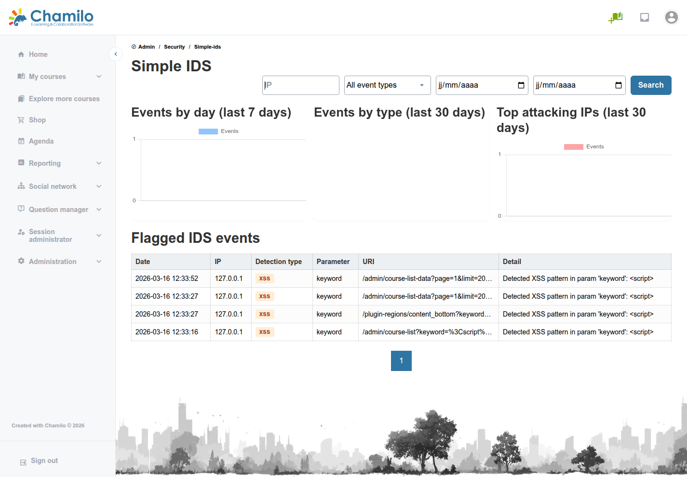

# Einfaches IDS

Chamilo enthält ein leichtgewichtiges, in die Anwendung integriertes Intrusion Detection System (IDS). Bei jeder Anfrage prüft es die URL-Abfrageparameter, den Anfragepfad und einige Header (`User-Agent`, `Referer`) auf gängige Angriffssignaturen — beispielsweise XSS-Payloads oder Path-Traversal-Muster — und protokolliert alles Verdächtige. Auf der Seite „Einfaches IDS“ können Sie prüfen, was markiert wurde.

Anfrage-**Bodies** werden absichtlich nicht geprüft, um Fehlalarme durch Inhalte aus Rich-Text-Editoren zu vermeiden (Kurstexte enthalten legitim HTML- bzw. JavaScript-ähnliches Markup).

## Zugriff auf Einfaches IDS

Klicken Sie im Administrationsbereich auf **Sicherheit > Einfaches IDS**.

## Was angezeigt wird

* **Ereignisse nach Tag (letzte 7 Tage)**, **Ereignisse nach Typ (letzte 30 Tage)** und **Häufigste angreifende IPs (letzte 30 Tage)** — Zusammenfassende Diagramme
* **Tabelle markierter IDS-Ereignisse** — Jeder Eintrag zeigt Datum, Quell-IP, Erkennungstyp (beispielsweise `XSS`), den betroffenen Parameter, die Anfrage-URI und eine kurze Beschreibung des Erkannten

Verwenden Sie die Filter für **IP**, Ereignistyp und Datumsbereich oberhalb der Diagramme, um die Ergebnisse einzugrenzen.

## Funktionsweise

* Jede Anfrage wird beim Eingang geprüft; Treffer werden an `var/logs/ids/ids_events.log` angehängt
* Beim Ausgang fügt derselbe Subscriber der Antwort die von OWASP empfohlenen Sicherheitsheader hinzu
* Ist die Blockierung aktiviert, wird eine Anfrage, die einer Signatur entspricht, sofort mit einer HTTP-400-Antwort gestoppt, anstatt Ihren Anwendungscode zu erreichen

## Konfiguration

Einfaches IDS wird über Umgebungsvariablen gesteuert, die in `config/packages/chamilo_ids.yaml` gesetzt werden:

| Variable | Zweck |
|----------|---------|
| `IDS_ENABLED` | Schaltet die Prüfung und Protokollierung von Anfragen ein oder aus |
| `IDS_BLOCK` | Wenn aktiviert, wird eine erkannte Anfrage abgelehnt (HTTP 400), anstatt nur protokolliert zu werden |
| `IDS_SECURITY_HEADERS` | Steuert, ob die von OWASP empfohlenen Antwortheader hinzugefügt werden |

Dies ist ein leichtgewichtiger Detektor nach bestem Bemühen, der offensichtliche Scan- und Ausnutzungsversuche erkennen soll — er ersetzt keine dedizierte Web Application Firewall (WAF) für Bereitstellungen mit hohem Risiko.