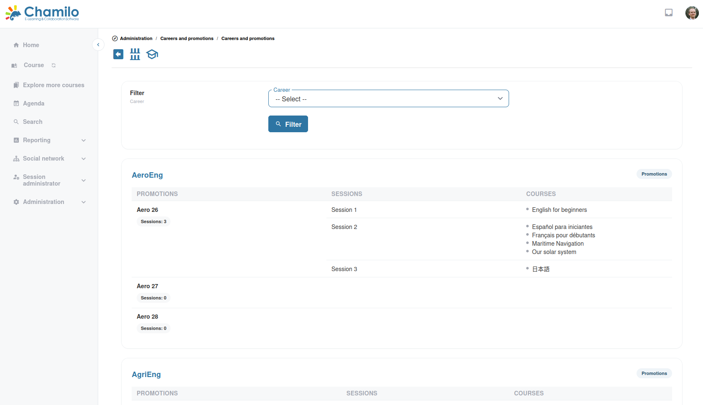

# Karrieren und Promotionen

Chamilo umfasst ein Karrieremanagementsystem, mit dem Sie Ausbildungspfade definieren und den Fortschritt der Lernenden durch strukturierte Programme verfolgen können.

## Karrieren

Eine **Karriere** stellt einen strukturierten Ausbildungspfad dar — eine Abfolge von Ausbildungsschritten, die Lernende durchlaufen, um ein berufliches Ziel zu erreichen.

### Eine Karriere erstellen

1. Navigieren Sie im Administrationsbereich zu **Karrieren**
2. Klicken Sie auf **Karriere erstellen**
3. Geben Sie einen **Namen** und eine **Beschreibung** ein
4. Speichern

## Promotionen

Eine **Promotion** stellt eine Kohorte oder einen Jahrgang von Lernenden dar, die eine Karriere durchlaufen. Stellen Sie sich dies als eine Gruppe von Personen vor, die denselben Karrierepfad zur gleichen Zeit absolvieren.

### Verknüpfung mit Sitzungen

Nachdem Sie eine Promotion erstellt haben, verknüpfen Sie Sitzungen damit. Dadurch wird die Abfolge der Ausbildung definiert, die Lernende absolvieren müssen.

Sie können Promotionen später replizieren, um die Erstellung der nächsten Promotion mit Kopien derselben Sitzungen zu erleichtern, sodass Ihre nächste Promotion im Handumdrehen aufgebaut werden kann.

### Eine Promotion erstellen

1. Navigieren Sie zu **Promotionen**
2. Klicken Sie auf **Promotion erstellen**
3. Geben Sie einen **Namen** und eine **Beschreibung** ein
4. Verknüpfen Sie sie mit einer **Karriere**
5. Weisen Sie der Promotion **Sitzungen** zu
6. Speichern

## Wie alles zusammenpasst

* Eine **Karriere** definiert den Pfad (z. B. „Zertifizierung zum Junior Developer“)
* Eine **Promotion** stellt eine Kohorte dar (z. B. „Jahrgang März 2026“)
* **Sitzungen** innerhalb der Promotion liefern die eigentlichen Ausbildungsinhalte

## Tipps

* **Für strukturierte Programme verwenden** — Karrieren und Promotionen sind besonders nützlich für mehrstufige Ausbildungsprogramme, bei denen Lernende eine definierte Abfolge durchlaufen
* **Abschluss verfolgen** — Verwenden Sie die Berichtswerkzeuge, um zu überwachen, wie Promotionen auf ihren Karrierepfaden vorankommen