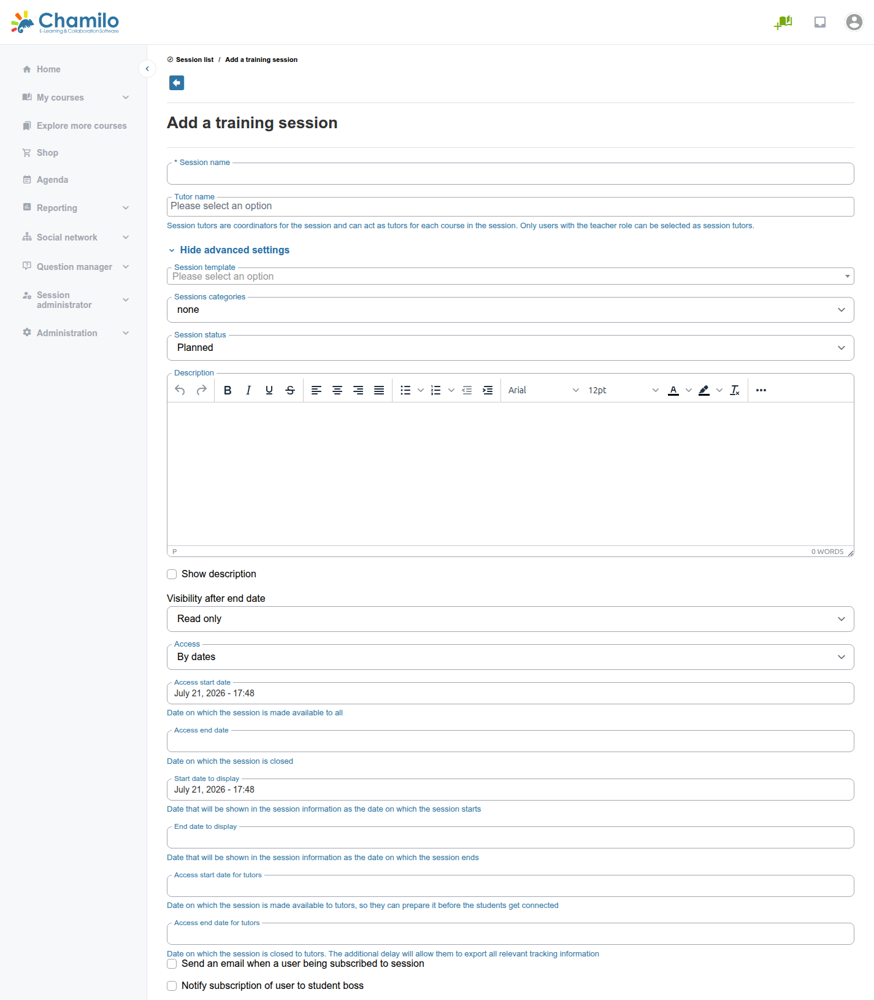
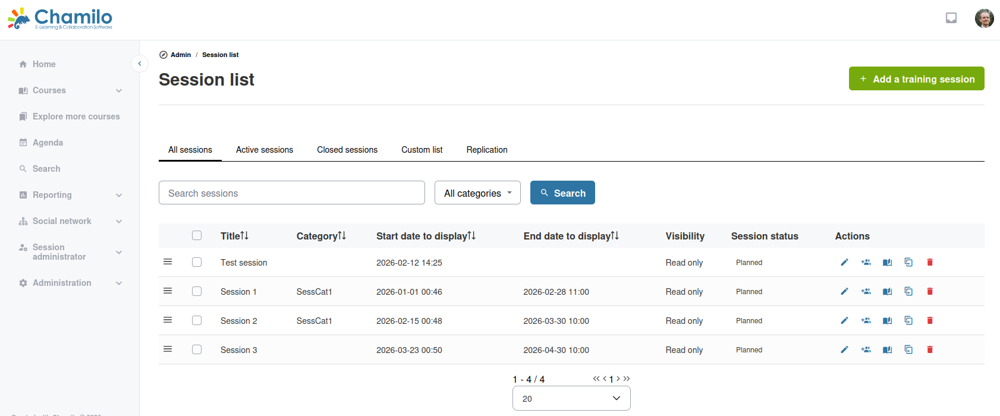
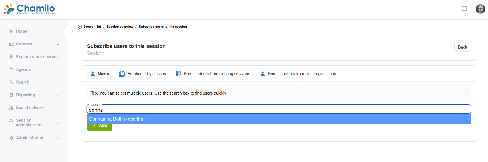

# Sitzungen verwalten

## Eine Sitzung erstellen

1. Klicken Sie im Administrationsbereich auf **Sitzung erstellen**
2. Füllen Sie die Sitzungsdetails aus:
   * **Sitzungsname** — Ein aussagekräftiger Name (z. B. „Spring 2026 Onboarding“)
   * **Start- und Enddatum** — Wann die Sitzung stattfindet (optional — Sitzungen können zeitlich unbegrenzt sein). Es gibt 3 Datumsgruppen: Anzeigedaten, Daten zur Begrenzung des Zugriffs für Lernende und Daten zur Begrenzung des Zugriffs für Tutoren
   * **Sitzungstutor** — Die Person, die die gesamte Sitzung betreut
   * **Kategorie** — Zuordnung zu einer Sitzungskategorie zur Organisation
   * **Sichtbarkeit** — Zugriff und Anzeigeverhalten steuern
3. **Kurse hinzufügen** — Wählen Sie einen oder mehrere Kurse aus, die in die Sitzung aufgenommen werden sollen
4. **Lernende einschreiben** — Fügen Sie einzelne Benutzer oder Benutzerklassen hinzu
5. **Kurstutoren zuweisen** — Weisen Sie jedem Kurs eine Lehrkraft (Kurstutor) zu
6. Speichern

## Sitzungsdaten

Sitzungen unterstützen eine flexible Datumskonfiguration:

| Datum | Zweck |
|------|---------|
| **Anzeige Start/Ende** | Wann die Sitzung in den Listen der Lernenden erscheint |
| **Zugriff Start/Ende** | Wann Lernende tatsächlich auf die Sitzungsinhalte zugreifen können |
| **Tutorzugriff Start/Ende** | Wann Tutoren auf die Sitzung zugreifen können (beginnt häufig vor und endet nach dem Zugriff der Lernenden) |

So können Sie die Sitzung vorbereiten, bevor die Lernenden eintreffen, und den Tutorzugriff nach Sitzungsende für Bewertung und Berichterstattung offen halten.

## Sitzungsliste

Die Sitzungsliste zeigt alle Sitzungen mit:

* Sitzungsname
* Start- und Enddatum
* Status (aktiv, bevorstehend, vergangen)

Verwenden Sie Suche und Filter, um Sitzungen nach Name, Datum, Kategorie oder Status zu finden.

## Eine Sitzung bearbeiten

Klicken Sie auf eine Sitzung, um sie zu bearbeiten:

* Daten, Name oder Kategorie ändern
* Kurse hinzufügen oder entfernen
* Kurstutoren ändern
* Lernende hinzufügen oder entfernen
* Tracking-Daten der Sitzung anzeigen

## Benutzer einschreiben

Sie können Benutzer auf folgende Weise in eine Sitzung einschreiben:

* **Einzeleinschreibung** — Einzelne Benutzer suchen und hinzufügen
* **Klasseneinschreibung** — Eine gesamte Klasse (Gruppe vordefinierter Benutzer) auf einmal hinzufügen
* **CSV-Import** — Eine Datei mit Benutzer-Sitzungs-Zuordnungen hochladen

## Sitzungszugriff

Lernende greifen über **Meine Sitzungen** in der Seitenleiste auf ihre Sitzungen zu. Sitzungen sind gegliedert in:

* **Aktuelle Sitzungen** — Derzeit aktiv
* **Vergangene Sitzungen** — Beendet
* **Bevorstehende Sitzungen** — Noch nicht begonnen

## Einschreibung über die API

Externe Systeme können die [API zur Einschreibung von Sitzungsteilnehmenden](../../developer-guide/api/session-students.md) verwenden, um IDs von Lernenden aufzulisten, ausgewählte Lernende hinzuzufügen oder ausgewählte Lernende zu entfernen. Diese Routen erfordern Plattformadministratorrechte und behalten andere Einschreibungen bei, wenn eine neue Liste von IDs übermittelt wird.

## Tipps

* **Daten sorgfältig planen** — Stellen Sie sicher, dass die Zugriffsdaten der Tutoren über die Daten der Lernenden hinausgehen, damit Tutoren vorbereiten und nachbereiten können
* **Klassen für wiederkehrende Einschreibungen verwenden** — Wenn Sie häufig dieselben Gruppen einschreiben, erstellen Sie Klassen und weisen Sie sie Sitzungen zu
* **Sitzungen übersichtlich halten** — Verwenden Sie Kategorien und klare Namenskonventionen für eine einfache Verwaltung