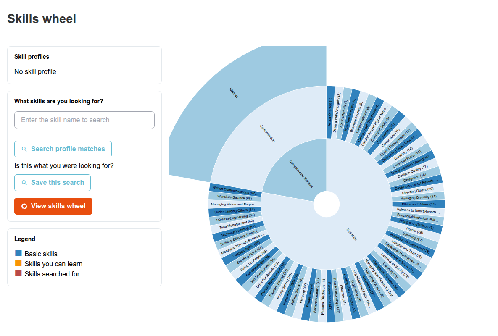
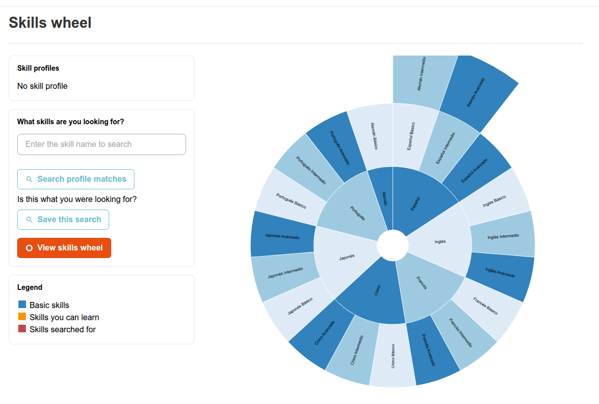
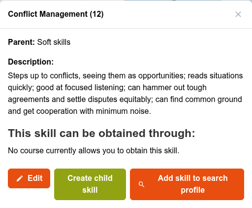

# Kompetenzrad

Das Kompetenzrad ist ein zoombares, radförmiges Diagramm des gesamten Kompetenzbaums — eine visuelle Alternative zum Durchsuchen der flachen Liste unter [Kompetenzen verwalten](managing-skills.md).

## Zugriff auf das Kompetenzrad

Klicken Sie im Administrationsbereich auf **Kompetenzen > Kompetenzrad**.

## Was angezeigt wird

Jedes Segment des Rades ist eine Kompetenz, die sich in ihre untergeordneten Kompetenzen aufklappen lässt. Ein Segment zeigt an, ob die Kompetenz mit einem Notenbuch verknüpft ist (siehe [Kompetenzen und Bewertungen](skills-assessments.md)) und, bei der Ansicht eines bestimmten Benutzers, ob dieser die Kompetenz bereits erreicht hat.

Klicken Sie auf ein Segment, um hineinzuzoomen und die untergeordneten Kompetenzen anzuzeigen; klicken Sie auf den mittleren Kreis, um wieder herauszuzoomen. Der moderne Explorer zeigt die aktuelle Hierarchie außerdem als Brotkrumen-Navigation an, sodass Sie durch die Zweige zurücknavigieren können.

### Kompetenzen erkunden und finden (3.1)

Das aktualisierte Rad verwendet einen responsiven **Explorer im 3D-Stil** mit einem Tiefeneffekt, wenn Sie den Zeiger über das Diagramm bewegen. Dies ist eine Visualisierung der Kompetenzhierarchie, keine separate Menge von Kompetenzen.

* Öffnen Sie **Welche Kompetenzen suchen Sie?**, um nach dem Kompetenznamen zu suchen. Sie können mehrere Kompetenzen auswählen und anschließend **Kompetenzrad anzeigen** verwenden, um eine ausgewählte Kompetenz in der Hierarchie zu finden.
* Drücken Sie `/` oder **Strg+K** (unter macOS **Cmd+K**), wenn Sie nicht in ein Formularfeld eingeben, um den Suchdialog zu öffnen.
* Verwenden Sie den **Fokusmodus** für eine erweiterte Ansicht des Rades; **Esc** beendet den Fokusmodus. Das Steuerelement **Hilfe** erläutert die Navigation und die Legende.
* Wählen Sie eine Kompetenz aus, um den kontextbezogenen Inspektor zu öffnen, der den Kompetenzcode, die Beschreibung, die übergeordnete Hierarchie sowie Kurse oder Bewertungen enthält, über die sie erworben werden kann, sofern verfügbar.

Der Inspektor für Kompetenzdetails bietet autorisierten Administratoren und Personalverantwortlichen die Aktionen **Bearbeiten**, **Untergeordnete Kompetenz erstellen** und **Kompetenz zum Suchprofil hinzufügen**. Nach dem Erstellen oder Bearbeiten einer Kompetenz über das Rad kehrt die Oberfläche zum Radkontext zurück, anstatt Sie in eine nicht zugehörige Liste zu versetzen.

Klicken Sie mit der rechten Maustaste auf ein Segment, um dessen Details zu öffnen: Beschreibung, übergeordnete Kompetenz und die Kurse (falls vorhanden), die sie vergeben. In diesem Dialog können Administratoren die Kompetenz außerdem bearbeiten, eine untergeordnete Kompetenz darunter erstellen oder sie zur unten beschriebenen Profilsuche hinzufügen.

Administratoren und Benutzer mit der Rolle Human Resources Manager erhalten hier außerdem eine Profilsuche: Kompetenzen können zu „Profilen“ gruppiert werden (Mengen von Kompetenzen, die für eine bestimmte Rolle oder Stellenbeschreibung erwartet werden). Auf dieser Seite können Sie nach Benutzern suchen, deren erworbene Kompetenzen einem bestimmten Profil entsprechen — nützlich, um zu erkennen, wer für eine Rolle bereit ist oder wo in einem Team Lücken bestehen.

### Kompetenzprofile verwenden

Das Steuerelement **Kompetenzprofile** steht Administratoren und Personalverantwortlichen zur Verfügung. Öffnen Sie es, um gespeicherte Profile zu finden und nach Benutzern zu suchen, deren Kompetenzen dazu passen. Sie können auch mehrere Kompetenzen im Suchdialog auswählen und **Profilübereinstimmungen suchen** oder **Diese Suche speichern** wählen. Diese Aktionen zur Profilverwaltung sind rollenbeschränkt; nicht jeder, der das Rad durchsucht, sieht sie.

Diese Verbesserung der Benutzeroberfläche wurde in [PR #9201](https://github.com/chamilo/chamilo-lms/pull/9201) umgesetzt.