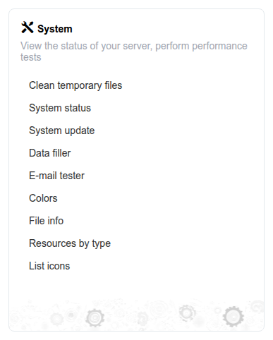

# System

Der Block **System** im Administrations-Dashboard fasst Wartungswerkzeuge auf Serverebene, den Selbstaktualisierungs-Workflow, Dienstprogramme zur Prüfung von Speicher und Ressourcen sowie das Plattform-Branding zusammen.

## Zugriff auf den Block System

Im Administrationsbereich erscheint der Block **System** neben den anderen Dashboard-Blöcken. Klicken Sie auf einen der Links, um das entsprechende Werkzeug zu öffnen.

## Inhalt des Blocks

* **[Systemwerkzeuge](system-tools.md)** — Temporäre Dateien bereinigen, den Selbstaktualisierungs-Workflow ausführen, gespeicherte Dateien und Ressourcen prüfen und den integrierten Symbolsatz durchsuchen
* **Systemstatus** — Beschrieben unter [Systemstatus](../maintenance/system-status.md) im Bereich Wartung
* **[Branding](branding/README.md)** — Farbdesigns (der Link „Farben“ des Blocks öffnet dieselbe Seite für Farbdesigns), Portal-Anpassung und Vorlagen

Zwei weitere Einträge — **Datenfüller** und **E-Mail-Tester** — erscheinen nur, wenn auf dem Server ein Verzeichnis `tests/` vorhanden ist; das entspricht einer Entwicklungs-/QA-Umgebung und keiner Produktionsumgebung. Sie erscheinen nicht bei einer typischen Produktionsinstallation; siehe [Systemwerkzeuge](system-tools.md#development-only-tools), um zu erfahren, was sie tun, wenn sie vorhanden sind.