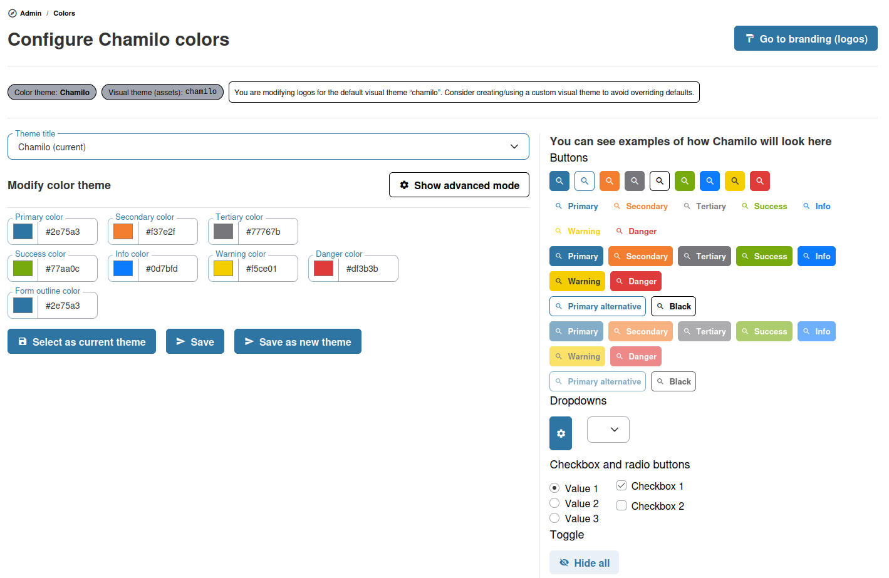

# Farbthemes

Chamilo 2.0 führt ein Farbthemesystem ein, mit dem Sie das visuelle Erscheinungsbild der Plattform anpassen können.

## Funktionsweise der Themes

Farbthemes definieren die Palette, die in der gesamten Chamilo-Oberfläche verwendet wird — Primärfarben, Akzentfarben, Hintergründe und Textfarben. Ein Theme ist einer Zugriffs-URL zugeordnet: In einem Portal mit einer einzigen URL wird es faktisch zum globalen Theme, und in einer Einrichtung mit mehreren URLs kann jede URL ein eigenes Theme haben.

## Ein Theme anwenden

1. Navigieren Sie im Administrationsbereich zu **Farbthemes**
2. Durchsuchen Sie die verfügbaren Themes
3. Wählen Sie ein Theme aus und klicken Sie auf **Anwenden**
4. Das Theme wird sofort auf die Plattform angewendet

## Seitenhintergründe

Einige Seiten zeigen unten ein dekoratives Bild, das horizontal wiederholt wird: **Meine Kurse** und **Meine Sitzungen** (eine Landschaft), die Seiten der **Administration** (eine Stadtansicht), die Seiten der **Sitzungsverwaltung** (Felder) und das **Soziale Netzwerk** (eine Meeresansicht). Jedes visuelle Theme liefert diese Bilder mit.

Auf der Seite „Farbthemes“ zeigt der Abschnitt **Seitenhintergründe** das Bild jedes dieser Orte im aktiven visuellen Theme. Für jedes Bild können Sie Folgendes tun:

* **Ersetzen** — Klicken Sie auf **Datei auswählen**, wählen Sie ein PNG-, JPEG- oder WebP-Bild mit höchstens 2 MB aus und klicken Sie anschließend auf **Hochladen**. Das Bild wird 180 Pixel hoch angezeigt und über die Seite wiederholt; ein breites Band, dessen Kanten nahtlos aneinander anschließen, liefert daher das beste Ergebnis.
* **Ausblenden** — Klicken Sie auf **Ausblenden**, um das Bild von diesen Seiten zu entfernen, und auf **Anzeigen**, um es wieder einzublenden. Beim Ausblenden eines hochgeladenen Bildes bleibt es für später erhalten.
* **Das Bild des Themes wiederherstellen** — Löscht das hochgeladene Bild nach einer Bestätigung und zeigt wieder das Bild an, das mit dem Theme ausgeliefert wird.

Wie die Logos gehören diese Bilder zum aktiven visuellen Theme: In einer Einrichtung mit mehreren URLs verfügt jede URL mit eigenem Theme über eigene Bilder. Vermeiden Sie es, sie im Standard-Theme `chamilo` zu ändern, dessen Bilder die Standardbilder aller anderen Themes sind.

Die hochgeladenen Bilder werden im Theme-Verzeichnis gespeichert (`var/themes/<theme>/images/bg-<place>-custom.<extension>` oder im Remote-Speicher der Themes), neben einer Datei `page-backgrounds.json`, die die Auswahl festhält. Um ein Bild stattdessen direkt auf dem Server zu ersetzen, legen Sie eine Datei namens `images/bg-landscape.png` (oder `bg-cityscape.png`, `bg-fieldscape.png`, `bg-seascape.png`) im Verzeichnis des aktiven Themes ab: Sie wird verwendet, wenn über die Seite kein Bild hochgeladen wurde. Browser speichern diese Bilder einen Tag lang, sodass eine auf dem Server ersetzte Datei erst nach dieser Zeit sichtbar werden kann, während ein hochgeladenes Bild sofort angezeigt wird.

## Themes pro URL

In einer Einrichtung mit mehreren URLs kann jede Zugriffs-URL ein eigenes Farbtheme haben. So können verschiedene Portale unterschiedliche visuelle Identitäten haben und gleichzeitig dieselbe Chamilo-Installation nutzen.

## Farbthemes importieren, exportieren und pflegen

Portaladministratoren können wiederverwendbare ZIP-Pakete für Farbthemes über die Konfigurationsoberfläche für Farbthemes verwalten:

1. Wählen Sie ein vorhandenes Theme aus und wählen Sie **Theme-ZIP exportieren**, um ein Paket herunterzuladen.
2. Um ein Paket zu importieren, wählen Sie **Farbtheme-ZIP importieren**, geben Sie einen **Neuen Themenamen** an, wählen Sie die ZIP-Datei aus und bestätigen Sie. Das Upload-Steuerelement akzeptiert ZIP-Dateien, die kleiner als 10 MB sind.
3. Verwenden Sie **Theme umbenennen**, um den Anzeigenamen eines Themes zu ändern, ohne dessen technischen Slug zu ändern.
4. Verwenden Sie **Theme löschen** nur für ein ungenutztes benutzerdefiniertes Theme. Integrierte Themes und von der Plattform referenzierte Themes sind vor dem Löschen geschützt.

Doppelte Importe und ungültige Archive werden abgelehnt. Prüfen Sie die Verwendung des Themes über alle Zugriffs-URLs hinweg, bevor Sie benutzerdefinierte Assets löschen; Szenarien mit mehreren Portalen verdienen zusätzliche Tests. Siehe [Farbtheme-Pakete PR #9404](https://github.com/chamilo/chamilo-lms/pull/9404).

## Tipps

* **An Ihre Marke anpassen** — Wählen oder passen Sie ein Theme an, das zu den Markenfarben Ihrer Organisation passt
* **Lesbarkeit prüfen** — Prüfen Sie nach dem Anwenden eines Themes, ob Text vor den Hintergrundfarben lesbar ist, insbesondere in Situationen mit hohem Kontrast
* **Barrierefreiheit berücksichtigen** — Stellen Sie einen ausreichenden Farbkontrast für Benutzer mit Sehbeeinträchtigungen sicher