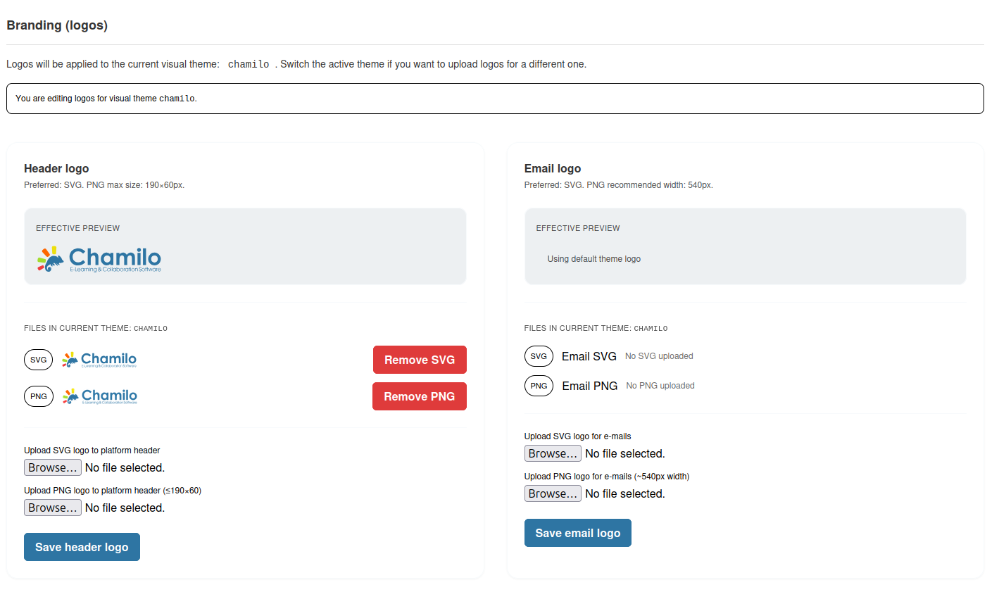

# Portal-Anpassung

Passen Sie das Erscheinungsbild Ihrer Chamilo-Plattform an und legen Sie fest, welche Informationen den Benutzern angezeigt werden.

## Plattformidentität

Konfigurieren Sie die grundlegende Identität Ihres Portals:

* **Plattformname** — Der Name, der im Browsertitel und in der gesamten Benutzeroberfläche angezeigt wird
* **Name der Institution** — Der Name Ihrer Organisation
* **URL der Institution** — Ein Link zur Website Ihrer Organisation
* **Plattformlogo** — Laden Sie das Logo Ihrer Organisation hoch (wird in der oberen Leiste angezeigt)

## Tipps

* **Halten Sie die Startseite übersichtlich** — Zu viele Inhalte auf der Startseite können überfordern. Konzentrieren Sie sich auf wesentliche Ankündigungen und den Kurszugang.
* **Aktualisieren Sie regelmäßig** — Halten Sie Systemankündigungen aktuell und entfernen Sie veraltete
* **Laden Sie ein hochwertiges Logo hoch** — Das Logo ist eines der sichtbarsten Branding-Elemente. Verwenden Sie ein scharfes Bild in angemessener Größe.