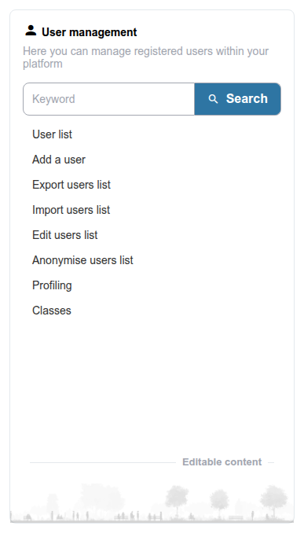

# Benutzer

Dieser Abschnitt behandelt die Verwaltung von Benutzerkonten auf Ihrer Chamilo-Plattform — das Anlegen von Benutzern, das Zuweisen von Rollen, die Organisation von Benutzern in Gruppen sowie die Verwaltung von Profilen.

* **[Benutzerrollen](user-roles.md)** — Die verschiedenen Benutzerrollen und ihre Berechtigungen verstehen
* **[Benutzer verwalten](managing-users.md)** — Benutzerkonten anlegen, bearbeiten, importieren und exportieren
* **[Benutzergruppen](user-groups.md)** — Benutzer in plattformweiten Gruppen organisieren
* **[Benutzerprofiling](user-profiling.md)** — Zusätzliche Profilfelder und Benutzermetadaten konfigurieren
* **[Akademische Zeugnisse](academic-transcripts.md)** — Unterzeichnete offizielle Zeugnisse für berechtigte Lernende konfigurieren und ausstellen