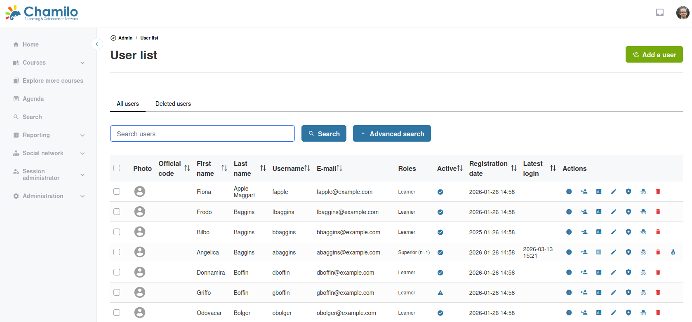
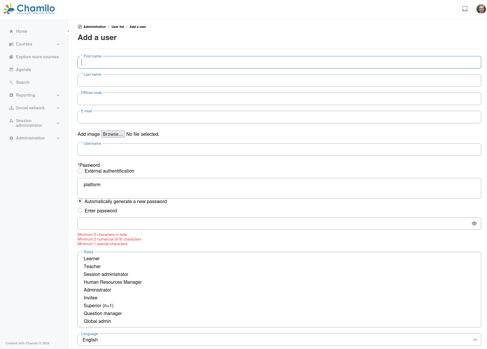
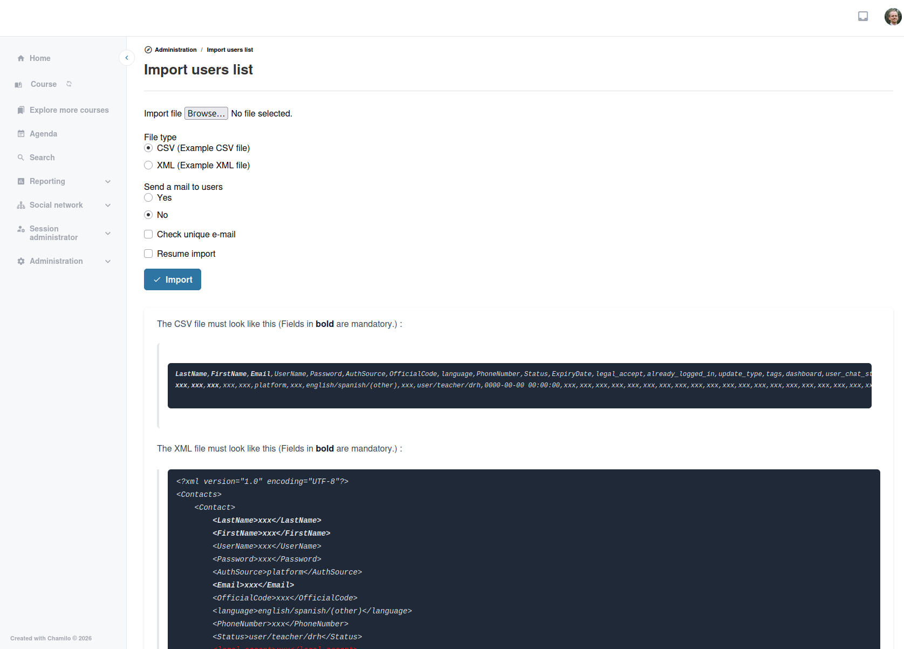

# Benutzer verwalten

Diese Seite behandelt die alltäglichen Aufgaben zum Erstellen, Bearbeiten und Verwalten von Benutzerkonten.

## Benutzerliste

Klicken Sie im Administrationsbereich auf **Benutzerliste**, um alle Benutzer der Plattform anzuzeigen. Die Liste zeigt:

* Avatar
* Name
* Benutzername
* E-Mail-Adresse
* Rollen
* Aktiv-/Inaktiv-Status
* Registrierungsdatum
* Datum der letzten Anmeldung

Verwenden Sie das Werkzeug **Erweiterte Suche**, um bestimmte Benutzer nach Name, E-Mail, Rolle oder anderen Kriterien zu finden.

## Einen Benutzer erstellen

1. Klicken Sie im Administrationsbereich auf **Benutzer hinzufügen**
2. Füllen Sie die Pflichtfelder aus:
   * **Vorname** und **Nachname**
   * **E-Mail** — Muss auf der Plattform eindeutig sein
   * **Benutzername** — Der Anmeldename (muss eindeutig sein)
   * **Passwort** — Legen Sie ein Anfangspasswort fest
   * **Rollen** — Wählen Sie die Plattformrolle(n) des Benutzers (Lernender, Lehrkraft, Administrator usw.)
   * **Sprache** — Die bevorzugte Sprache der Benutzeroberfläche
3. Füllen Sie optional weitere Felder aus:
   * Offizieller Code (z. B. eindeutige ID in der Organisation)
   * Telefonnummer
   * Ablaufdatum — Das Konto nach einem bestimmten Datum automatisch deaktivieren
   * Aktiv-/Inaktiv-Status
   * Zusätzliche Profilfelder (falls konfiguriert)
4. Speichern

## Benutzer importieren

Für die Massenerstellung von Benutzern können Sie Benutzer aus einer Datei importieren:

1. Klicken Sie im Administrationsbereich auf **Benutzer importieren**
2. Laden Sie eine **CSV**- oder **XML**-Datei mit Benutzerdaten hoch
3. Ordnen Sie die Dateispalten den Chamilo-Benutzerfeldern zu
4. Legen Sie fest, wie vorhandene Benutzer behandelt werden (aktualisieren oder überspringen)
5. Importieren

Die Importdatei sollte mindestens Spalten für Vorname, Nachname, E-Mail, Benutzername und Passwort enthalten.

Hinweis: Die Spalte **Status** ist die frühere Bezeichnung für **Rolle** und akzeptiert nur wenige Werte, etwa 1 für Lehrkraft und 5 für Lernenden. Eine weitergehende Anpassung der Rollen kann später nur manuell erfolgen, indem der Benutzer bearbeitet wird.

## Benutzer exportieren

Klicken Sie auf **Benutzer exportieren**, um die Benutzerliste als CSV- oder XML-Datei herunterzuladen. Sie können filtern, welche Benutzer exportiert werden, nach Rolle, Registrierungsdatum oder anderen Kriterien.

## Einen Benutzer bearbeiten

Klicken Sie in der Benutzerliste auf den Namen eines Benutzers, um dessen Konto zu bearbeiten. Sie können Folgendes ändern:

* Persönliche Angaben (Name, E-Mail, Telefon)
* Rollen
* Passwort (zurücksetzen)
* Aktiv-/Inaktiv-Status
* Ablaufdatum
* Zusätzliche Profilfelder

## Einen Benutzer löschen

Wenn Benutzer (in der Regel Lehrkräfte) gelöscht werden, die Inhalte auf der Plattform erstellt haben, kann das System das endgültige Löschen der Benutzer verhindern und eine Warnmeldung anzeigen, die erklärt, dass der Benutzer noch mit einigen Ressourcen verknüpft ist. Wenn Sie das Löschen bestätigen, löscht das System die Inhalte selbst nicht, sondern ordnet sie aus Gründen der Datenkonsistenz einem neutralen Benutzer zu (wir nennen ihn den „Fallback-Benutzer“).

Um dies zu vermeiden, prüfen Sie die Benutzerdetails, löschen Sie jeden ihrer Kurse einzeln und löschen Sie anschließend den Benutzer.

## Benutzeraktionen

| Aktion | Beschreibung |
|--------|-------------|
| **Deaktivieren** | Deaktiviert das Konto eines Benutzers, ohne es zu löschen. Der Benutzer kann sich nicht anmelden, seine Daten bleiben jedoch erhalten. |
| **Aktivieren** | Aktiviert ein zuvor deaktiviertes Konto erneut. |
| **Anmelden als** | Meldet sich auf der Plattform als dieser Benutzer an (Identitätsübernahme). Nützlich zur Fehlerbehebung. |
| **Anonymisieren** | Löscht alle personenbezogenen Angaben des Kontos gemäß der DSGVO der EU. |
| **Löschen** | Löscht das Benutzerkonto vorläufig (Soft Delete). Verwenden Sie die Registerkarte **Gelöschte Benutzer**, um das Konto und die zugehörigen Daten endgültig zu löschen. |

> **Anmelden als** ist eine leistungsstarke Funktion. Verwenden Sie sie verantwortungsvoll und nur für legitime Supportzwecke.

## Stapeloperationen

Wählen Sie in der Benutzerliste mehrere Benutzer aus, um Stapelaktionen auszuführen:

* Mehrere Benutzer gleichzeitig aktivieren oder deaktivieren
* Mehrere Benutzer löschen
* Benutzer einem Kurs oder einer Sitzung zuweisen

## Benutzerkonten zusammenführen

Die Aktion **Vereinheitlichen** des Berichts über doppelte Benutzer (**Administration > Berichte > Doppelte Benutzer**) führt die übrigen Konten einer Duplikatgruppe in das Konto zusammen, das Sie behalten. Die zusammengeführten Konten werden vorläufig gelöscht und anschließend endgültig gelöscht.

### Wer zusammenführen darf

* Nur Administratoren (`ROLE_ADMIN` oder `ROLE_GLOBAL_ADMIN`). Sitzungsadministratoren können keine Konten zusammenführen.
* Sowohl das Konto, das Sie behalten, als auch jedes darin zusammengeführte Konto müssen innerhalb der Zugriffs-URLs liegen, die Sie verwalten: Ein globaler Administrator, der auf einen Teilportalbaum beschränkt ist, kann nur Benutzer dieses Baums zusammenführen; ein einfacher Administrator nur Benutzer der URL(s), für die er registriert ist. Duplikate außerhalb Ihres Bereichs werden ignoriert; liegt keines in Ihrem Bereich, wird die Aktion abgelehnt.
* Sie können Ihr eigenes Konto nicht in ein anderes zusammenführen.

### Was abgelehnt wird

Der gesamte Vorgang wird abgebrochen (es wird nichts zusammengeführt) und eine ausdrückliche Meldung ausgegeben, wenn:

* das zusammenzuführende Konto eine administrative Rolle (Administrator, globaler Administrator, Sitzungsadministrator) besitzt, die das beizubehaltende Konto nicht besitzt: Die Rollen werden niemals übertragen, sodass die Berechtigung stillschweigend entfallen würde;
* das zusammenzuführende Konto eine **Lehrkraft** (Rolle Lehrkraft oder Personalverantwortlicher) ist und das beizubehaltende Konto ein **Lernender** (keine der Rollen Lehrkraft, Personalverantwortlicher oder Administrator). Die umgekehrte Richtung (Lernender in Lehrkraft) und Zusammenführungen gleicher Rollen bleiben zulässig.

### Was zusammengeführt wird

Alles, was dem Lernenden gehört, folgt dem beibehaltenen Konto: Einschreibungen in Kurse, Sitzungen, Klassen und URLs, Lernpfadfortschritt, Übungsversuche und Tracking, Notenbuchergebnisse und Zertifikate, Anwesenheit, Forum, Blog, Wiki, Dropbox, Aufgaben, Umfragen (Einladungen und die Antworten nicht anonymer Umfragen), Tickets, Nachrichten, Kompetenzen, Zertifikate/Transcripts, Laufbahn, Nachweisdokumente, Links zu geteilten Ressourcen (`resource_link.user_id`), Urheberschaft (wer ein Element erstellt oder zuletzt bearbeitet hat) und Audit-Protokolle.

Wenn beide Konten einen Datensatz für dasselbe Element haben (derselbe Kurs, derselbe Lernpfad, dieselbe Bewertung, dieselbe Kursabstimmung …), bleibt der Datensatz des beibehaltenen Kontos erhalten und der Datensatz des zusammengeführten Kontos wird verworfen (oder, wenn andere Daten daran hängen, beim zusammengeführten Konto belassen). Antworten auf eine Umfrage, die beide Konten beantwortet haben, werden nicht kombiniert: Es bleiben nur die des beibehaltenen Kontos.

### Was niemals zusammengeführt wird

Anmeldedaten und private Daten verbleiben auf dem (gelöschten) zusammengeführten Konto, sodass die Identität einer Person niemals an ein anderes Konto übergeben wird: Anmeldemethoden (`user_auth_source`), OAuth-Token und Einwilligungen, Anforderungen zum Zurücksetzen des Passworts, Push-Abonnements und API-Schlüssel, Unterhaltungen mit dem KI-Tutor und dem Support-Bot, Dashboard-Blöcke, Benutzervorlagen, gespeicherte Suchen und Abonnements von Benachrichtigungsereignissen. Anonyme Umfrageantworten werden niemals verändert. Benutzername, E-Mail-Adresse und Passwort des beibehaltenen Kontos werden niemals geändert.

## Tipps

* **CSV-Import für große Einschreibungen verwenden** — Wenn zu Beginn eines Schulungsprogramms viele Benutzer aufgenommen werden, bereiten Sie eine CSV-Datei vor und importieren Sie sie gesammelt
* **Ablaufdaten festlegen** — Legen Sie für temporäre Benutzer (Workshop-Teilnehmer, Testbenutzer) ein Ablaufdatum fest, um ihre Konten automatisch zu deaktivieren
* **Deaktivieren statt löschen** — Wenn ein Benutzer ausscheidet, deaktivieren Sie zuerst sein Konto. Dadurch bleiben seine Schulungsnachweise erhalten. Löschen Sie nur, wenn Sie sicher sind, dass die Daten nicht mehr benötigt werden.