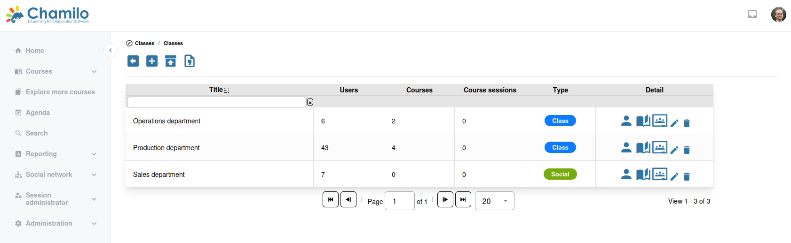

# Klassen / Benutzergruppen

Klassen im Administrationsbereich sind plattformweite Gruppen, mit denen Benutzer zu Verwaltungszwecken organisiert werden. Sie unterscheiden sich von Gruppen auf Kursebene (die von Lehrenden innerhalb eines Kurses erstellt werden).

> Benutzergruppen und [Klassen](../../admin-guide/sessions/classes.md) verwenden dieselbe Oberfläche. Der einzige Unterschied ist die Einstellung **Gruppentyp**: Wählen Sie „Klasse“, um eine Klasse zu erstellen (für die Masseneinschreibung in Sitzungen), oder „Benutzergruppe“ für eher soziale Gruppen, die einen eigenen Bereich im internen sozialen Netzwerk haben können. Siehe [Klassen](../../admin-guide/sessions/classes.md) für Details zur Sitzungseinschreibung.

## Eine Gruppe erstellen

1. Navigieren Sie im Administrationsbereich zu **Klassen**
2. Klicken Sie auf **Klassen hinzufügen**
3. Geben Sie einen **Titel** und optional eine **Beschreibung** ein
4. Aktivieren Sie **Soziale Gruppe**, wenn es sich um eine soziale Gruppe handeln soll. Lassen Sie das Kontrollkästchen deaktiviert, wenn es eine Klasse sein soll.
5. Fügen Sie optional eine Referenz-URL und ein Bild/Logo hinzu.
6. Wählen Sie die Gruppen-**Berechtigungen**:
   * **Offen** — Jeder Benutzer kann beitreten
   * **Geschlossen** — Benutzer müssen von einem Administrator hinzugefügt werden
7. Aktivieren Sie die Option, wenn Mitglieder die Klasse selbstständig verlassen können sollen.
8. Speichern.

## Mitglieder hinzufügen

1. Öffnen Sie die Liste der Klassen/Benutzergruppen
2. Klicken Sie auf das Benutzersymbol **Benutzer in Klasse einschreiben**
3. Suchen Sie Benutzer nach Name, Benutzername oder E-Mail
4. Wählen Sie die hinzuzufügenden Benutzer aus, indem Sie die Pfeile auf der rechten Seite verwenden
5. Klicken Sie auf die Bestätigungsschaltfläche, um zu speichern

## Anwendungsfälle

* **Abteilungsorganisation** — Benutzer nach Abteilung oder Team gruppieren
* **Masseneinschreibung** — Alle Mitglieder einer Gruppe auf einmal einem Kurs oder einer Sitzung hinzufügen
* **Gezielte Kommunikation** — Ankündigungen an bestimmte Gruppen senden
* **Berichterstattung** — Lernfortschritt nach Gruppe gefiltert anzeigen

## Gruppen verwalten

* **Bearbeiten** — Gruppenname, Beschreibung oder Sichtbarkeit ändern
* **Mitglieder verwalten** — Mitglieder hinzufügen oder entfernen
* **Löschen** — Die Gruppe entfernen (löscht nicht die Mitgliedskonten)

## Sortierreihenfolge der Listen

Der Hilfsmechanismus, der mehrere Listen sortierte, wandte die angeforderte Richtung verkehrt herum an: Die Auswahl von „aufsteigend“ in einer Spaltenüberschrift lieferte zuerst den höchsten Wert und „absteigend“ zuerst den niedrigsten. Er folgt nun der angeforderten Richtung. Wenn Sie gewohnt waren, eine Überschrift zweimal anzuklicken, um die gewünschte Reihenfolge zu erhalten, liefert der erste Klick sie nun.

Betroffene Listen (Sortierung durch Klicken auf eine Spaltenüberschrift):

* Liste **Administration > Klassen / Benutzergruppen** (Spalten Titel, Benutzer, Kurse, Sitzungen und Typ)
* Die Benutzergruppenliste der Kursregisterkarte **Klassen**
* Drei Listen der Kursstartseiten (bereitgestellt von `course_home.ajax.php`)

Unverändert: die Tageszelle der Agenda, der Block „nächste Übung“ des Benutzerportals (explizit aufsteigend, wie zuvor) und das Raster **Übungen** der Sitzung, dessen Zeilen anschließend vom Raster selbst neu sortiert werden (Anfangssortierung: älteste zuerst).