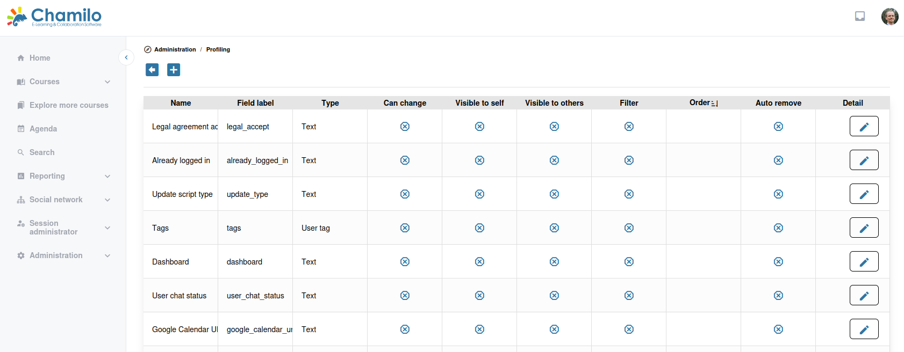

# Benutzerprofile

Mit Chamilo können Sie benutzerdefinierte Profilfelder (Zusatzfelder) definieren, um zusätzliche Informationen über Benutzer zu erfassen, die über den Standardnamen, die E-Mail-Adresse und die Rolle hinausgehen.

## Zusätzliche Profilfelder

Zusatzfelder ermöglichen es Ihnen, organisationsspezifische Metadaten zu speichern, beispielsweise:

* Mitarbeiter-ID
* Abteilung
* Berufsbezeichnung
* Standort/Büro
* Telefonnummer
* Benutzerdefinierte Kennungen

## Zusatzfelder erstellen

1. Navigieren Sie im Administrationsbereich zu **Zusatzfelder** oder **Profilfelder**
2. Klicken Sie auf **Hinzufügen**
3. Konfigurieren Sie das Feld:
   * **Name** — Der Feldtitel, der den Benutzern angezeigt wird
   * **Beschreibung** — Optionale Beschreibung
   * **Hilfetext** — Wird unter dem Feld in jedem Formular angezeigt, das es enthält
   * **Feldtyp** — Text, Dropdown, Datum, Kontrollkästchen usw.
   * **Feldbezeichnung** — Der interne Name des Feldes für die Integration von Plugins
   * **Mögliche Werte** — Wenn das Feld eine Auswahl zwischen diesen Werten ist
   * **Standardwert** — Ein optionaler Standardwert
   * **Für sich selbst sichtbar** — Ob das Feld im Benutzerprofil für den Benutzer selbst sichtbar ist
   * **Für andere sichtbar** — Ob das Feld für andere Benutzer der Plattform sichtbar ist
   * **Kann ändern** — Ob der Benutzer sein eigenes Feld selbst ändern kann (oder ob dies nur Administratoren können)
   * **Filter** — Ob ein Feld vom Typ Auswahl als Filter auf Administrationsseiten einbezogen werden soll (z. B. um Benutzer in Kurse oder Sitzungen einzuschreiben)
   * **Reihenfolge** — Wenn Sie die Anzeigereihenfolge der Felder steuern möchten, müssen Sie jedem Feld eine numerische Reihenfolge zuweisen
   * **Bei Anonymisierung entfernen** — Wichtig für Datenschutzregeln und -gesetze: Wenn der Benutzer anonymisiert, aber nicht gelöscht wird, soll dieses Feld als potenzieller Träger personenbezogener Daten betrachtet werden?
4. Speichern

## Feldtypen

Die Zusatzfeld-Engine unterstützt eine breite Palette von Eingabetypen. Häufig verwendete Typen sind:

| Typ | Beschreibung |
|------|-------------|
| **Text** | Ein einzeiliges Texteingabefeld |
| **Textbereich** | Ein mehrzeiliges Texteingabefeld |
| **Optionsfeld** | Eine Optionsfeldgruppe mit Einfachauswahl |
| **Dropdown / Dropdown mehrfach** | Eine Liste vordefinierter Optionen (Einfach- oder Mehrfachauswahl) |
| **Doppelauswahl** | Zwei voneinander abhängige Dropdowns (z. B. Land → Stadt) |
| **Kontrollkästchen** | Ein Ja/Nein-Schalter |
| **Datum / Datum und Uhrzeit** | Auswahl für Datum oder Datum und Uhrzeit |
| **Ganzzahl** | Ein numerisches Eingabefeld |
| **Tag** | Mehrere frei formulierte Tag-Werte |
| **Datei** | Feld zum Hochladen von Dateien |
| **Video-URL** | Eine URL, die auf ein Video verweist |
| **Mobiltelefonnummer** | Ein formatiertes Feld für Telefonnummern |
| **Zeitzone** | Eine Zeitzonenauswahl |
| **Soziales Profil** | Ein Link zu einem Profil in einem sozialen Netzwerk |
| **Trennlinie** | Eine visuelle Trennlinie innerhalb des Formulars (ohne Wert) |

Die genaue Menge der verwendbaren Typen hängt von der Chamilo-Version ab; das Dropdown für den Feldtyp auf der Administrationsseite **Zusatzfelder** ist die maßgebliche Quelle.

## Zusatzfelder verwenden

Zusatzfelder erscheinen:

* In den Formularen zur Benutzererstellung (wenn für sich selbst sichtbar) und zur Bearbeitung
* Auf Benutzerprofilseiten (wenn für sich selbst sichtbar)
* Bei Benutzerimporten (Sie können Werte von Zusatzfeldern in CSV-Importe aufnehmen)
* In Exporten und Berichten (Filtern oder Gruppieren nach Werten von Zusatzfeldern)

## Tipps

* **Vor dem Erstellen planen** — Legen Sie fest, welche Informationen Sie benötigen, bevor Sie Felder erstellen, da das Ändern von Feldtypen nach der Eingabe von Daten problematisch sein kann
* **Dropdowns für Konsistenz verwenden** — Wenn ein Feld eine bekannte Menge möglicher Werte hat, verwenden Sie ein Dropdown anstelle von Freitext, um die Datenkonsistenz sicherzustellen
* **Für Berichte verwenden** — Zusatzfelder eignen sich zum Filtern von Berichten (z. B. „alle Benutzer in Abteilung X anzeigen, die Schulung Y abgeschlossen haben“)