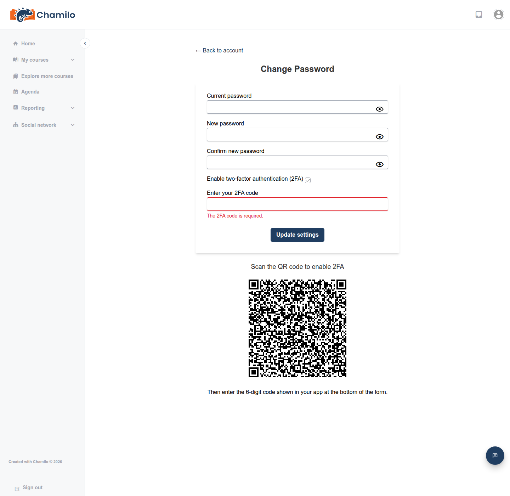

# Zwei-Faktor-Authentifizierung

Die Zwei-Faktor-Authentifizierung (2FA) fügt der Anmeldung einen zweiten Schritt hinzu — einen 6-stelligen Code aus einer App auf Ihrem Telefon zusätzlich zu Ihrem Passwort —, sodass das Kennen Ihres Passworts allein nicht ausreicht, um auf Ihr Konto zuzugreifen.

Diese Funktion erscheint nur, wenn Ihr Administrator sie plattformweit aktiviert hat. Wenn Sie sie auf Ihrer Kontoseite nicht sehen, wurde sie für Ihre Plattform nicht eingeschaltet.

## 2FA aktivieren

1. Öffnen Sie Ihr **Avatar-Menü** und klicken Sie auf **Mein Profil**.
2. Klicken Sie auf **Passwort ändern**.
3. Geben Sie Ihr **aktuelles Passwort** ein, aktivieren Sie das Kontrollkästchen **Zwei-Faktor-Authentifizierung (2FA) aktivieren** und klicken Sie auf **Einstellungen aktualisieren**.
4. Die Seite wird neu geladen und zeigt einen QR-Code sowie die Meldung „Scannen Sie den QR-Code, um 2FA zu aktivieren.“ Scannen Sie ihn mit einer Authenticator-App auf Ihrem Telefon (jede TOTP-kompatible App funktioniert, z. B. Google Authenticator, Microsoft Authenticator oder Authy).

5. Geben Sie Ihr aktuelles Passwort erneut ein, zusammen mit dem 6-stelligen Code, den Ihre App nun anzeigt, im Feld **2FA-Code**, und klicken Sie erneut auf **Einstellungen aktualisieren**. Sie sehen eine Bestätigung, dass 2FA aktiviert wurde.

Das Aktivieren des Kontrollkästchens allein zeigt den QR-Code nicht an — Sie sehen ihn erst nach diesem ersten Absenden, und Ihre Passwortfelder werden bei jedem Neuladen der Seite geleert, sodass Sie Ihr aktuelles Passwort auch bei diesem zweiten Absenden erneut eingeben müssen.

## Anmeldung mit aktivierter 2FA

Nachdem Sie wie gewohnt Ihren Benutzernamen und Ihr Passwort eingegeben haben, zeigt das Anmeldeformular auf demselben Bildschirm ein zusätzliches Feld **2FA-Code** — geben Sie den aktuellen 6-stelligen Code aus Ihrer Authenticator-App ein und senden Sie ihn ab (die Schaltfläche lautet an dieser Stelle **Code absenden** statt **Anmelden**).

## Wenn Sie den Zugriff auf Ihre Authenticator-App verlieren

Chamilo erzeugt keine Backup- oder Wiederherstellungscodes für 2FA. Wenn Sie das Gerät mit Ihrer Authenticator-App verlieren, können Sie selbst keinen gültigen Code erzeugen — wenden Sie sich an Ihren Plattformadministrator, der 2FA für Ihr Konto deaktivieren kann, damit Sie sich erneut anmelden und die Funktion bei Bedarf auf einem neuen Gerät einrichten können.

## 2FA deaktivieren

Kehren Sie zu **Passwort ändern** zurück, deaktivieren Sie **Zwei-Faktor-Authentifizierung (2FA) aktivieren**, geben Sie Ihr aktuelles Passwort ein und senden Sie das Formular ab.

## Tipps

* **Richten Sie sie ein, bevor Sie sie brauchen** — das Aktivieren von 2FA dauert eine Minute und schützt Ihr Konto spürbar.
* **Halten Sie Ihre Authenticator-App zugänglich** — wenn Sie sie verlieren, sind Sie auf Ihren Administrator angewiesen, um wieder Zugang zu erhalten, da es keine Backup-Codes gibt.
* **Teilen Sie Ihre 2FA-Codes nicht** — jeder, der Ihr Passwort und einen gültigen Code hat, kann sich als Sie anmelden.