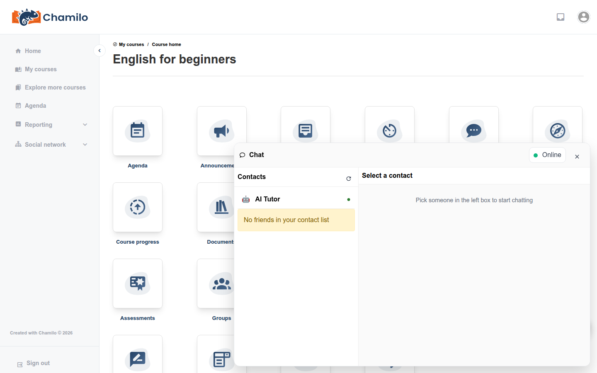
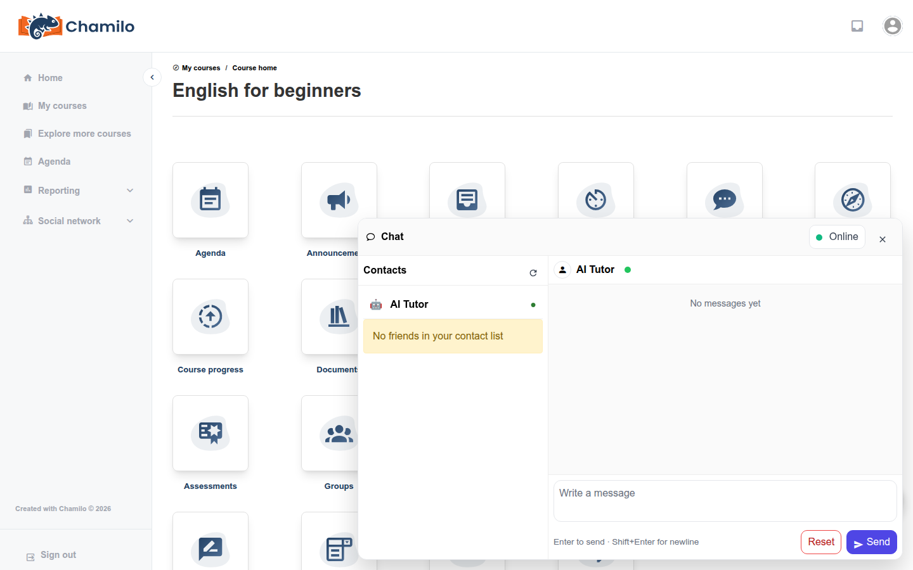

# KI-Tutor-Chatbot

Wenn Ihre Plattform und Ihr Kurs dies beide aktiviert haben, haben Sie Zugriff auf einen **KI-Tutor** — einen Chat-Assistenten, dem Sie Fragen stellen und von dem Sie sofort kontextbezogene Antworten erhalten können, ohne auf die Antwort Ihrer Lehrkraft warten zu müssen.

## Ob Sie Zugriff haben

Der KI-Tutor hängt von der Konfiguration auf zwei Ebenen ab, die beide außerhalb Ihrer Kontrolle liegen:

* **Plattformebene** — Ihre Administration muss KI-Helfer aktivieren und einen KI-Anbieter konfigurieren.
* **Kursebene** — Ihre Lehrkraft muss den KI-Tutor für diesen bestimmten Kurs einschalten.

Siehe [KI-Tutor](../../teacher-guide/ai-tools/ai-tutor.md) im Leitfaden für Lehrkräfte, wie dies auf Seiten der Lehrkraft eingerichtet wird. Wenn Sie die unten beschriebene Option nirgendwo sehen, wurde sie für Sie nicht aktiviert — entweder überhaupt nicht oder nicht für den Kurs, in dem Sie sich gerade befinden.

Einige Plattformen aktivieren den KI-Tutor auch **außerhalb eines Kurses** — in diesem Fall wechselt er dort den Fokus: Statt Fragen zu einem bestimmten Kurs zu beantworten, hilft er bei allgemeinen Fragen zur Plattformnutzung, etwa wie man eine Funktion findet oder verwendet. Dieser plattformweite Modus ist ein separater Schalter gegenüber dem kursbezogenen, sodass einer aktiv sein kann, ohne dass der andere es ist.

## Den Chat öffnen

Suchen Sie nach der Chat-Schaltfläche (einem schwebenden Sprechblasen-Symbol) am unteren Bildschirmrand. Beim Öffnen werden Ihre Kontakte angezeigt und, falls aktiviert, ein eigener **KI-Tutor**-Eintrag mit einem Robotersymbol und einem „online“-Punkt — klicken Sie darauf, um Ihr Gespräch mit der KI zu beginnen oder fortzusetzen.

Geben Sie Ihre Frage ein und drücken Sie die **Eingabetaste**, um sie zu senden (**Umschalt+Eingabe** fügt stattdessen einen Zeilenumbruch ein). Der KI-Tutor formatiert seine Antworten mit Überschriften, Listen, fettem Text und Codeblöcken, wo dies sinnvoll ist, damit längere Erklärungen lesbar bleiben.

## Zu etwas fragen, das Sie gerade lesen

Während Sie ein Dokument, einen Forenbeitrag, eine Wiki-Seite, einen Portfolio-Eintrag oder einen Schritt eines Lernpfads ansehen, können Sie einen Textabschnitt auf der Seite auswählen, bevor Sie Ihre Frage stellen. Über dem Nachrichtenfeld erscheint ein kleines Chip „Auswahl“ — senden Sie Ihre Nachricht, und der ausgewählte Text wird als Kontext mitgesendet, sodass der KI-Tutor gezielt zur markierten Passage antworten kann. Klicken Sie auf das **×** des Chips, um die Auswahl zu verwerfen, wenn Sie sie nicht einbeziehen möchten.

## Neu beginnen

Wenn ein Gespräch vom Thema abkommt, verwenden Sie die Option **Zurücksetzen** im Chat-Eingabefeld, um es zu löschen und neu zu beginnen. Dadurch wird nur Ihr Gespräch mit dem KI-Tutor gelöscht — Ihre regulären Nachrichten mit Ihrer Lehrkraft oder Ihren Mitlernenden bleiben unberührt.

## Wenn er nicht verfügbar ist

Der KI-Tutor wird automatisch deaktiviert, während Sie einen Test absolvieren oder an einer Aufgabe arbeiten, damit er nicht verwendet werden kann, um während einer Bewertung Antworten zu erhalten. Er erscheint auch nicht, wenn der zugrunde liegende KI-Anbieter vorübergehend nicht verfügbar ist — Chamilo versucht automatisch, auf einen anderen konfigurierten Anbieter auszuweichen, aber wenn keiner erreichbar ist, kann der KI-Tutor kurzzeitig nicht verfügbar sein.

## Tipps

* **Nutzen Sie ihn für schnelle Klärungen** — er ist besonders nützlich für Fragen, auf deren Antwort Sie sonst warten müssten.
* **Prüfen Sie wichtige Informationen dennoch** — wie jedes KI-System kann er Fehler machen. Gleichen Sie alles Kritische mit Ihrem Kursmaterial oder Ihrer Lehrkraft ab.
* **Er ist eine Ergänzung, kein Ersatz** — bei allem, was ein echtes Urteil Ihrer Lehrkraft erfordert (Notenstreitigkeiten, Fristverlängerungen, persönliche Umstände), wenden Sie sich stattdessen direkt an sie.