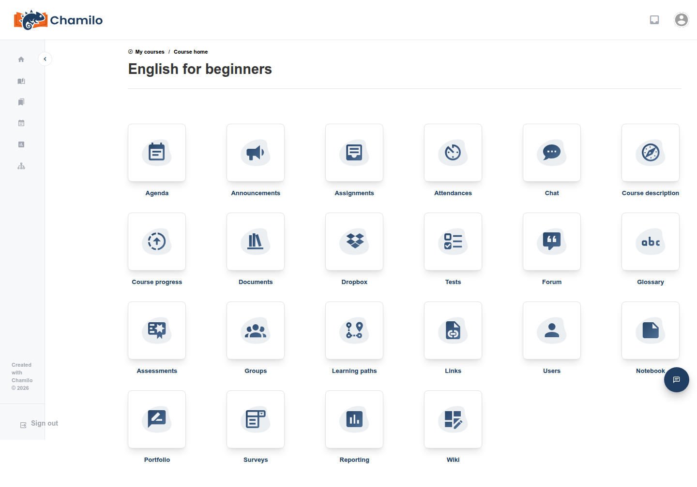
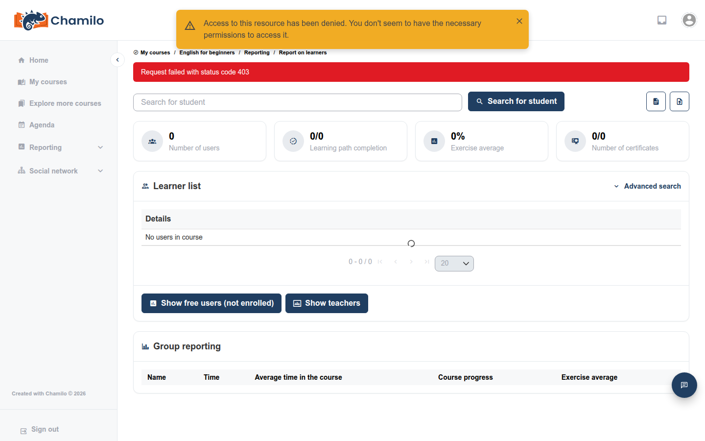

# Sich in einem Kurs zurechtfinden

Sobald Sie einen Kurs öffnen, sehen Sie dessen Startseite mit einem Raster von Werkzeugsymbolen. Diese Seite erläutert, was jedes Werkzeug für Sie als lernende Person bedeutet, und verlinkt auf die Stellen, an denen die zugrunde liegende Funktion ausführlicher beschrieben wird.

In Ihrem Raster erscheinen nur die Werkzeuge, die Ihre Lehrkraft für Lernende sichtbar gemacht hat — Ihre Lehrkraft sieht möglicherweise zusätzliche, ausgeblendete Werkzeuge, die Ihnen nicht angezeigt werden. Wenn ein erwartetes Werkzeug fehlt, ist es möglicherweise einfach ausgeblendet oder für den gesamten Kurs deaktiviert; fragen Sie Ihre Lehrkraft.

## Das Werkzeugraster

| Werkzeug | Symbol | Was es für Sie bedeutet | Mehr erfahren |
|------|------|------------------------|------------|
| Dokumente |  | Lesen und laden Sie Dateien herunter, die Ihre Lehrkraft hochgeladen hat | [Dokumente](../../teacher-guide/adding-content/documents.md) |
| Lernpfade |  | Folgen Sie einer geführten Abfolge von Aktivitäten in der vorgegebenen Reihenfolge und verfolgen Sie dabei Ihren eigenen Fortschritt | [Lernpfade](../../teacher-guide/adding-content/learning-paths.md) |
| Links |  | Öffnen Sie externe Ressourcen, die Ihre Lehrkraft zusammengestellt hat | [Links](../../teacher-guide/adding-content/links.md) |
| Tests (Übungen) |  | Absolvieren Sie Tests und Prüfungen; einige werden automatisch bewertet, andere von Ihrer Lehrkraft | [Übungen](../../teacher-guide/assessing-learners/exercises.md) |
| Ankündigungen |  | Lesen Sie wichtige Aktualisierungen, die Ihre Lehrkraft veröffentlicht hat | [Ankündigungen](../../teacher-guide/adding-content/announcements.md) |
| Bewertungen (Notenbuch) |  | Sehen Sie Ihre eigenen Ergebnisse für die bewerteten Aktivitäten des Kurses sowie jedes Zertifikat, das Sie erworben haben | [Notenbuch](../../teacher-guide/assessing-learners/gradebook.md) |
| Glossar |  | Schlagen Sie zentrale Begriffe nach, die für den Kurs definiert wurden | [Glossar](../../teacher-guide/adding-content/glossary.md) |
| Anwesenheiten |  | Sehen Sie Ihre eigene erfasste Anwesenheit, sofern Ihre Lehrkraft diese nachverfolgt | [Anwesenheit](../../teacher-guide/assessing-learners/attendance.md) |
| Kursfortschritt |  | Sehen Sie eine Zusammenfassung, wie weit Sie im Kurs vorangekommen sind | [Kursfortschritt](../../teacher-guide/additional-tools/course-progress.md) |
| Agenda |  | Sehen Sie kursspezifische Termine und Fristen | — |
| Forum |  | Lesen und schreiben Sie in Diskussionssträngen mit Ihrer Lehrkraft und Ihren Mitlernenden | [Foren](../../teacher-guide/collaboration-and-communication/forums.md) |
| Dropbox |  | Tauschen Sie Dateien vertraulich mit Ihrer Lehrkraft oder Ihren Mitlernenden aus | [Dropbox](../../teacher-guide/additional-tools/dropbox.md) |
| Benutzer |  | Sehen Sie, wer sonst noch im Kurs eingeschrieben ist | — |
| Gruppen |  | Arbeiten Sie in einer kleineren Gruppe, die Ihre Lehrkraft zugewiesen hat, mit eigenen gemeinsamen Werkzeugen | [Gruppen](../../teacher-guide/collaboration-and-communication/groups.md) |
| Chat |  | Schreiben Sie Ihrer Lehrkraft oder Ihren Mitlernenden in Echtzeit | [Chat](../../teacher-guide/collaboration-and-communication/chat.md) |
| Aufgaben |  | Reichen Sie Dateien oder Texte ein, damit Ihre Lehrkraft sie prüfen und bewerten kann | [Aufgaben](../../teacher-guide/assessing-learners/assignments.md) |
| Umfragen |  | Beantworten Sie Fragebögen, manchmal anonym | [Umfragen](../../teacher-guide/assessing-learners/surveys.md) |
| Wiki |  | Verfassen und bearbeiten Sie gemeinsam geteilte Seiten | [Wiki](../../teacher-guide/collaboration-and-communication/wiki.md) |
| Notizbuch |  | Führen Sie Ihre eigenen privaten Notizen innerhalb des Kurses | [Notizbuch](../../teacher-guide/additional-tools/notebook.md) |
| Portfolio |  | Erstellen Sie eine persönliche Sammlung von Arbeiten zur Präsentation oder zur Abgabe | [Portfolio](../../teacher-guide/additional-tools/portfolio.md) |
| Berichte |  | Nichts, für Sie — siehe unten | — |

## Werkzeuge, die Sie nicht sehen — und eines, das nicht funktioniert

Einige Einträge existieren nur für Lehrkräfte und Kursadministratoren, um den Kurs selbst zu konfigurieren — Kurseinstellungen, Kurswartung (Sicherung/Import/Export), der Editor der Kursstartseite und (auf den meisten Plattformen) das Blog-Werkzeug befinden sich in einem Menü „Weitere Aktionen“, das nur Personen mit Bearbeitungsrechten für den Kurs angezeigt wird. Als Lernende oder Lernender sehen Sie dieses Menü überhaupt nicht.

Die Kachel **Berichte** ist ein Sonderfall: Sie erscheint zwar in Ihrem Raster, öffnet jedoch die für Lehrkräfte vorgesehene Ansicht zur Nachverfolgung der gesamten Klasse. Ein Klick darauf führt daher zu einer Meldung „Zugriff verweigert“ und nicht zu etwas Nützlichem:

Keine Sorge — Ihr eigener Fortschritt ist an anderer Stelle verfügbar: über **Mein Fortschritt** in der Hauptseitenleiste (siehe [Die Benutzeroberfläche verstehen](../getting-started/understanding-the-interface.md) und [Mein Fortschritt](../my-progress.md)) sowie über die oben genannten Werkzeuge **Kursfortschritt** und **Bewertungen**, die beide Ihre eigenen Daten anzeigen.

Wenn in Ihrem Kurs KI-Funktionen aktiviert sind, fällt Ihnen möglicherweise auch auf, dass die Option „KI-Analysator“ einer Lehrkraft (zum Vortrainieren des KI-Tutors anhand der eigenen Kursinhalte) sich vom lernendenseitigen Chat **KI-Tutor** unterscheidet — siehe [KI-Tutor-Chatbot](ai-tutor.md).

## Tipps

* **Fehlt ein Werkzeug?** Fragen Sie Ihre Lehrkraft — es ist höchstwahrscheinlich ausgeblendet oder deaktiviert und nicht defekt.
* **Kursbeschreibung und Ankündigungen** können von Ihrer Lehrkraft vollständig deaktiviert werden; in diesem Fall erscheinen sie für niemanden, auch nicht für die Lehrkraft.
* **Alles hier kann je nach Kurs variieren** — Ihre Lehrkraft entscheidet für jeden Kurs einzeln, welche Werkzeuge aktiv und sichtbar sind.