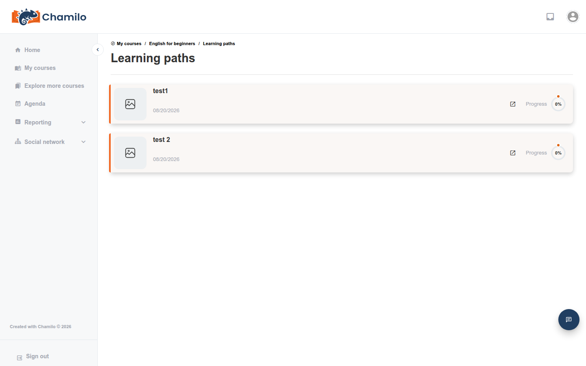

# Einem Lernpfad folgen

Ein **Lernpfad** führt Sie durch eine strukturierte Abfolge von Aktivitäten — Dokumente, Tests, Links und mehr — in einer Reihenfolge, die Ihre Lehrkraft festgelegt hat. In vielen Kursen ist er das wichtigste (oder einzige) Werkzeug, das Sie tatsächlich benötigen, da er alles andere in sich bündeln kann.

## Einen Lernpfad öffnen

Öffnen Sie das Werkzeug **Lernpfade**  auf der Kursstartseite und klicken Sie auf einen Eintrag, um zu beginnen. Wenn Ihre Lehrkraft den **automatischen Start** aktiviert hat, kann sich der Lernpfad automatisch öffnen, sobald Sie den Kurs betreten.

## Den Pfad durchlaufen

Innerhalb eines Lernpfads sehen Sie:

* Eine **Liste der Elemente** (Schritte) in einem Bereich, gegliedert in Abschnitte, die Ihre Lehrkraft wie Kapitel gruppiert haben kann
* Den **Inhalt des aktuellen Elements** im Hauptbereich — ein Dokument, ein eingebetteter Test, ein Link und so weiter

Wenn Sie Elemente abschließen, werden sie mit einem Häkchen markiert, und ein **Fortschrittsbalken** zeigt Ihren Gesamtfortschritt in Prozent für den gesamten Pfad. Wenn Sie den Pfad verlassen und später zurückkehren, setzen Sie genau dort fort, wo Sie aufgehört haben — nichts geht verloren.

## Gesperrte Elemente und Voraussetzungen

Einige Elemente können **gesperrt** erscheinen, bis Sie eine von Ihrer Lehrkraft festgelegte Voraussetzung erfüllen — in der Regel das Abschließen eines früheren Elements oder das Erreichen einer Mindestpunktzahl bei einem Test weiter vorne im Pfad. Wenn Sie einen Schritt nicht öffnen können, prüfen Sie, ob ein früherer Schritt noch unvollständig ist.

## Tests und Zertifikate innerhalb eines Pfads

Ein Lernpfad kann einen Test als einen seiner Schritte enthalten — die Durchführung entspricht der Beschreibung unter [Tests absolvieren](taking-tests.md). Einige Pfade enden mit einem Schritt **Zertifikat**: Wenn Sie ihn erreichen (und dabei alle Punktanforderungen erfüllt haben), wird Ihr Abschlusszertifikat ausgelöst, sofern Ihre Lehrkraft eines für den Kurs konfiguriert hat.

## SCORM und andere importierte Inhalte

Einige Elemente eines Lernpfads werden nicht direkt in Chamilo erstellt, sondern als **SCORM**-Paket, als **CMI5/xAPI**-Paket importiert oder mit dem Plugin C-Studio erstellt. Sie sehen in der Regel aus und verhalten sich wie andere interaktive Inhalte — Chamilo erfasst Ihren Fortschritt und Ihre Punktzahl auf dieselbe Weise, auch wenn der Inhalt selbst an anderer Stelle erstellt wurde.

## KI-Lernhilfe

Wenn Ihre Administration KI-Hilfen aktiviert hat, können Dokumentenschritte in einem Lernpfad eine **KI-Lernhilfe** anbieten. Markieren Sie eine Passage im Dokument; neben der Auswahl erscheint eine kleine Roboteraktion. Öffnen Sie sie, wählen Sie eine **Lerntechnik** (zum Beispiel Feynman-Technik, Mindmapping, verteiltes Wiederholen oder SQ3R) und klicken Sie auf **Generieren**.

Chamilo sendet die ausgewählte Passage und die Technik an den konfigurierten KI-Dienst und zeigt die erzeugte Erklärung in einem Dialog an. Die Hilfe soll Ihr Verständnis des Materials unterstützen; sie ändert weder Ihre Antworten noch Ihre Punktzahl oder Ihren Lernpfadfortschritt.

## Tipps

* **Nutzen Sie den Fortschrittsbalken**, um einzuschätzen, wie viel vom Pfad noch übrig ist.
* **Machen Sie sich keine Sorgen, Ihren Platz zu verlieren** — Chamilo merkt sich zwischen den Sitzungen genau, wo Sie sich in einem Pfad befinden.
* **Ein gesperrter Schritt bedeutet in der Regel unerledigte Arbeit weiter vorne im Pfad** — gehen Sie zurück und prüfen Sie dies, anstatt anzunehmen, dass der Zugriff versehentlich verweigert wurde.