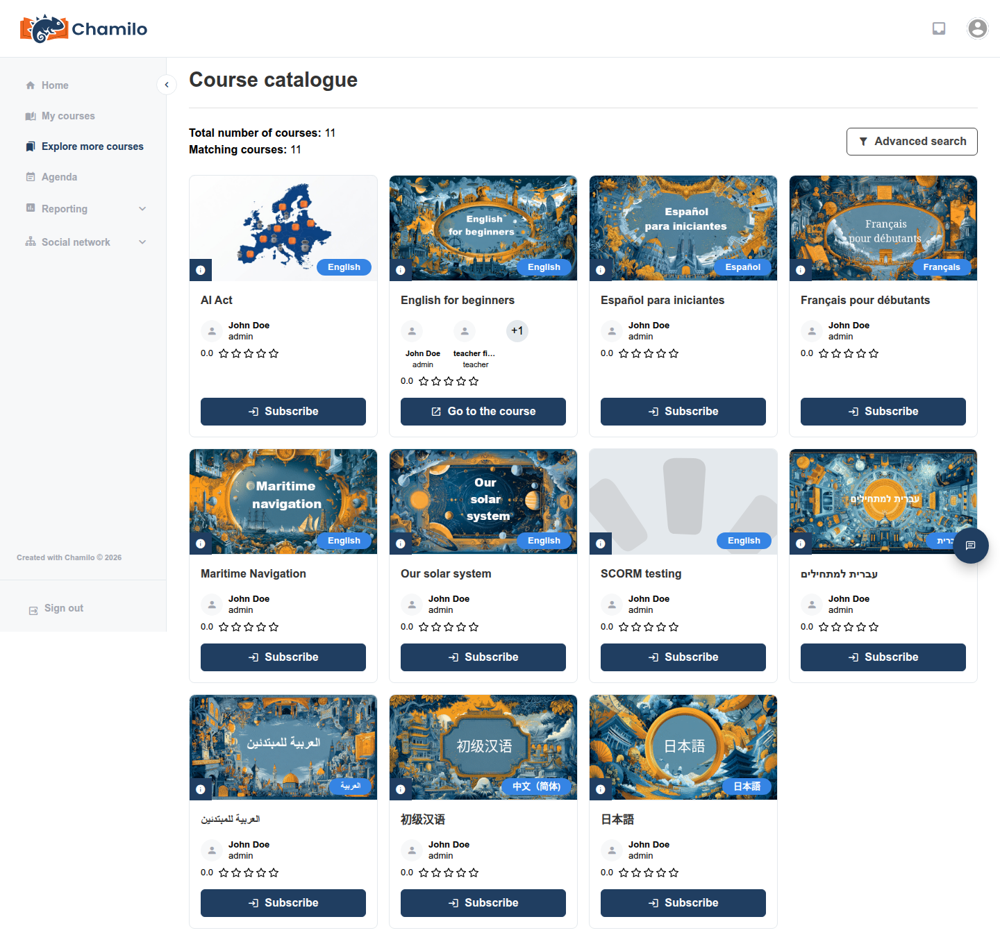

# Einschreibung in einen Kurs

Bevor Sie auf die Inhalte eines Kurses zugreifen können, müssen Sie in diesen eingeschrieben sein. Je nach Plattform kann dies auf unterschiedliche Weise geschehen — in den meisten Fällen ist von Ihnen keinerlei Aktion erforderlich.

| Wie es geschieht | Was Sie tun müssen |
|-----------------|----------------------|
| Ein Administrator schreibt Sie ein | Nichts — der Kurs erscheint unter **Meine Kurse**, sobald dies erledigt ist |
| Eine Lehrkraft schreibt Sie manuell ein | Nichts — wie oben |
| Sie schreiben sich selbst über den Kurskatalog ein | Durchsuchen Sie **Weitere Kurse entdecken** und klicken Sie dann, um beizutreten |
| Sie erhalten eine Kurseinladung per E-Mail | Klicken Sie auf den Link; registrieren Sie sich, falls Sie noch kein Konto haben |

## Ihre Kurse prüfen

Klicken Sie jederzeit in der Seitenleiste auf **Meine Kurse**, um alles zu sehen, worin Sie derzeit eingeschrieben sind. Wenn ein erwarteter Kurs nicht aufgeführt ist, wurden Sie noch nicht eingeschrieben — nutzen Sie eine der folgenden Methoden oder wenden Sie sich an Ihre Lehrkraft oder Ihre Administration.

## Selbsteinschreibung über den Kurskatalog

Wenn die Sichtbarkeit eines Kurses dies zulässt, können Sie sich selbst einschreiben, ohne auf andere zu warten:

1. Klicken Sie in der Seitenleiste auf **Weitere Kurse entdecken**, um den Kurskatalog zu öffnen.
2. Durchsuchen oder suchen Sie den Kurs, dem Sie beitreten möchten.
3. Klicken Sie auf den Kurs, um dessen Details zu öffnen, und klicken Sie dann auf die Schaltfläche, um beizutreten.

Bei einem Kurs, in den Sie bereits eingeschrieben sind, wird **Zum Kurs** anstelle einer Einschreibeschaltfläche angezeigt.

Für manche Kurse ist zur Selbsteinschreibung ein Passwort erforderlich — Ihre Lehrkraft hat es Ihnen in diesem Fall separat mitgeteilt. Wenn ein Kurs überhaupt keine Beitrittsschaltfläche anbietet, ist die Selbsteinschreibung dafür nicht geöffnet; bitten Sie die Lehrkraft oder eine Administration, Sie stattdessen einzuschreiben.

Wenn Ihre Plattform **Sitzungen** verwendet, gilt dasselbe für **Meine Sitzungen** — einige Sitzungen können über den Katalog zur Selbsteinschreibung offen sein, obwohl dies häufiger von einer Administration oder einem Sitzungstutor verwaltet wird, da die Einschreibung in eine Sitzung Sie in jeden darin enthaltenen Kurs einschreibt.

## Eine Kurseinladung annehmen

Anstelle eines Katalogeintrags kann eine Lehrkraft Ihnen eine **Kurseinladung** per E-Mail senden — dies ist die einzige Methode, bei der Sie nicht bereits ein Plattformkonto benötigen. Wenn Sie den Link in der E-Mail öffnen:

* Wird das E-Mail-Feld im Registrierungsformular mit Ihrer eingeladenen Adresse vorausgefüllt und gesperrt.
* Können Sie sich registrieren, auch wenn die allgemeine Selbstregistrierung auf der Plattform derzeit geschlossen ist.
* Werden Sie automatisch in den Kurs eingeschrieben (oder in die gesamte Sitzung, wenn der Kurs in einer solchen geöffnet wird), sobald Sie die Registrierung abschließen, und angemeldet.

Der Link ist einmalig verwendbar und läuft nach 7 Tagen ab — wenn er nicht mehr funktioniert, bitten Sie die Lehrkraft, die Sie eingeladen hat, einen neuen zu senden. Weitere Einzelheiten zu diesem Ablauf finden Sie unter [Was die eingeladene Person sieht](../../teacher-guide/assessing-learners/subscribing-users.md#what-the-invited-person-sees), und unter [Ein Konto erstellen](../getting-started/creating-an-account.md) erfahren Sie, wie das Registrierungsformular selbst aussieht.

## Tipps

* **Prüfen Sie „Weitere Kurse entdecken“, bevor Sie nachfragen** — auf vielen Plattformen ist die Selbsteinschreibung in Kurse offen, sodass Sie möglicherweise sofort beitreten können, ohne auf jemanden warten zu müssen.
* **Behalten Sie Ihren Posteingang im Blick** — sowohl Kurseinladungen als auch Benachrichtigungen zur Kontogenehmigung treffen per E-Mail ein.
* **Sie kommen immer noch nicht hinein?** Einschreibemethoden können plattformweit eingeschränkt oder deaktiviert sein. Wenn keine der oben genannten Möglichkeiten funktioniert, können Ihre Lehrkraft oder Ihre Administration Sie stets direkt einschreiben.