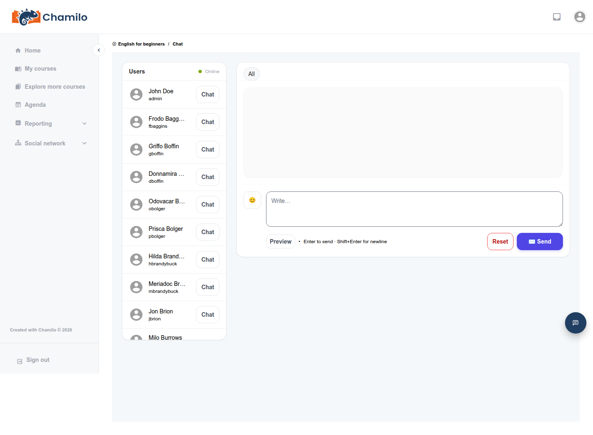

# Verwendung des Chat-Werkzeugs

Einige Kurse enthalten ein **Chat**-Werkzeug — Echtzeit-Textnachrichten, die an den jeweiligen Kurs gebunden sind und sich für kurze Austausche oder Live-Fragen und -Antworten eignen, solange eine Lehrkraft anwesend ist.

## Nachrichten senden

Öffnen Sie das **Chat**-Werkzeug über die Kursstartseite. Sie sehen eine Liste **Benutzer** aller Personen, die derzeit im Kurs online sind, jeweils mit einer eigenen Schaltfläche **Chat**, sowie eine Registerkarte **Alle** für die gesamte Gruppe:

Wählen Sie eine Person (oder **Alle**) und geben Sie Ihre Nachricht in das Feld unten ein. Drücken Sie **Enter**, um sie zu senden, oder **Shift+Enter**, um eine neue Zeile zu beginnen, ohne zu senden. Mit der Option **Vorschau** können Sie die Formatierung vor dem Senden prüfen, und **Zurücksetzen** löscht den eingegebenen Text.

## Wenn der Chat auf Tutoren beschränkt ist

Ihre Administration kann den Kurschat so einschränken, dass nur Ihre Lehrkraft (oder andere Kurstutorinnen und -tutoren) Beiträge verfassen kann — in diesem Fall können alle anderen lesen, aber nicht direkt teilnehmen. Wenn Sie in einem Kurschat keine Nachricht senden können, ist diese Einstellung der wahrscheinlichste Grund und kein Fehler.

## Nicht zu verwechseln mit

Chamilo verfügt über drei verschiedene Funktionen, die alle mit Nachrichten zu tun haben, und sie lassen sich leicht verwechseln:

* **Dieses Kurs-Chat-Werkzeug** — in Echtzeit, an einen bestimmten Kurs gebunden und nur über die Startseite dieses Kurses erreichbar.
* **[Posteingang](../inbox.md)** — private, asynchrone Nachrichten an beliebige Personen auf der Plattform, unabhängig von einem bestimmten Kurs.
* **Das schwebende Chat-Panel** (unten auf dem Bildschirm, fast überall verfügbar) — dient dem direkten Nachrichtenaustausch, [Einzelvideoanrufen](../video-calls.md), sofern aktiviert, und dem [KI-Tutor](ai-tutor.md), unabhängig von diesem Kurswerkzeug.

Wenn Sie eine der beiden anderen Funktionen suchen, lesen Sie die jeweiligen Seiten.

## Tipps

* **Nutzen Sie es für Live-Austausche im Moment** — für alles, das Sie später wiederfinden möchten, verwenden Sie stattdessen das [Forum](using-the-forum.md).
* **Prüfen Sie, ob eine Live-Chat-Sitzung geplant ist** — Lehrkräfte kündigen manchmal bestimmte Zeiten an, zu denen sie im Kurschat erreichbar sind, häufig über die Agenda.
* **Wenn in Ihrem Kurs Videokonferenzen eingerichtet sind**, bevorzugt Ihre Lehrkraft diese für Live-Sitzungen möglicherweise gegenüber dem Textchat.