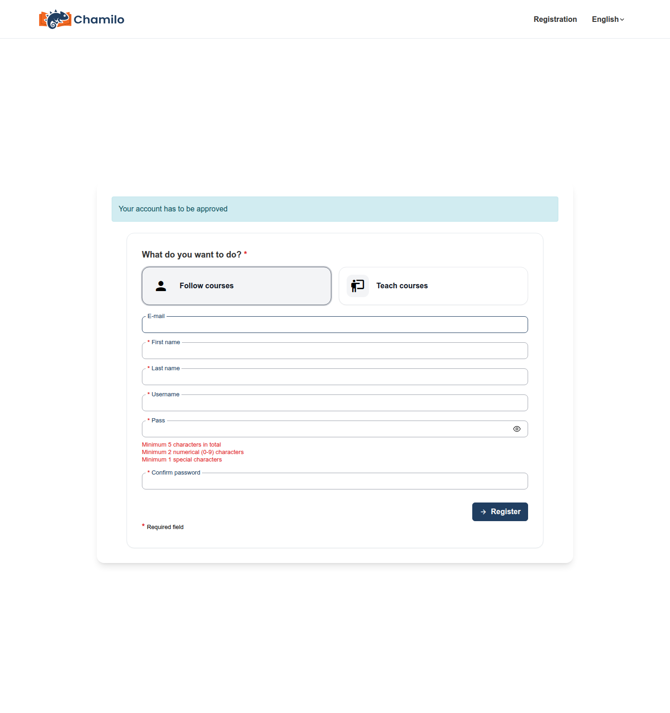

# Ein Konto erstellen

Ob Sie selbst ein Konto erstellen können, hängt davon ab, wie Ihre Plattform konfiguriert ist. Diese Seite beschreibt, was Sie vom Formular zur Selbstregistrierung erwarten können und was geschieht, wenn es für Sie nicht verfügbar ist.

## Wenn die Selbstregistrierung nicht verfügbar ist

Nicht jede Chamilo-Plattform erlaubt es Besuchern, sich selbst zu registrieren — eine Schule oder ein Unternehmen bevorzugt es häufig, Konten für ihre Mitglieder direkt anzulegen oder die Registrierung auf Personen zu beschränken, die eine bestimmte Einladung erhalten haben. Wenn Sie auf der Anmeldeseite keinen Link **Registrieren** (oder **Sign up**) sehen, ist dies der Grund. In diesem Fall:

* Bitten Sie Ihre Einrichtung oder die Plattformadministration, ein Konto für Sie zu erstellen, oder
* Bitten Sie Ihre Lehrkraft um eine **Kurseinladung** — einen einmaligen Link, der an Ihre E-Mail-Adresse gesendet wird und es Ihnen ermöglicht, sich direkt zu registrieren, auch auf einer Plattform, auf der die allgemeine Registrierung geschlossen ist, und der Sie nach Abschluss sofort in den Kurs dieser Lehrkraft einschreibt. Siehe [Was die eingeladene Person sieht](../../teacher-guide/assessing-learners/subscribing-users.md#what-the-invited-person-sees), um zu erfahren, wie dies aus Ihrer Sicht aussieht.

## Das Registrierungsformular ausfüllen

Wenn die Selbstregistrierung aktiviert ist, klicken Sie auf der Anmeldeseite auf **Registrieren**. Das Formular fragt je nach Konfiguration durch Ihre Administration nach einer Kombination der folgenden Angaben:

* E-Mail-Adresse und/oder Benutzername
* Vor- und Nachname
* Passwort (mit einer Stärkeanzeige während der Eingabe)
* Telefonnummer, Sprache, offizieller Code oder Geburtsdatum
* Zusätzliche Profilfelder, die für Ihre Plattform spezifisch sind

Sie müssen sich keine Sorgen machen, wenn Ihr Formular von dieser Liste abweicht — Administratoren können einzelne Felder einblenden, ausblenden oder als Pflichtfelder festlegen.

## Dieses Formular erstellt nur Lernendenkonten

Standardmäßig bietet das öffentliche Registrierungsformular überhaupt keine Möglichkeit, sich als Lehrkraft zu registrieren — jedes darüber erstellte Konto ist ein Lernendenkonto. Es gibt kein Dropdown-Menü, kein Kontrollkästchen und keine deaktivierte Option, die auf eine Lehrkraftrolle hinweist; diese Auswahl ist schlicht nicht Teil des Formulars.

Einige Plattformen aktivieren einen Schritt **„Was möchten Sie tun?“** mit zwei Karten — **Kursen folgen** und **Kurse unterrichten** —, dieser erscheint jedoch nur, wenn Ihre Administration die Registrierung als Lehrkraft ausdrücklich aktiviert hat. Selbst dann kann die Entscheidung zu unterrichten erfordern, dass Ihr Konto genehmigt wird, bevor Sie Lehrkraftrechte erhalten.

Wenn Sie ein Lehrkraftkonto benötigen und diese Option nicht sehen, bitten Sie Ihre Plattformadministration, eines für Sie zu erstellen oder Ihr bestehendes Konto hochzustufen.

## Nutzungsbedingungen und CAPTCHA

Je nach Konfiguration Ihrer Plattform kann das Formular außerdem Folgendes enthalten:

* Ein Kontrollkästchen **Nutzungsbedingungen** nahe dem unteren Rand des Formulars („Ich habe die Nutzungsbedingungen gelesen und stimme ihnen zu“), wobei der vollständige Text in einem scrollbaren Feld darüber angezeigt wird.
* Eine **CAPTCHA**-Aufgabe am Ende des Formulars, bei der Sie die in einem Bild gezeigten Buchstaben eingeben sollen. Siehe [CAPTCHA](../account-and-security/captcha.md), warum dies vorhanden ist.

Auf einigen Plattformen zeigt das Absenden des Formulars einen Bestätigungsschritt („Sie bestätigen, dass Sie sich wirklich auf dieser Plattform registrieren möchten.“), bevor Ihr Konto tatsächlich erstellt wird — dies ist eine Schutzmaßnahme gegen versehentliche Übermittlungen, kein zusätzlicher Genehmigungsschritt.

## Was nach dem Absenden geschieht

Je nachdem, wie Ihre Administration die Registrierung konfiguriert hat, geschieht eines von drei Dingen:

* **Sie werden sofort angemeldet** — die häufigste Einstellung, insbesondere bei offenen Plattformen.
* **Ihr Konto muss genehmigt werden** — Ihr Konto wird erstellt, bleibt jedoch deaktiviert, bis eine Administration es manuell genehmigt. Sie werden benachrichtigt, sobald dies geschehen ist.
* **Sie müssen Ihre E-Mail-Adresse bestätigen** — Sie erhalten einen Bestätigungslink per E-Mail; Ihr Konto bleibt deaktiviert, bis Sie darauf klicken.

Wenn Sie nicht sicher sind, welcher Fall auf Sie zutrifft, und nach der Registrierung scheinbar nichts geschieht, prüfen Sie Ihren Posteingang (einschließlich Spam) auf eine Nachricht der Plattform oder wenden Sie sich an Ihre Administration.

## Tipps

* **Verwenden Sie eine E-Mail-Adresse, die Sie regelmäßig prüfen** — darüber erhalten Sie Passwortzurücksetzungen, Kurseinladungen und Kontobestätigungen.
* **Wählen Sie ein starkes Passwort** — die Stärkeanzeige im Formular gibt Ihnen während der Eingabe eine Rückmeldung in Echtzeit.
* **Sie können sich überhaupt nicht registrieren?** Wenden Sie sich an die Person, die Ihre Plattform verwaltet — eine geschlossene Selbstregistrierung ist auf vielen institutionellen und unternehmensinternen Plattformen eine bewusste Entscheidung.