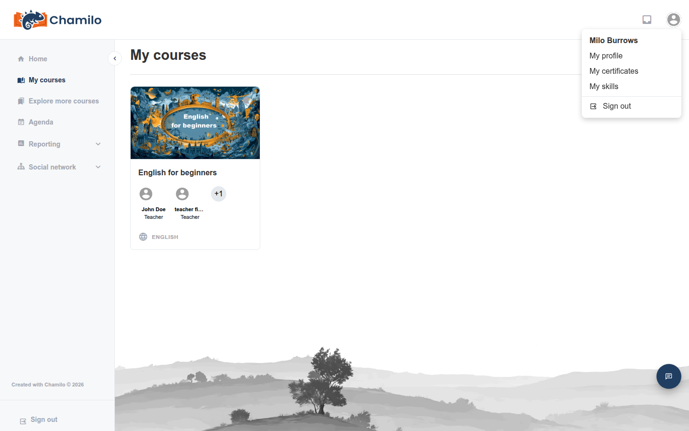
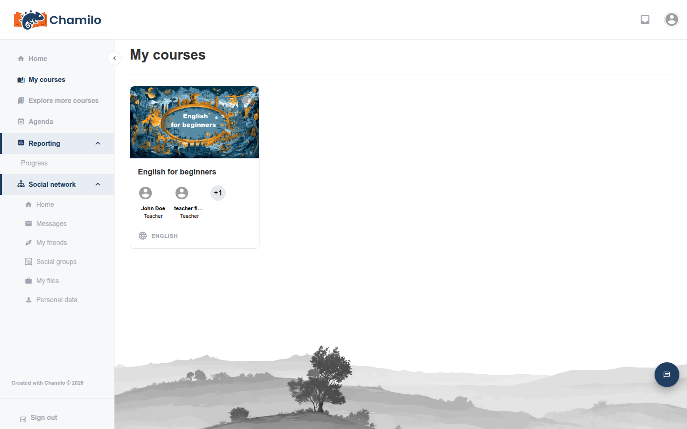

# Die Benutzeroberfläche verstehen

Chamilo 3.0 verfügt über eine klare, moderne Benutzeroberfläche, die die Navigation einfach halten soll. Diese Seite erläutert jeden Teil der Benutzeroberfläche aus der Sicht einer lernenden Person.

## Die obere Leiste

Die obere Leiste ist auf jeder Seite stets oben sichtbar. Sie enthält:

* **Plattformlogo** — Klicken Sie darauf, um jederzeit zur Startseite zurückzukehren.
* **Posteingang-Symbol**  — Zeigt Ihre Nachrichten an. Ein rotes Kennzeichen weist auf ungelesene Nachrichten hin. Klicken Sie darauf, um Ihren [Posteingang](../inbox.md) zu öffnen.
* **Support-Ticket-Symbol**  — Wenn Ihre Administration dies aktiviert hat, erhalten Sie darüber Zugang zum Support-Ticket-System. Nicht jede Plattform aktiviert diese Funktion; möglicherweise sehen Sie daher nur das Posteingang-Symbol und Ihren Avatar.
* **Ihr Avatar** — Ein kreisförmiges Bild in der oberen rechten Ecke. Klicken Sie darauf, um ein Dropdown-Menü zu öffnen:

* **Mein Profil** — Bearbeiten Sie Ihre persönlichen Angaben, ändern Sie Ihr Passwort und richten Sie (sofern aktiviert) die Zwei-Faktor-Authentifizierung ein
* **Meine Zertifikate** — Alle Zertifikate, die Sie in sämtlichen Ihrer Kurse erworben haben
* **Mein Transcript** — Wenn Ihre Plattform Transcripts verwendet, das [Transcript](../account-and-security/my-transcript.md) der von Ihnen abgeschlossenen Kurse
* **Meine Kompetenzen** — Kompetenzabzeichen, die Ihnen verliehen wurden
* **Abmelden**

## Die Seitenleiste

Die Seitenleiste links ist Ihre Hauptnavigation. Sie lässt sich einklappen, um dem Inhaltsbereich mehr Platz zu geben. Klicken Sie auf den Umschaltpfeil an ihrem rechten Rand, um sie ein- oder auszuklappen. Chamilo speichert Ihre Einstellung.

Die Seitenleiste enthält die folgenden Links (einige können je nach Konfiguration Ihrer Plattform ausgeblendet sein):

| Menüpunkt | Symbol | Beschreibung |
|-----------|------|-------------|
| **Startseite** |  | Kehrt zum Haupt-Dashboard zurück |
| **Meine Kurse** |  | Listet alle Kurse auf, in denen Sie eingeschrieben sind |
| **Meine Sitzungen** |  | Listet Ihre Schulungssitzungen auf (aktuell, vergangen, bevorstehend) |
| **Weitere Kurse entdecken** |  | Durchsuchen Sie den Kurskatalog, um neue Kurse zu finden und sich selbst einzuschreiben |
| **Agenda** |  | Ihr persönlicher Kalender und der Kurskalender |
| **Berichte** |  | Klappt zu **Fortschritt** auf — Ihre eigene Übersicht [Mein Fortschritt](../my-progress.md) |
| **Soziales Netzwerk** |  | Klappt zum [Sozialen Netzwerk](../social-network.md) und zugehörigen Links auf, sofern aktiviert |
| **Videokonferenz** |  | Zugang zu Live-Videositzungen (sofern konfiguriert) |

**Berichte** und **Soziales Netzwerk** sind keine einfachen Links — ein Klick darauf klappt eine kleine Liste von Unterpunkten direkt in der Seitenleiste auf:

* Unter **Berichte**: nur **Fortschritt**, der Sie zu [Mein Fortschritt](../my-progress.md) führt.
* Unter **Soziales Netzwerk**: **Startseite** (die soziale Pinnwand), **Nachrichten** (eine Verknüpfung zu Ihrem [Posteingang](../inbox.md)), **Meine Freunde**, **Soziale Gruppen** — und, etwas unerwartet ebenfalls hier eingeordnet, **Meine Dateien** (Ihr persönlicher Dateispeicher) sowie **Persönliche Daten** (ein Export der persönlichen Daten, die die Plattform über Sie speichert). Diese beiden letzten Punkte sind keine eigentlichen „sozialen“ Funktionen; sie befinden sich lediglich in diesem Teil der Seitenleiste.

Wenn Ihr Konto über zusätzliche Rollen verfügt (wenn Sie beispielsweise auch einen Kurs unterrichten), sehen Sie möglicherweise weitere Einträge in der Seitenleiste — etwa **Administration** —, die ein reines Lernendenkonto niemals sieht.

Ganz unten in der Seitenleiste finden Sie die Option **Abmelden**, um sich schnell abzumelden, wenn Sie fertig sind. Diese Option ist auch über das Dropdown-Menü Ihres Avatar-Symbols in der oberen rechten Ecke verfügbar.
Wenn die Plattform über externe Authentifizierungsmethoden verwaltet wird, stehen diese Abmeldeoptionen möglicherweise nicht zur Verfügung.

## Der Hauptinhaltsbereich

Der zentrale Bereich des Bildschirms zeigt den Inhalt der aktuellen Seite an. Oben sehen Sie häufig eine **Brotkrumen-Navigation**, die Ihren aktuellen Standort in der Plattform anzeigt (zum Beispiel: Startseite > Rockmusik > Dokumente). Nutzen Sie die Brotkrumen, um zu einer übergeordneten Seite zurückzukehren.

## Die Kursstartseite

Wenn Sie einen Kurs betreten, sehen Sie die **Kursstartseite**:

* **Kurstitel** — Wird oben prominent angezeigt
* **Kurseinführung** — Eine optionale Rich-Text-Beschreibung, die von Ihrer Lehrkraft verfasst wurde
* **Werkzeugraster** — Ein Raster von Symbolen, die die in diesem Kurs verfügbaren Werkzeuge darstellen (Dokumente, Übungen, Foren usw.)

Im Raster erscheinen nur die Werkzeuge, die Ihre Lehrkraft sichtbar gemacht hat — siehe [Sich in einem Kurs zurechtfinden](../courses/course-tools-overview.md), um zu erfahren, was jedes davon bewirkt. Steuerelemente zum Bearbeiten des Kurses selbst (Vorschau als Lernende oder Lernender, Ein-/Ausblenden von Werkzeugen, Neuanordnen) erscheinen nur Lehrkräften und Kursadministratoren — in einem Kurs, in dem Sie als Lernende oder Lernender eingeschrieben sind, sehen Sie sie nicht.

## Symbolfarben

Dies ist in Chamilo 3.0 noch experimentell und nicht vollständig umgesetzt, wir versuchen jedoch, die folgenden Regeln für alle Schaltflächen und Aktionssymbole in der Benutzeroberfläche anzuwenden:

* **Grün** für Erstellungsaktionen. Dazu gehören das Hinzufügen, Erstellen, Importieren, Speichern und Kopieren von Inhalten.
* **Blau** für Ansichtsaktionen. Dazu gehören das Exportieren, Anzeigen, die Vorschau in Listen oder Detailansichten, das Suchen und Herunterladen.
* **Orange** für Bearbeitungsaktionen. Dazu gehören das Bearbeiten, Verschieben, Konfigurieren, Aktivieren/Deaktivieren, Ausblenden und Einblenden.
* **Rot** für Lösch-/Entfernungsaktionen. Dazu gehören das Löschen, Entfernen und Abmelden.
* **Grau** für Abbruchaktionen. Dabei bleibt der bisherige Zustand unverändert.

## Responsives Design

Chamilo 3.0 passt sich an unterschiedliche Bildschirmgrößen an. Auf einem Mobilgerät oder in einem schmalen Browserfenster:

* Die Seitenleiste ist standardmäßig ausgeblendet und kann durch Tippen auf das Menüsymbol geöffnet werden
* Kurskarten werden in einer einzelnen Spalte statt in einem Raster angezeigt
* Tabellen werden horizontal scrollbar

Das bedeutet, dass Sie von einem Telefon, Tablet oder Computer aus auf Ihre Kurse zugreifen können, auch wenn die Benutzeroberfläche je nach Gerät leicht unterschiedlich aussehen kann.