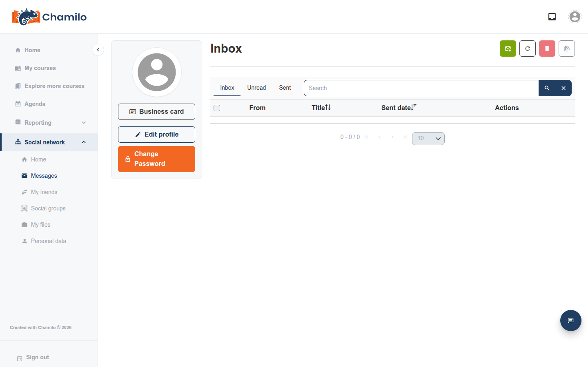

# Posteingang

Der **Posteingang** ist das private Nachrichtensystem von Chamilo — asynchrone, E-Mail-ähnliche Nachrichten zwischen Ihnen und anderen Benutzerinnen und Benutzern der Plattform, unabhängig von einem bestimmten Kurs.

## Auf Ihren Posteingang zugreifen

Klicken Sie in der oberen Leiste auf das Symbol **Posteingang** . Ein rotes Kennzeichen zeigt an, wie viele ungelesene Nachrichten Sie haben. Wenn dieses Symbol überhaupt nicht vorhanden ist, hat Ihre Administratorin oder Ihr Administrator die Plattformnachrichten deaktiviert.

## Lesen und Antworten

Ihr Posteingang listet empfangene Nachrichten auf und zeigt an, welche ungelesen sind. Öffnen Sie eine Nachricht, um sie zu lesen, und verwenden Sie **Antworten**, um zu reagieren — Sie können mehrere Empfängerinnen und Empfänger gleichzeitig in eine Antwort aufnehmen. Das ist nützlich, um eine kleine Gruppe von Personen auf dem Laufenden zu halten, ohne einen formalen Kurs oder eine soziale Gruppe einzurichten.

## Aus der E-Mail antworten

Wenn Ihre Administratorin oder Ihr Administrator E-Mail-Antworten für Direktnachrichten aktiviert hat, enthält die Benachrichtigungs-E-Mail zu einer Chamilo-Nachricht eine spezielle Antwortadresse. Sie können aus Ihrem normalen E-Mail-Programm antworten; Chamilo prüft die Antwort und fügt sie derselben Unterhaltung in Ihrem Posteingang hinzu.

Senden Sie die Antwort von derselben E-Mail-Adresse, die in Ihrem Chamilo-Konto registriert ist, und schreiben Sie Ihre Antwort oberhalb der Markierung **Reply above this line**. Nicht jede Plattformbenachrichtigung ist beantwortbar — diese Funktion gilt für Benachrichtigungen zu Direktnachrichten, wenn die Administratorin oder der Administrator den eingehenden E-Mail-Verkehr konfiguriert hat.

## Eine neue Nachricht verfassen

Klicken Sie auf die Schaltfläche **neue Nachricht** , wählen Sie eine oder mehrere Empfängerinnen und Empfänger aus, schreiben Sie einen Betreff und einen Nachrichtentext und senden Sie die Nachricht. Genau wie eine Antwort kann eine neue Nachricht gleichzeitig an mehrere Personen gehen.

## Einen Funktionsgraphen einfügen

Sie können einer neuen Posteingangsnachricht oder einer Antwort einen Graphen einer mathematischen Funktion hinzufügen:

1. Wählen Sie im Nachrichten-Editor **Graph** (die Aktion **Insert graph**).
2. Geben Sie eine Funktion von `x` ein, zum Beispiel `x^3`, `sin(x)` oder `2*x+1`.
3. Wählen Sie **Insert graph**, prüfen Sie das Ergebnis in Ihrer Nachricht und senden Sie sie.

Der Ausdruck kann `x`, Zahlen, `pi`, `e`, Klammern, `+`, `-`, `*`, `/`, `^` sowie die Funktionen `sin`, `cos`, `tan`, `sqrt`, `abs`, `log` und `exp` verwenden. Verwenden Sie `*` für die Multiplikation und Klammern für Funktionsargumente. Ausdrücke sind auf 120 Zeichen begrenzt. Der Graph zeigt ein festes Fenster von ungefähr **x = -3 bis 3** und **y = -10 bis 10**; Werte außerhalb dieses Fensters werden nicht angezeigt.

Empfängerinnen und Empfänger können den gerenderten Graphen in der Posteingangsnachricht ansehen. Diese Funktion ist unabhängig vom Schreiben [mathematischer LaTeX-Formeln](../teacher-guide/adding-content/math-formulas.md); sie stellt unterstützte Funktionen grafisch dar, anstatt beliebige Skripte oder eine vollständige Sprache für grafikfähige Taschenrechner auszuwerten. Siehe [PR #9439](https://github.com/chamilo/chamilo-lms/pull/9439).

## Registerkarten und Aktionen

Neben Ihrem **Posteingang** zeigt eine Registerkarte nur Ihre **Ungelesen**-Nachrichten und eine weitere **Gesendet** — was Sie gesendet haben, zu Ihrer eigenen Orientierung. Ein Suchfeld ermöglicht es Ihnen, eine Nachricht anhand eines Schlüsselworts zu finden. Mit den Schaltflächen oberhalb der Liste können Sie eine neue Nachricht verfassen, aktualisieren, ausgewählte Nachrichten löschen und ausgewählte Nachrichten als gelesen markieren.

## Status der E-Mail-Benachrichtigung

Wenn Ihre Administratorin oder Ihr Administrator die Nachverfolgung des Öffnens von E-Mails aktiviert hat, kann die Liste **Gesendet** ein Datum unter **E-Mail-Benachrichtigungen** für Nachrichten anzeigen, deren Tracking-Bild für die Benachrichtigung angefordert wurde. Dies ist nur ein Hinweis darauf, dass die E-Mail möglicherweise geöffnet wurde; es ist kein Nachweis dafür, dass sie gelesen wurde.

## Nachrichten-Tags

Wenn Ihre Plattform Nachrichten-Tags verwendet, sehen Sie in Ihrem Posteingang eine Tag-Liste, auf die Sie klicken können, um Nachrichten nach diesem Tag zu filtern — praktisch, um zusammengehörige Unterhaltungen leicht auffindbar zu halten, wenn Ihr Posteingang wächst.

## Beziehung zu anderen Nachrichtenfunktionen

Der Posteingang ist unabhängig vom Kurswerkzeug [Chat](courses/using-the-chat-tool.md) und vom schwebenden Chat-Bereich, der für Direktnachrichten und den [KI-Tutor](courses/ai-tutor.md) verwendet wird — jedes davon ist eine tatsächlich eigenständige Funktion, auch wenn bei allen Nachrichten ausgetauscht werden. Das [Soziale Netzwerk](social-network.md) verwendet, sofern es aktiviert ist, denselben Posteingang für private Nachrichten, anstatt einen eigenen zu haben.

## Tipps

* **Achten Sie auf das Kennzeichen am Posteingangssymbol** — das ist der schnellste Weg, neue Nachrichten zu bemerken, ohne die Seite zu öffnen.
* **Verwenden Sie den Posteingang für alles, was nicht an einen einzelnen Kurs gebunden ist** — kursspezifische Diskussionen gehören in der Regel stattdessen in das Forum oder den Chat dieses Kurses.
* **Der Link „Nachrichten“ des Sozialen Netzwerks führt zu demselben Posteingang** — Sie verpassen kein separates Postfach, wenn Sie ihn von dort statt über die obere Leiste erreichen.