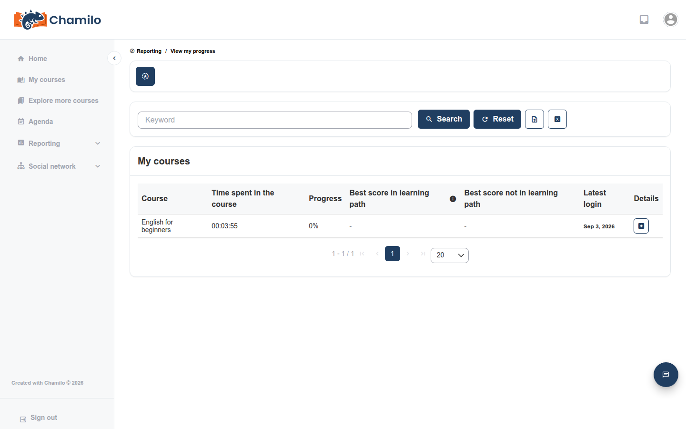
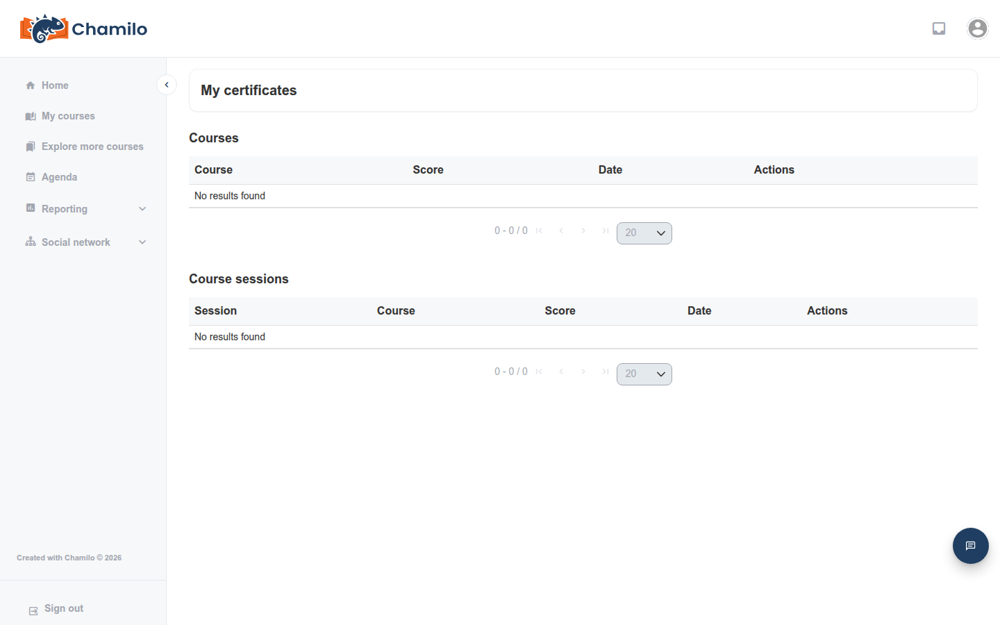

# Mein Fortschritt

**Mein Fortschritt** bietet Ihnen einen einzigen, schnellen Überblick über Ihre Aktivität und Ihre Ergebnisse in allen Kursen, in denen Sie eingeschrieben sind — Sie müssen nicht jeden Kurs einzeln öffnen, um zu sehen, wo Sie stehen.

## Zugriff

Klicken Sie in der Seitenleiste auf **Berichte** , um den Bereich zu erweitern, und klicken Sie anschließend auf **Fortschritt**. Dies ist Ihre eigene, persönliche Ansicht — sie zeigt ausschließlich Ihre eigenen Daten, nicht die Ihrer Mitlernenden.

## Was Sie sehen

Eine Tabelle listet jeden Kurs auf, in dem Sie eingeschrieben sind, mit:

* **Im Kurs verbrachte Zeit**
* **Fortschritt** — Ihr Abschlussprozentsatz im Lernpfad
* **Beste Punktzahl im Lernpfad** und **beste Punktzahl außerhalb des Lernpfads** — Ihre besten Ergebnisse, getrennt danach, ob sie aus einem in einen Lernpfad eingebetteten Test oder aus einem eigenständigen Test stammen
* **Letzte Anmeldung** — der letzte Zeitpunkt, zu dem Sie auf diesen Kurs zugegriffen haben

Klicken Sie neben einem beliebigen Kurs auf die Schaltfläche **Details**, um drei Untertabellen zu erweitern, ohne die Seite zu verlassen:

* **Tests** — Ihre Versuche, die beste Punktzahl und die Rangfolge unter den Mitlernenden (sofern Ihre Lehrkraft Ranglisten anzeigt)
* **Lernpfade** — verbrachte Zeit, Fortschritt und Punktzahl für jeden Lernpfad
* **Erworbene Kompetenzen** — alle Kompetenzabzeichen, die Sie in diesem Kurs erworben haben

## Ihre Zertifikate

Zertifikate gehören nicht zu dieser Seite — Sie finden sie unter **Meine Zertifikate** im Avatar-Menü oben rechts auf dem Bildschirm. Dort werden alle Kurse und Sitzungen aufgeführt, in denen Sie ein Zertifikat erworben haben, mit der Punktzahl, dem Datum und Schaltflächen zum **Anzeigen** oder **Herunterladen**.

Ihr Avatar-Menü enthält außerdem einen Link **Meine Kompetenzen**, der die Ihnen verliehenen Kompetenzabzeichen auflistet — getrennt von den beiden oben genannten Seiten.

## An anderer Stelle in einem Kurs

Einige verwandte Angaben befinden sich im Kurs selbst und nicht hier:

* Das Werkzeug **Bewertungen** (Notenbuch) zeigt Ihre eigene Punktzahl für diesen Kurs und manchmal Ihre Rangfolge, die beste Punktzahl und den Klassendurchschnitt, sofern Ihre Lehrkraft diese Detailstufe aktiviert hat.
* Aus Ihren Notenbuchergebnissen finden Sie möglicherweise auch eine Option **Abzeichen exportieren** für erworbene Kompetenzen.

## Tipps

* **Prüfen Sie „Mein Fortschritt“ vor einem Gespräch mit einer Lehrkraft** — so sehen Sie am schnellsten Ihren Stand in allen Kursen auf einmal.
* **Verbrachte Zeit und Fortschritt sind nicht dasselbe** — Sie können viel Zeit aufwenden und dennoch wenig Fortschritt erzielen, oder umgekehrt; nutzen Sie beides gemeinsam, um Ihre Leistung einzuschätzen.
* **Zertifikate befinden sich in einem anderen Menü** — denken Sie daran, den Link „Meine Zertifikate“ in Ihrem Avatar zu prüfen und nicht diese Seite, wenn Sie nach einem Zertifikat suchen.