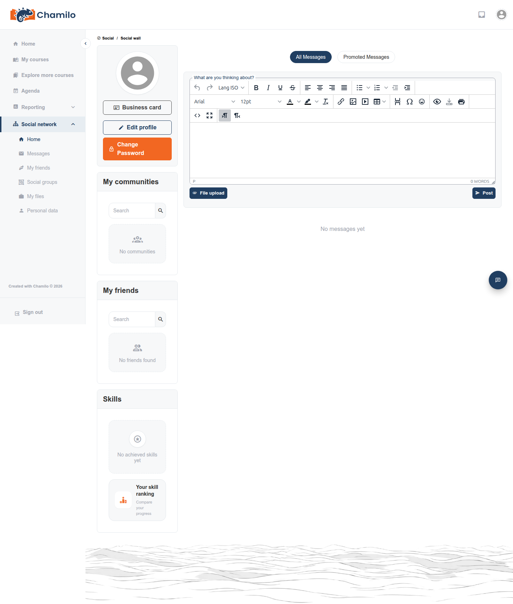

# Soziales Netzwerk

Chamilo enthält ein integriertes soziales Netzwerk, um sich mit anderen Benutzerinnen und Benutzern auf der Plattform zu verbinden — unabhängig von einem bestimmten Kurs. Ob Sie darauf zugreifen können, hängt vollständig von Ihrer Administration ab: Es ist standardmäßig aktiviert, kann aber plattformweit deaktiviert werden.

## Ob Sie Zugriff haben

Klicken Sie in der Seitenleiste auf **Soziales Netzwerk** , um den Bereich zu erweitern, und klicken Sie anschließend auf **Startseite**. Wenn diese Option überhaupt nicht vorhanden ist, hat Ihre Administration sie für Ihre Plattform deaktiviert — auf Ihrer Seite fehlt nichts.

Im selben erweiterten Bereich werden außerdem **Nachrichten**, **Meine Freundinnen und Freunde**, **Soziale Gruppen** aufgeführt — und, etwas unerwartet, **Meine Dateien** (Ihr persönlicher Dateispeicher) sowie **Persönliche Daten** (ein Export der persönlichen Daten, die die Plattform über Sie speichert). Die letzten beiden sind keine sozialen Funktionen; sie sind lediglich in diesem Teil der Seitenleiste zusammengefasst.

## Ihre soziale Pinnwand

Sobald Sie sich darin befinden, zeigt Ihre **Pinnwand** einen Feed mit Aktivitäten von Ihnen und den Personen, mit denen Sie verbunden sind. Sie können Aktualisierungen veröffentlichen und — sofern von Ihrer Administration aktiviert — Beiträge Ihrer Kontakte mit „Gefällt mir“ oder „Gefällt mir nicht“ bewerten und kommentieren.

## Mit anderen in Kontakt treten

Sie können nach anderen Benutzerinnen und Benutzern suchen und ihnen eine Verbindungsanfrage senden. Als **Lernende oder Lernender können Sie sich nur mit anderen Lernenden verbinden** — Sie können keine Verbindungsanfrage an eine Lehrkraft senden. Eine Lehrkraft kann Ihnen hingegen eine solche Anfrage senden. Auf manchen Plattformen konfiguriert die Administration Lehrkräfte so, dass sie automatisch allen Lernenden als Freundinnen und Freunde angezeigt werden, ohne dass eine der beiden Seiten dies anfordern muss — wenn Lehrkräfte bereits als Kontakte aufgeführt sind, ohne dass Sie danach gefragt haben, ist dies der Grund.

## Nachrichten aus dem sozialen Netzwerk

Beiträge und Verbindungen bilden die soziale Seite; das Senden einer privaten Nachricht erfolgt über den separaten [Posteingang](inbox.md) der Plattform — das soziale Netzwerk verweist darauf, anstatt ein eigenes separates Nachrichtensystem zu besitzen.

## Schwebender Chat und Videoanrufe

Das schwebende Chat-Panel ist eine separate Echtzeit-Nachrichtenfunktion, getrennt vom [Posteingang](inbox.md) und vom eigenen Chat-Werkzeug eines Kurses. Wählen Sie einen Online-Kontakt aus, um direkt zu chatten.

Wenn Ihre Administration den Videochat aktiviert hat und Ihr Browser WebRTC unterstützt, kann bei einem Online-Kontakt außerdem **Videoanruf starten** angezeigt werden. Anrufe erfolgen eins zu eins: Ein eingehender Anruf kann **angenommen** oder **abgelehnt** werden, und während des Anrufs können Sie das Mikrofon stummschalten, die Kamera ein- oder ausschalten oder auflegen. Ihr Browser kann die Berechtigung für Kamera und Mikrofon anfordern.

Wenn die Videoaktion nicht angezeigt wird, kann die Funktion von der Administration deaktiviert sein, die andere Person offline sein oder der Browser die erforderlichen Medien-APIs nicht unterstützen.

## Soziale Gruppen

Sie können bestehenden **sozialen Gruppen** beitreten, die sich um gemeinsame Interessen bilden, und — sofern Ihre Administration Lernenden das Erstellen von Gruppen erlaubt — eine eigene Gruppe gründen. Soziale Gruppen gelten plattformweit und stehen in keinem Zusammenhang mit dem eigenen Werkzeug **Gruppen** eines Kurses (siehe [Sich in einem Kurs zurechtfinden](courses/course-tools-overview.md)); der Beitritt zu einer sozialen Gruppe oder das Veröffentlichen darin hat keine Auswirkung auf einen Kurs, in dem Sie eingeschrieben sind.

## Tipps

* **Erwarten Sie nicht, eine Lehrkraft selbst als Freundin oder Freund hinzuzufügen** — dies funktioniert nur in die andere Richtung, sofern Ihre Administration keine automatischen Verbindungen konfiguriert hat.
* **Soziale Gruppen und Kursgruppen sind unabhängig voneinander** — verwechseln Sie eine Kursprojektgruppe nicht mit einer gleichnamigen Gruppe im sozialen Netzwerk.
* **Keine „Gefällt mir“- oder „Gefällt mir nicht“-Bewertungen sichtbar?** Ihre Administration kann diese Funktion plattformweit aktivieren oder teilweise deaktivieren (und nur „Gefällt mir“ beibehalten).