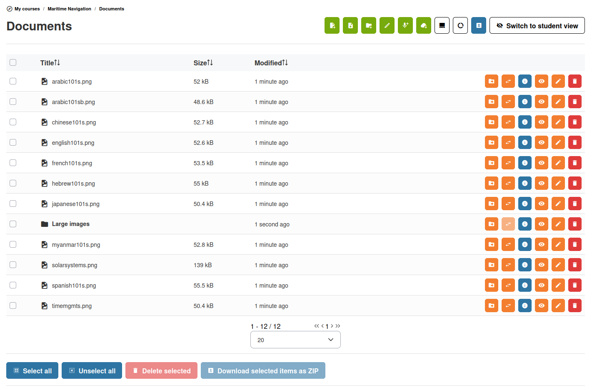

# Dokumente

Das Dokumente-Werkzeug ist die Dateiablage Ihres Kurses. Sie können Dateien hochladen, Dokumente im HTML-Format erstellen, Inhalte in Ordnern organisieren und Lernenden Zugriff auf alle Materialien geben, die sie benötigen.

## Zugriff auf das Dokumente-Werkzeug

Öffnen Sie das Werkzeug **Dokumente**  auf der Kursstartseite. Sie sehen einen Dateibrowser, der den Stammordner der Dokumentenbibliothek Ihres Kurses anzeigt.

## Dateien hochladen

1. Klicken Sie auf die Schaltfläche **Hochladen** 
2. Wählen Sie eine oder mehrere Dateien von Ihrem Computer aus (Sie können Dateien per Drag-and-drop in den Upload-Bereich ziehen)
3. Die Dateien werden hochgeladen und erscheinen im aktuellen Ordner

Chamilo unterstützt die meisten gängigen Dateitypen: PDF, Office-Dokumente (.docx, .odt), Präsentationen (.pptx, .odp), Tabellenkalkulationen (.xlsx, .ods), Bilder (PNG, JPG, SVG, GIF), Audiodateien, Videodateien (einschließlich WEBM), HTML-Dateien und weitere.

Einige Formate können vom Portaladministrator über eine Whitelist-/Blacklist-Filtereinstellung im Sicherheitsbereich der Administration untersagt sein.

Für eine bessere Lesbarkeit für Lernende empfehlen wir, Dateien hochzuladen, die ein Browser ohne zusätzliche Werkzeuge anzeigen oder öffnen kann. Dadurch wird Ihr Kurs portabler und damit für mobile Geräte zugänglicher sowie für Menschen mit besonderen Bedürfnissen besser lesbar.

## Inhalte erstellen

Zusätzlich zum Hochladen von Dateien können Sie Inhalte direkt in Chamilo erstellen:

### Webseiten

1. Klicken Sie auf **Neues Dokument**
2. Verwenden Sie den Rich-Text-Editor, um Ihre Inhalte mit Formatierung, Bildern, Tabellen und Links zu verfassen
3. Geben Sie einen **Titel** für die Seite ein
4. Speichern

Der Rich-Text-Editor (TinyMCE) bietet Funktionen ähnlich einer Textverarbeitung, darunter:

* Textformatierung (fett, kursiv, Überschriften, Listen)
* Tabellen
* Bilder (hochladen oder auf vorhandene Bilder verlinken)
* Eingebettete Videos und Audiodateien
* Links zu anderen Ressourcen
* HTML-Quellbearbeitung für fortgeschrittene Benutzer

### KI-Medienerzeugung

Wenn KI-Hilfen auf der Plattform aktiviert sind, können Sie die KI bitten, ein **Bild** oder ein **kurzes Video** zu erzeugen, um einen Absatz im Dokument zu veranschaulichen, das Sie bearbeiten. Wählen Sie einen Absatz aus, öffnen Sie den Dialog **KI-Medien erzeugen**, und die KI erstellt ein Medienelement, das Sie prüfen und einfügen können. Der Dialog berücksichtigt Berechtigungen auf Kursebene und erscheint nur in Kursen, in denen die KI-Medienerzeugung erlaubt ist.

### Audioaufnahme

Wenn Ihr Browser dies unterstützt, können Sie Audio direkt im Dokumente-Werkzeug aufnehmen — nützlich zum Erstellen von Audioanleitungen oder Inhalten für den Sprachunterricht. Dafür ist eine HTTPS-Konfiguration für Chamilo erforderlich, da die Audioaufnahme eine Technologie verwendet, die der Browser nur bei einer sicheren Verbindung zulässt.

## Organisieren mit Ordnern

Halten Sie Ihre Dokumentenbibliothek mithilfe von Ordnern übersichtlich:

1. Klicken Sie auf **Neuer Ordner** 
2. Geben Sie einen Ordnernamen ein
3. Speichern

Sie können verschachtelte Ordner erstellen, um eine logische Inhaltshierarchie aufzubauen (z. B. `Module 1 > Week 1 > Readings`).

### Dateien verschieben

* Suchen Sie Ihre Datei in der Liste
* Klicken Sie auf **Verschieben** 
* Wählen Sie den Zielordner aus
* Bestätigen

## Dokumente verwalten

Für jede Datei oder jeden Ordner können Sie:

| Aktion | Symbol | Beschreibung |
|--------|------|-------------|
| **Bearbeiten** |  | Die Datei umbenennen oder ihren Inhalt bearbeiten (bei Webseiten) |
| **Löschen** |  | Die Datei oder den Ordner entfernen |
| **Herunterladen** |  | Die Datei auf Ihren Computer herunterladen |
| **Sichtbarkeit** |  | Die Datei für Lernende ausblenden oder anzeigen |
| **Ersetzen** |  | Die Datei durch eine aktualisierte Version ersetzen |
| **Verschieben** |  | In einen anderen Ordner verschieben |

Das Ersetzen einer Datei ist eine wichtige Funktion, wenn Sie Dokumente zum Aufbau von Lernpfaden verwenden, da das Ersetzen des Dokuments eine Aktualisierung ermöglicht, ohne dass Lernende den für dieses Dokument gespeicherten Fortschritt verlieren.

### Massenaktionen

Wählen Sie mehrere Dateien über Kontrollkästchen aus und verwenden Sie dann die Symbolleiste, um alle ausgewählten Elemente auf einmal zu löschen oder herunterzuladen.

#### Mehrere Dokumente gleichzeitig verschieben

Wählen Sie in der Dokumentenliste die Dateien oder Ordner aus, die verschoben werden sollen, und verwenden Sie anschließend die Aktion **Verschieben** für die Auswahl. Wählen Sie den Zielordner und bestätigen Sie. Dadurch werden die ausgewählten Dokumente gemeinsam verschoben, anstatt den Vorgang für jedes Element einzeln zu wiederholen.

Der Vorgang berücksichtigt die Bearbeitungsrechte für Dokumente sowie die bestehenden Schutzmechanismen beim Verschieben von Ordnern; ein Element, für das Ihnen keine Bearbeitungsrechte vorliegen, ist kein gültiges Verschiebeziel. Prüfen Sie nach der Bestätigung den Zielordner und den resultierenden Ordnerinhalt, insbesondere beim Verschieben einer gemischten Auswahl aus Dateien und Unterordnern. Siehe [Massenverschiebung von Dokumenten, PR #9349](https://github.com/chamilo/chamilo-lms/pull/9349).

## OnlyOffice-Integration

Wenn Ihr Administrator das Plugin **OnlyOffice** konfiguriert hat, können Sie Word-, Excel- und PowerPoint-Dateien (oder LibreOffice-Dateien) direkt im Browser bearbeiten, ohne sie herunterzuladen. Achten Sie beim Anzeigen einer unterstützten Datei auf die Option **Mit OnlyOffice bearbeiten** .

Die Dokumente werden in Chamilo gespeichert; OnlyOffice dient lediglich dazu, die Dokumente im Browser **anzuzeigen** oder zu bearbeiten, ohne dass ein zusätzliches Werkzeug erforderlich ist.

## Cloud-Dateien

Wenn Sie Cloud-Speicher (Azure Blob, AWS S3 oder Google Cloud) für Ihre Dateien verwenden, werden diese in der Cloud gespeichert, Sie können sie jedoch von hier aus verknüpfen. Dies ist für Sie und Ihre Lernenden transparent — das Dokumentenwerkzeug funktioniert unabhängig vom Speicher-Backend auf dieselbe Weise.

## Tipps

* **Frühzeitig organisieren** — Erstellen Sie Ihre Ordnerstruktur, bevor Sie Inhalte hochladen, damit Sie später nicht neu organisieren müssen. Wenn Sie andere Kurse mit der passenden Struktur erstellt haben, können Sie diese Kurse später als Vorlage verwenden
* **Aussagekräftige Dateinamen verwenden** — Helfen Sie Lernenden mit klaren, aussagekräftigen Namen, das Benötigte zu finden
* **Unfertige Arbeiten ausblenden** — Verwenden Sie den Sichtbarkeitsschalter, um Dokumente auszublenden, die Sie noch vorbereiten
* **Aus Lernpfaden verlinken** — Verweisen Sie in Ihren Lernpfaden auf Dokumente, um geführte Lernsequenzen zu erstellen
* **Speicherkontingent prüfen** — Wenn Ihr Kurs ein Speicherlimit hat, entfernen Sie veraltete Dateien, um Speicherplatz freizugeben