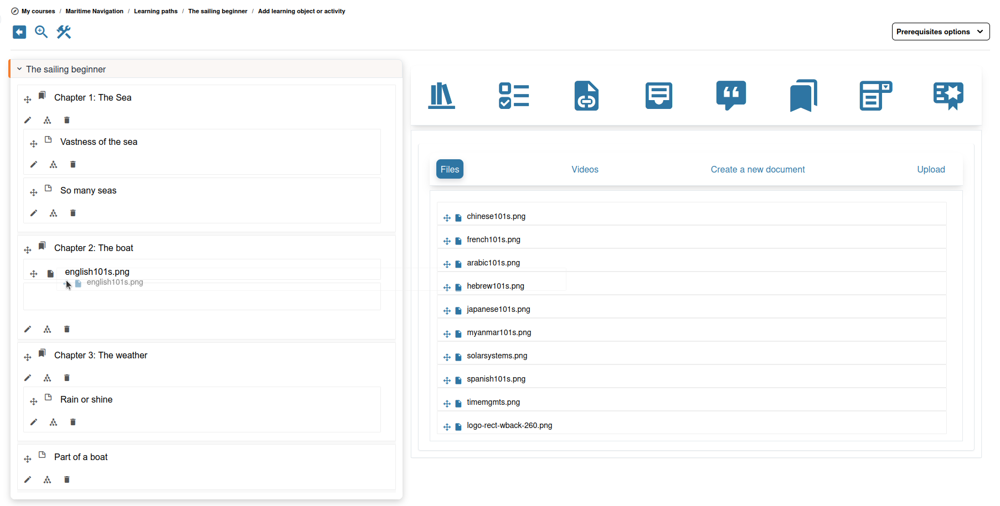
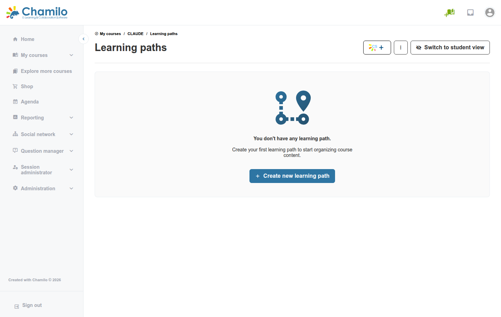
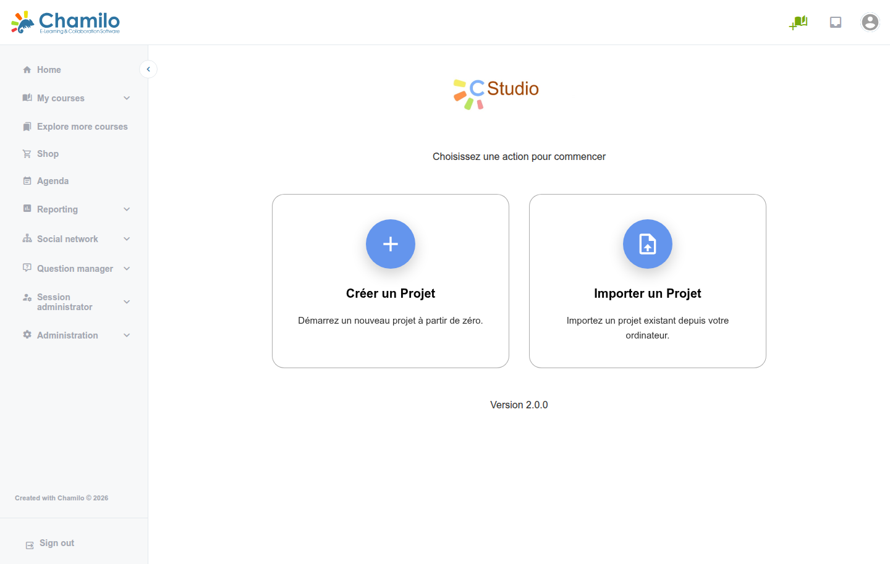
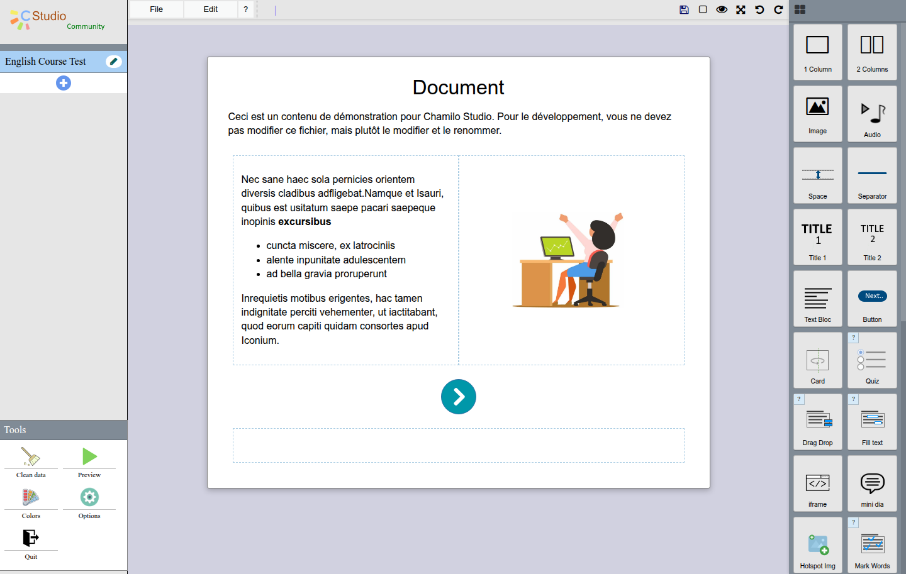
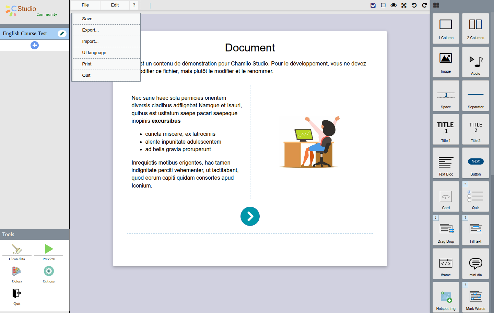

# Lernpfade

Lernpfade ermöglichen es Ihnen, strukturierte Abfolgen von Lernaktivitäten zu erstellen. Ein Lernpfad führt Ihre Lernenden in einer festgelegten Reihenfolge durch Dokumente, Übungen, Links und andere Ressourcen, optional mit Voraussetzungen und Fortschrittsverfolgung.

Dieses Werkzeug ist wohl das am häufigsten verwendete Kurswerkzeug, da es als Komponist für viele andere Werkzeuge dient und durchaus das ***einzige*** Werkzeug sein kann, das den Lernenden gegenübersteht.

## Warum Lernpfade verwenden?

Lernpfade sind nützlich, wenn Sie Folgendes möchten:

* **Die Reihenfolge steuern**, in der Inhalte konsumiert werden — sicherstellen, dass Lernende Grundlagenmaterial abschließen, bevor sie fortfahren
* **Fortschritt verfolgen** — genau sehen, wo sich jede lernende Person in der Abfolge befindet
* **Voraussetzungen festlegen** — von Lernenden verlangen, eine Übung zu bestehen, bevor sie auf den nächsten Abschnitt zugreifen
* **Abschluss auszeichnen** — den Abschluss eines Lernpfads mit dem Notenbuch und Zertifikaten verknüpfen
* **Inhalte bündeln** — eigenständige Lernmodule erstellen, die Lernende in ihrem eigenen Tempo durcharbeiten können

## Einen Lernpfad erstellen

1. Öffnen Sie das Werkzeug **Lernpfade**  auf der Kursstartseite
2. Klicken Sie auf **Lernpfad erstellen**
3. Geben Sie einen **Titel** und eine optionale Beschreibung ein
4. Speichern Sie — Sie gelangen zum Lernpfad-Editor

## Der Lernpfad-Editor

Der Editor hat zwei Hauptbereiche:

* **Linkes Panel** — Die Liste der Elemente (Schritte) im Lernpfad, dargestellt als Baumstruktur
* **Rechtes Panel** — Der Inhalt des ausgewählten Elements

### Elemente hinzufügen

Klicken Sie auf **Element hinzufügen** und wählen Sie aus, was hinzugefügt werden soll:

| Elementtyp | Beschreibung |
|-----------|-------------|
| **Abschnitt** | Eine Überschrift, die zusammengehörige Elemente gruppiert (wie ein Kapiteltitel). Abschnitte enthalten selbst keinen Inhalt. |
| **Dokument** | Eine Datei oder Webseite aus dem Dokumente-Werkzeug Ihres Kurses |
| **Übung** | Ein Quiz oder Test aus dem Übungen-Werkzeug |
| **Link** | Eine externe URL |
| **Aufgabe** | Eine Studierendenarbeit aus dem Aufgaben-Werkzeug |
| **Forum** | Ein Link zu einem Kursforum |
| **Umfrage** | Ein Link zu einer Umfrage |
| **Zertifikat** | Eine spezielle Seite, um die Erstellung eines Abschlusszertifikats oder die Vergabe von Kompetenzen auszulösen |

### Elemente organisieren

* **Ziehen und ablegen** Sie Elemente, um sie neu anzuordnen
* **Elemente verschachteln** unter Abschnitten, indem Sie sie nach rechts ziehen
* **Löschen** Sie Elemente, die Sie nicht mehr benötigen

### Voraussetzungen festlegen

Voraussetzungen stellen sicher, dass Lernende bestimmte Schritte abschließen, bevor sie auf andere zugreifen:

1. Wählen Sie ein Element im Lernpfad aus
2. Öffnen Sie dessen Einstellungen für **Voraussetzungen**
3. Wählen Sie aus, welche vorhergehenden Elemente zuerst abgeschlossen sein müssen
4. Bei Übungen können Sie eine **Mindestpunktzahl** verlangen (z. B. „Mindestens 70 % in Quiz 1 erreichen, bevor auf Modul 2 zugegriffen werden kann“)

### Vorhandene Elemente und ältere Links bearbeiten

Verwenden Sie den **Lernpfad-Editor** (den Vue-Builder), um einen Schritt zu bearbeiten, seine Voraussetzungen anzupassen, ihn im Baum zu verschieben oder zu entfernen. Wählen Sie ein Element aus und verwenden Sie **Bearbeiten**, um dessen Formular zu öffnen (bei verknüpften Testelementen kann die Bearbeitung das Übungen-Werkzeug öffnen); verwenden Sie **Voraussetzungen**, um die Zugriffsanforderungen zu ändern, ziehen Sie Elemente, um ihre Reihenfolge zu ändern, und verwenden Sie die Löschaktion (mit Bestätigung), um ein Element zu entfernen. Diese Änderungen erfordern die Berechtigung, den Lernpfad in seinem Kurs zu bearbeiten.

Ältere Lesezeichen oder Integrationen verweisen möglicherweise noch auf `public/main/lp/lp_controller.php` mit einer Elementaktion wie `edit_item`, `edit_item_prereq`, `move_item`, `delete_item` oder `deleteitem`. Diese Aktionen **leiten nun zum Vue-Builder weiter, anstatt das Element zu ändern**. Ein gültiger Elementlink kann das Element auswählen und das Bearbeitungs- oder Voraussetzungsfenster öffnen; ein früherer Verschiebe- oder Löschlink öffnet nur den Builder, sodass die Lehrkraft diese Aktion dort abschließen muss. Wenn ein Link das beabsichtigte Element nicht öffnet, navigieren Sie vom aktuellen Kurs aus zum Lernpfad und wählen Sie es manuell aus.

## Lernerfahrung

Wenn eine lernende Person einen Lernpfad öffnet:

* Sie sieht die Liste der Elemente im linken Panel
* Abgeschlossene Elemente sind mit einem Häkchen markiert
* Elemente mit nicht erfüllten Voraussetzungen sind gesperrt
* Der Fortschritt wird automatisch verfolgt — wenn eine lernende Person den Pfad verlässt und zurückkehrt, setzt sie dort fort, wo sie aufgehört hat
* Ein Fortschrittsbalken zeigt den Gesamtfortschritt in Prozent

### Externe Links, die nicht eingebettet werden können

Ein externer **Link**-Schritt öffnet normalerweise innerhalb des Lernpfads, wenn die Zielwebsite die Einbettung zulässt. Einige Websites verhindern die Anzeige in einem iframe mit `X-Frame-Options` oder einer Content Security Policy (`frame-ancestors`); eine HTTPS-Chamilo-Seite kann in diesem Ablauf außerdem keine unsichere HTTP-Seite einbetten.

Wenn Chamilo feststellt, dass ein externer Link nicht eingebettet werden kann, zeigt der Player **Dieser Link kann nicht innerhalb des Lernpfads angezeigt werden** mit einem Link **In einem neuen Tab öffnen**. Die Lernenden können diesen Link verwenden, um die Seite separat anzuzeigen und anschließend zum Lernpfad zurückzukehren. Versuchen Sie nicht, die Einbettungsbeschränkungen einer anderen Website zu umgehen.

Ob eine entfernte Seite eingebettet werden kann, hängt von ihren eigenen Antwort-Headern und der Netzwerkverfügbarkeit ab. Dieser Fallback wurde in [PR #9164](https://github.com/chamilo/chamilo-lms/pull/9164) hinzugefügt.

### Forum-Schritte und Diskussionsnavigation

Wenn ein Lernpfad eine **Forum**-Diskussion enthält, lesen die Lernenden die Antworten mit den neuesten Beiträgen zuerst und bleiben dabei im Kontext des Lernpfads. Forumspezifische Zurück-Schaltflächen sind in dieser Ansicht ausgeblendet; verwenden Sie daher die Steuerelemente des Lernpfads, um zum nächsten Schritt zu gelangen. Außerhalb des Lernpfads behält derselbe Thread die Standardnavigation der Foren und die chronologische Anzeige bei. Siehe [Foren](../collaboration-and-communication/forums.md#forum-discussions-inside-a-learning-path) ([PR #9163](https://github.com/chamilo/chamilo-lms/pull/9163)).

## SCORM-Inhalte

Das Lernpfad-Werkzeug von Chamilo kann **SCORM 1.2**-Pakete — den am weitesten verbreiteten E-Learning-Standard — und mit teilweiser Unterstützung **SCORM 2004**-Pakete importieren. Laden Sie eine SCORM-ZIP-Datei hoch, und Chamilo erstellt daraus einen Lernpfad und verfolgt Fortschritt und Punktzahlen gemäß der SCORM-Spezifikation.


**Die Unterstützung für SCORM 2004 ist teilweise.** Inhalte sowie die Verfolgung von Fortschritt und Punktzahlen funktionieren, aber die *Sequenzierungs- und Navigationsregeln* von SCORM 2004 (die steuern, in welcher Reihenfolge Lernende die Inhalte besuchen dürfen) werden nicht angewendet. Lernende können sich frei durch den Lernpfad bewegen, wie in jedem anderen Lernpfad. Verwenden Sie die eigenen [Voraussetzungen](#setting-prerequisites) von Chamilo, wenn Sie eine Reihenfolge erzwingen müssen.


So importieren Sie ein SCORM-Paket:

1. Klicken Sie im Werkzeug **Lernpfade** oben rechts auf der Seite auf die Schaltfläche **⋮** (weitere Aktionen) und anschließend auf **Importieren**

   

2. Klicken Sie auf **Datei auswählen** und wählen Sie die SCORM-Datei `.zip` aus. Entpacken Sie sie nicht vorher — Chamilo erwartet das Paket genau so, wie es von Ihrem Autorentool exportiert wurde.
3. Passen Sie optional die Einstellungen an (siehe unten) und klicken Sie dann auf **Importieren**

   

4. Chamilo entpackt das Paket und erstellt den Lernpfad automatisch. Er erscheint in der Liste der Lernpfade, wo Sie Titel, Sichtbarkeit und andere Einstellungen wie bei jedem anderen Lernpfad bearbeiten können.

| Einstellung | Auswirkung |
| --- | --- |
| **Standardmäßige Höchstpunktzahl von 100 verwenden** | Standardmäßig aktiviert. Lassen Sie die Option aktiviert, sofern Sie keinen besonderen Grund haben, die Behandlung der Höchstpunktzahl des Pakets zu ändern. |
| **Inhalt** (erweitert) | **Lokal** ist die Standardeinstellung und bedeutet, dass das Paket auf Ihrem Chamilo-Server gespeichert wird. Belassen Sie dies für einen normalen Upload unverändert. |
| **Authoring** (erweitert) | Eine Bezeichnung, die festhält, welches Werkzeug das Paket erstellt hat. Der Standardwert (`Scorm`) ist für die meisten Pakete geeignet. |

### CMI5- / xAPI-Pakete

CMI5-Pakete (der moderne, auf xAPI basierende Nachfolger von SCORM) werden über das Plugin **XApi** unterstützt. Sobald Ihr Administrator das Plugin aktiviert hat, können Sie ein CMI5-Paket importieren, und Lernende können es aus dem Kurs starten; ihre Statements werden an den konfigurierten Learning Record Store weitergeleitet.

## Inhaltserstellung mit C-Studio

*Verfügbar, wenn Ihr Administrator das C-Studio-Plugin aktiviert hat.*

C-Studio fügt einen integrierten visuellen Drag-and-drop-Editor hinzu, mit dem Sie interaktive Inhalte direkt in einem Lernpfad erstellen können — eine Alternative zum Import eines SCORM-Pakets, wenn Sie kein separates Autorentool wie Articulate oder iSpring haben (oder erlernen möchten). Sie erstellen die Inhalte Seite für Seite direkt in Chamilo; sie werden wie jedes andere Lernpfadelement gespeichert und verfolgt.

### Ein C-Studio-Projekt starten

Wenn das Plugin aktiv ist, zeigt die Liste der Lernpfade neben dem üblichen Aktionsmenü eine zusätzliche Schaltfläche mit einem „+“ und dem Tooltip „Studio Tools“:

Klicken Sie darauf, um zu beginnen. Sie werden aufgefordert, ein neues Projekt von Grund auf zu erstellen oder ein vorhandenes zu importieren:

Dieser Bildschirm ist derzeit unabhängig von der Plattform- oder Kurssprache nur auf Französisch verfügbar — eine bekannte Einschränkung der verwendeten Plugin-Version. Geben Sie Ihrem Projekt einen Titel, und es öffnet sich direkt im Editor.

### Der Editor

Der Editor ist ein visueller Builder, der Seite für Seite arbeitet:

* **Linker Bereich** — die Seiten Ihres Projekts, mit einem „+“, um weitere hinzuzufügen, und einem Abschnitt **Werkzeuge** unten (Daten bereinigen, Vorschau, Farben, Optionen, Beenden)
* **Mittlere Arbeitsfläche** — die Seite, die Sie erstellen; klicken Sie auf ein beliebiges Element, um es direkt zu bearbeiten
* **Rechter Bereich** — die Komponentenpalette, die auf die Arbeitsfläche gezogen wird

Die Palette umfasst grundlegende Bausteine (Spalten, Bilder, Audio, Titel, Text, Schaltflächen, Karten) sowie mehrere interaktive Aufgabentypen: **Drag Drop**, **Fill text**, **Hotspot Img**, **Mark Words**, **Find Words** und **Sort paragraphs**, außerdem einen **iframe**-Block zum Einbetten externer Inhalte und einen **Quiz**-Block.

### Sprache

Die eigene Oberfläche von C-Studio kann beim ersten Öffnen standardmäßig auf Französisch eingestellt sein, unabhängig von der Sprache der Chamilo-Oberfläche oder der Kurssprache. Wechseln Sie in diesem Fall zu **File > UI language** und wählen Sie Ihre Sprache — der Editor wird sofort neu geladen und merkt sich Ihre Auswahl anschließend.

### Speichern und Exportieren

Verwenden Sie während der Arbeit **File > Save**. **File > Export...** packt Ihr Projekt als SCORM-Datei, die Sie herunterladen, sichern oder an anderer Stelle über **Import...** wiederverwenden können. **File > Quit** führt Sie zurück zur Liste der Lernpfade, in der Ihr C-Studio-Projekt nun als regulärer Eintrag erscheint.

## Einstellungen für Lernpfade

Legen Sie fest, wie sich der Lernpfad verhält:

| Einstellung | Beschreibung |
|---------|-------------|
| **Sichtbarkeit** | Den Lernpfad für Lernende ausblenden oder anzeigen |
| **Voraussetzungen** | Den Abschluss anderer Lernpfade vor diesem Lernpfad verlangen |
| **Automatischer Start** | Diesen Lernpfad automatisch öffnen, wenn Lernende den Kurs betreten |
| **Kumulierte SCORM-Zeit** | Ob die Zeit über mehrere Sitzungen hinweg kumuliert wird |

## Verknüpfung mit dem Notenbuch

Sie können den Abschluss eines Lernpfads als bewertete Aktivität in das Notenbuch aufnehmen. So kann der Fortschritt im Lernpfad zur Gesamtnote des Kurses und zur Zertifikatsberechtigung der Lernenden beitragen.

## Einsatz von KI

Wenn die Administration die KI-gestützte Erstellung von Lernpfaden aktiviert hat, finden Sie im Dropdown-Menü der Aktionen eine Option für den KI-Generator. Geben Sie der KI einen so präzisen Kontext, wie Sie ihn für Ihren Lernpfad wünschen, fordern Sie eine Anzahl von Seiten und eine ungefähre Wortzahl pro Seite an, teilen Sie anschließend mit, ob Sie den Lernpfad mit Tests füllen möchten, und starten Sie die Generierung. Wenige Minuten später liegt ein vollständiger, textbasierter Lernpfad vor Ihnen.

Bearbeiten Sie die Dokumente, um mit weiterer KI Illustrationen zu erzeugen, und es bleibt nur noch eine Durchsicht, bevor Sie den Lernpfad mit Ihren Lernenden teilen können.

### KI-Lernhilfe für Lernende

Wenn die globale Einstellung `ai_helpers.enable_ai_helpers` aktiviert ist, können Lernende beim Lesen eines Dokumentelements im normalen Lernpfad-Player eine **KI-Lernhilfe** verwenden. Sie markieren eine Textpassage, öffnen die kleine KI-Hilfe-Aktion, die neben der Auswahl erscheint, wählen eine **Lerntechnik** und klicken auf **Generieren**.

Die verfügbaren Techniken umfassen Mindmapping, die Feynman-Technik, Elaboratives Hinterfragen, Verteiltes Wiederholen, SQ3R, Analogien und Metaphern, Duale Kodierung, Storytelling, Thematische Verknüpfungen, Verschachteltes Lernen und Gedächtnispaläste. Die erzeugte Erklärung basiert auf der ausgewählten Passage und verwendet den Sprachkontext von Kurs und Benutzer.

Die Hilfe ist nur für Dokumentelemente in der regulären Laufzeitumgebung verfügbar; sie wird weder in Berichten noch im Impress-Modus angezeigt.

## Tipps

* **Beginnen Sie mit einer Gliederung** — Planen Sie Ihre Abschnitte und Elemente, bevor Sie den Lernpfad erstellen
* **Verwenden Sie Abschnitte als Kapitel** — Gruppieren Sie verwandte Elemente unter Abschnittsüberschriften, um die Übersichtlichkeit zu erhöhen
* **Legen Sie Voraussetzungen für Bewertungen fest** — Verlangen Sie, dass Lernende die Inhalte durcharbeiten, bevor sie ein Quiz absolvieren
* **Mischen Sie Inhaltstypen** — Kombinieren Sie Lesematerialien, Videos, interaktive Übungen und externe Ressourcen für ein ansprechendes Lernerlebnis
* **Prüfen Sie die Lernendenansicht** — Verwenden Sie die Funktion „Student View“, um den Lernpfad so zu erleben, wie es ein Lernender tun würde
* **Nutzen Sie SCORM für Interaktivität** — Wenn Sie Zugang zu SCORM-Autorentools (wie Articulate, iSpring oder ähnlichen) haben, erstellen Sie reichhaltige interaktive Inhalte und importieren Sie diese in Chamilo. Wenn Ihr Administrator das C-Studio-Plugin aktiviert hat, können Sie stattdessen ähnliche interaktive Inhalte direkt in Chamilo erstellen — siehe [Inhalte mit C-Studio erstellen](#content-authoring-with-c-studio) oben