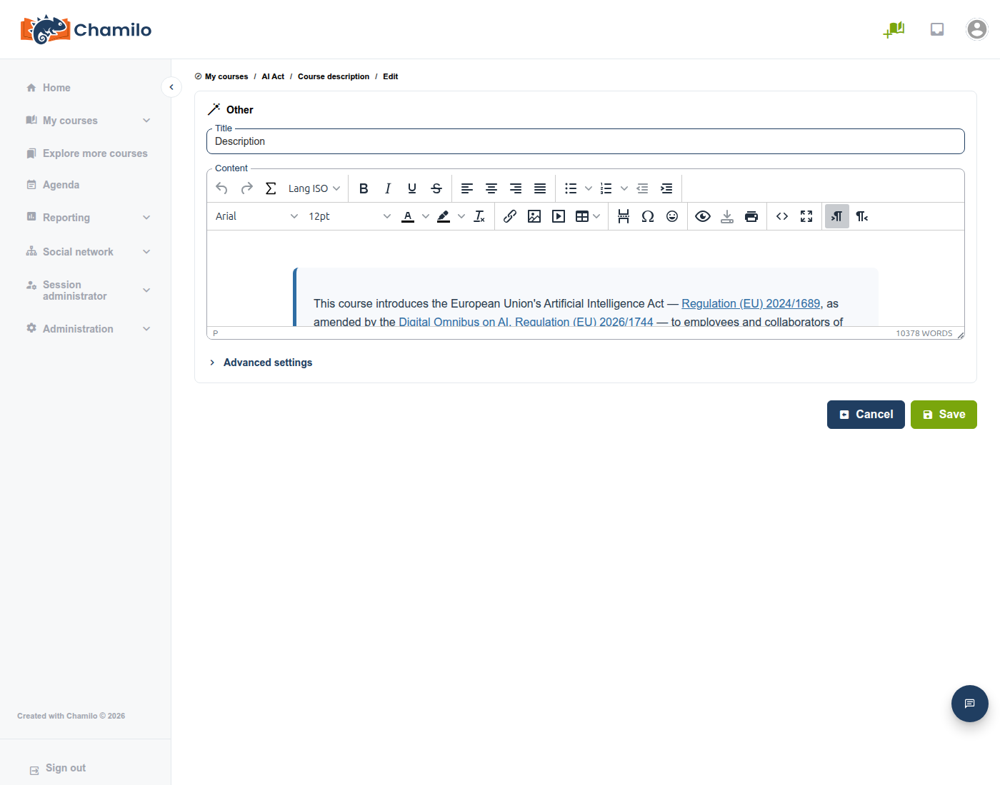
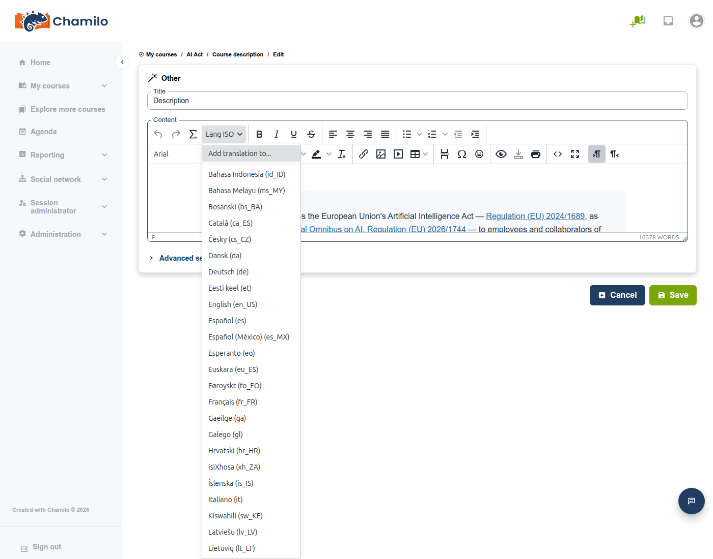
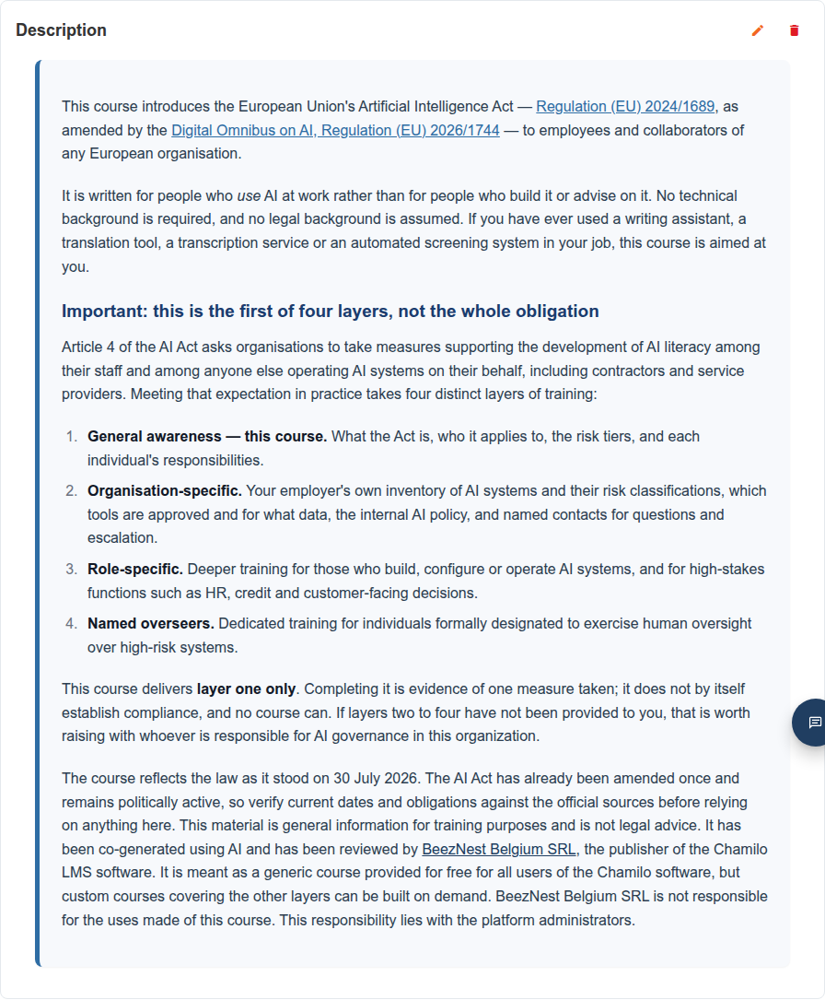
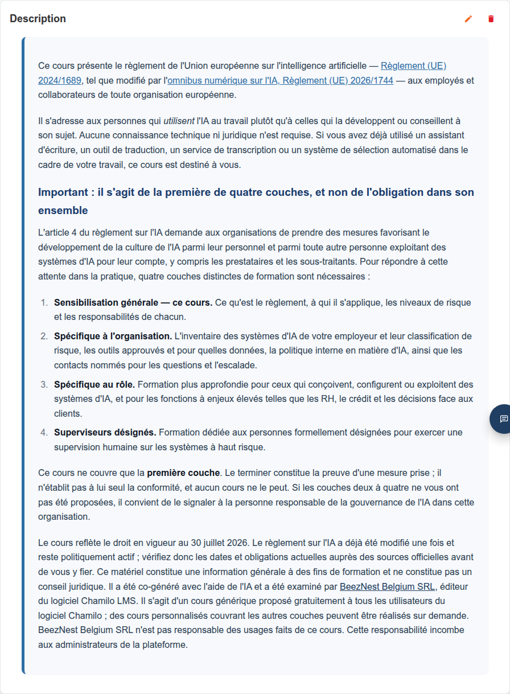
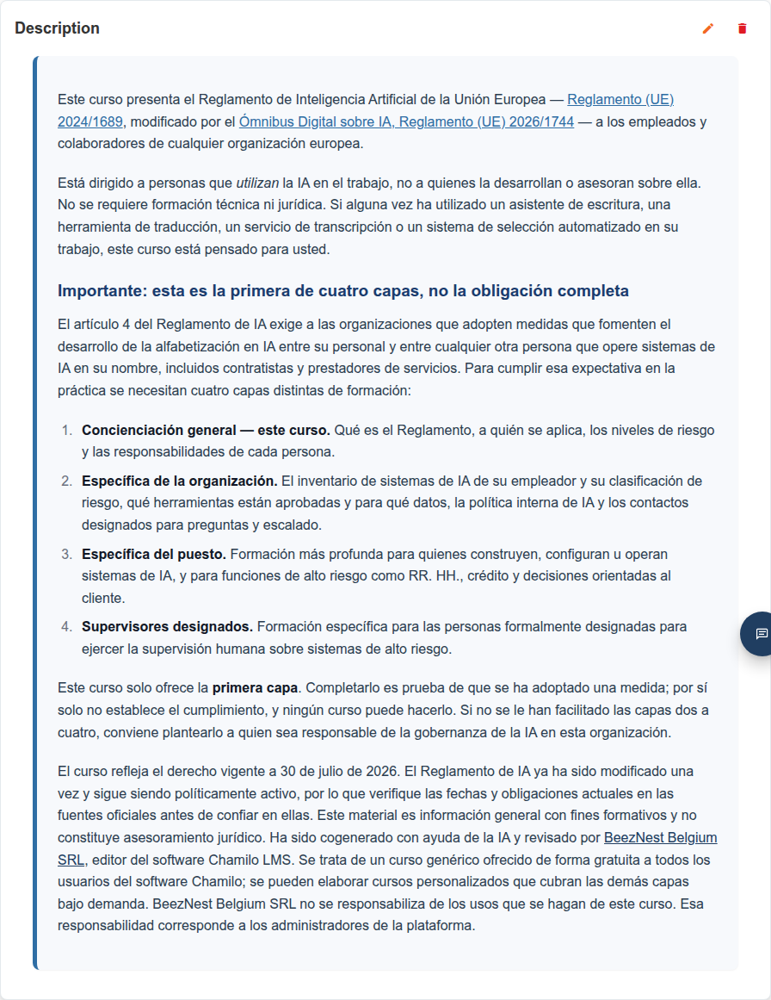
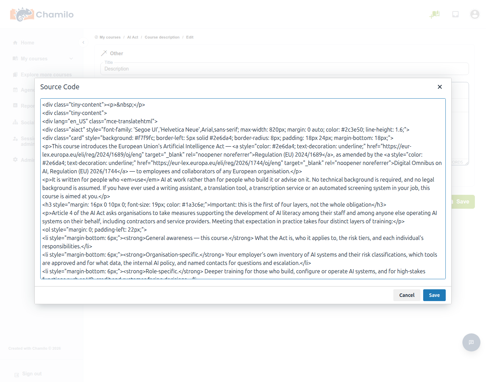

# Mehrsprachige Inhalte

Chamilo ermöglicht es Ihnen, **mehrere Sprachversionen desselben Inhalts in einem einzigen Feld** zu verfassen — einen Abschnitt der Kursbeschreibung, ein Dokument, eine Testfrage, eine Umfrage — und jedem Lernenden automatisch nur die Version in seiner eigenen Sprache anzuzeigen. Dies ist die Funktion **translate_html**, benannt nach der Plattformeinstellung, die sie steuert.

Dabei sind drei verschiedene Personen beteiligt, die jeweils eine andere Seite davon sehen:

* **Ihr Administrator** muss die Funktion plattformweit aktivieren, bevor sie jemand nutzen kann.
* **Sie (die Lehrkraft)** verfassen die verschiedenen Sprachversionen über eine Schaltfläche im Rich-Text-Editor.
* **Der Lernende** profitiert davon, ohne jemals zu wissen, dass die Funktion existiert — er sieht den Inhalt einfach in seiner eigenen Sprache, ohne eine Einstellung suchen oder umschalten zu müssen.

## Die Funktion aktivieren

Dies ist eine Aufgabe des Administrators, nicht der Lehrkraft. Unter **Administration > Configuration settings > Editor** muss die Einstellung **Support multi-language HTML content** (`translate_html`) aktiviert sein. Wenn Sie die unten beschriebene Schaltfläche **Lang ISO** nicht in der Symbolleiste Ihres Editors sehen, ist dies mit ziemlicher Sicherheit der Grund — wenden Sie sich an Ihren Administrator. Die vollständige Übersicht der Einstellungen finden Sie unter [Editor-Einstellungen](../../admin-guide/platform-settings/editor-settings.md). Ab v3.0.0 ist diese Einstellung standardmäßig aktiviert (vor dieser Version war das nicht der Fall), es sei denn, Sie haben von einer früheren Version aktualisiert, in der die Einstellung deaktiviert war.

Wenn Sie diese Einstellung wieder deaktivieren, werden bereits auf diese Weise verfasste Inhalte weder gelöscht noch beschädigt — siehe unten [Was Lernende sehen](#what-learners-see).

## Mehrsprachige Inhalte verfassen

Die Funktion steht überall zur Verfügung, wo Sie den vollständigen Rich-Text-Editor haben: Abschnitte der [Kursbeschreibung](../creating-your-course/course-description.md), [Dokumente](documents.md), Test- und Umfragefragen und mehr.

1. Verfassen (oder fügen Sie ein) den Inhalt in Ihrer Standardsprache wie gewohnt.
2. Markieren Sie diesen Text und klicken Sie dann auf die Schaltfläche **Lang ISO** in der Symbolleiste des Editors.

3. Wählen Sie im Menü die Sprache aus, in der Sie gerade geschrieben haben — die Liste umfasst jede auf Ihrer Plattform aktive Sprache. Wenn die benötigte Sprache nicht aufgeführt ist, verwenden Sie unten **Custom Chamilo ISO code...** und geben Sie sie ein (z. B. `en_US`, `fr_FR`, `es`).

4. Chamilo umschließt Ihre Auswahl mit diesem Sprach-Tag. Verfassen (oder fügen Sie ein) nun direkt danach die Version in der nächsten Sprache, markieren Sie sie und wiederholen Sie den Vorgang mit einer anderen Sprache.

Fahren Sie fort, bis Sie so viele Sprachen abgedeckt haben, wie Sie möchten. Alle befinden sich im selben Feld — während der Bearbeitung sehen Sie jede Sprachversion nacheinander gestapelt; erst wenn jemand die Seite tatsächlich *betrachtet*, blendet Chamilo alles außer der einen Sprache aus, die für diese Person gilt (siehe unten).

### KI-gestützte Übersetzung

Wenn Ihr Administrator einen KI-Textanbieter konfiguriert hat, bietet dasselbe Menü **Lang ISO** oben auch **Add translation to...** an. Dadurch wird Ihr vorhandener Inhalt an das konfigurierte KI-Modell gesendet und ein neuer, automatisch übersetzter Block in der von Ihnen gewählten Sprache eingefügt (oder auf einmal in jeder verbleibenden Sprache, sofern Ihre Plattform dies zulässt) — Sie müssen ihn nicht selbst verfassen. Vorhandene Sprachblöcke bleiben unverändert, und bereits vorhandene Sprachen werden aus der Liste ausgeschlossen, sodass eine wiederholte Nutzung keine Duplikate erzeugt.

Wie bei allen KI-generierten Inhalten sollten Sie das Ergebnis Korrektur lesen — es ist ein schneller Weg zu einem soliden ersten Entwurf in einer Sprache, die Sie selbst möglicherweise nicht sprechen, kein Ersatz für eine Prüfung.

## Was Lernende sehen

Jeder Lernende sieht genau eine Sprachversion: Chamilo versucht zuerst die Profilsprache des Lernenden; wenn keiner Ihrer Blöcke dazu passt, wird auf die eigene Sprache des Kurses und anschließend auf die Standardsprache der Plattform zurückgegriffen; wenn auch keine davon passt, wird die Sprache angezeigt, die Sie zufällig zuerst verfasst haben, anstatt den Inhalt leer zu lassen. All dies geschieht automatisch — der Lernende muss nichts konfigurieren, und auch Sie müssen nichts pro Lernendem konfigurieren.

Hier ist derselbe Abschnitt der Kursbeschreibung, wie ihn drei Lernende mit unterschiedlichen Oberflächensprachen sehen — zwischen diesen drei Screenshots hat sich am Kurs nichts anderes geändert, nur die eigene Sprache der betrachtenden Person:

### Unter der Haube

Wenn Sie die Ansicht **Quellcode** eines mehrsprachigen Feldes öffnen (die Schaltfläche `<>` in der Symbolleiste des Editors), sehen Sie jede Sprachversion wie folgt umschlossen:

Jede Version ist in ein `
` eingeschlossen (oder in ein ``, bei einer kurzen Inline-Phrase statt eines ganzen Blocks) — anhand dieses `lang`-Attributs gleicht Chamilo die Sprache der betrachtenden Person ab und entscheidet, was angezeigt wird. Es lohnt sich, diesen spezifischen Klassennamen zu erkennen, wenn Sie den Seitenquelltext untersuchen oder Inhalte prüfen, die falsch aussehen: **`mce-translatehtml`** ist die Markierung, nach der Sie suchen sollten.

Das erklärt auch, warum das Deaktivieren von `translate_html` in den Plattformeinstellungen bereits Geschriebenes nicht beeinträchtigt: Die Einstellung steuert nur, ob die Schaltfläche **Lang ISO** zur *Erstellung* im Editor erscheint. Die oben beschriebene Filterung auf der *Anzeigeseite* läuft bedingungslos, sodass zuvor verfasste mehrsprachige Inhalte für jede betrachtende Person korrekt gefiltert bleiben, selbst auf einer Plattform, auf der ein Administrator die Erstellungsschaltfläche inzwischen deaktiviert hat.

## Titel funktionieren nicht auf diese Weise

Der Titel eines Kurses, der Titel eines Dokuments, der Titel eines Tests — dies sind reine Textfelder, kein Rich Text, sodass sie das oben beschriebene, mit `lang` ausgezeichnete Markup nicht aufnehmen können. Sie bleiben ein einzelner, neutraler Wert, unabhängig davon, wer sie betrachtet, ganz gleich wie viele Sprachversionen Sie in den darunterliegenden Inhalt geschrieben haben.

Die einzige Ausnahme: Wenn Ihr Administrator **Titel als HTML speichern** (`save_titles_as_html`, ebenfalls unter **Administration > Konfigurationseinstellungen > Editor**) für das konkrete Titelfeld aktiviert hat, mit dem Sie arbeiten, wird auch dieses Feld zu einem echten HTML-Feld, und dieselbe oben beschriebene Technik **Lang ISO** kann darauf angewendet werden. Dies ist unüblich und wird vor allem für Testfragen verwendet — die meisten Titel auf der Plattform bleiben reiner Text.

## Tipps

* **Quellsprache an erster Stelle belassen** — setzen Sie die auf Ihrer Plattform häufigste Sprache als Erstes in das Feld; sie ist der natürlichste Fallback, falls Sie später vergessen, eine seltenere Sprache zu kennzeichnen.
* **Sprachblöcke nicht verschachteln** — schreiben Sie jede Version als eigenen, aufeinanderfolgenden Block; das Umschließen eines Blocks durch einen anderen wird nicht unterstützt, und der Editor entfernt verschachtelte Markierungen aktiv, sobald Sie eine neue einfügen.
* **Ein Abschnitt, der in einer Sprache leer aussieht,** bedeutet in der Regel, dass für ihn nie ein Block gekennzeichnet wurde (oder für dessen erweiterten Fallback auf die Standard-Kurs- bzw. Plattformsprache) — prüfen Sie in der Quellcode-Ansicht, welche Sprachen tatsächlich vorhanden sind.