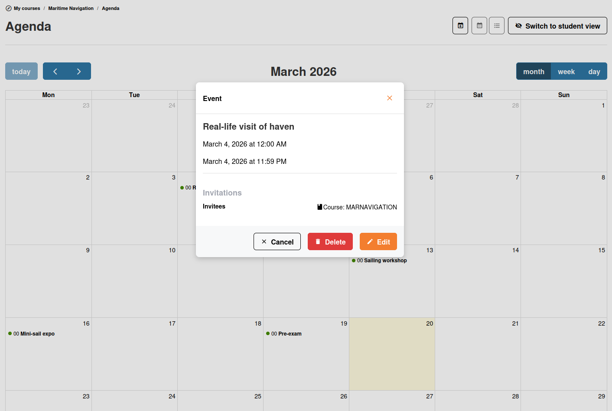
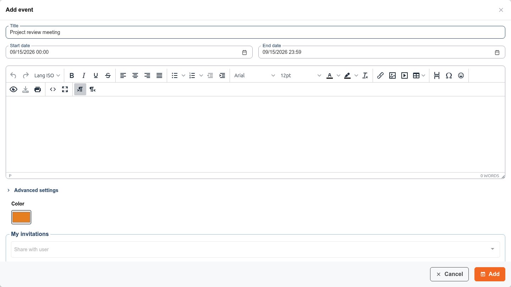
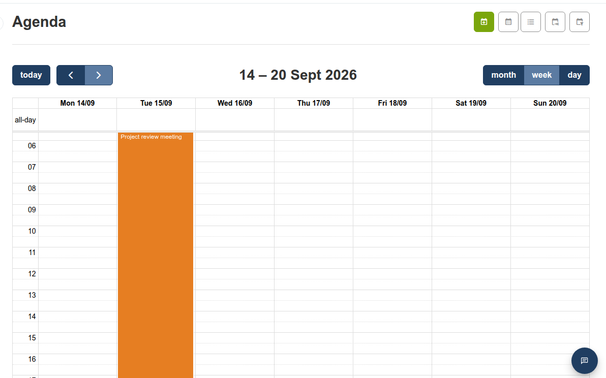

# Agenda

Das Agenda-Werkzeug ermöglicht es Ihnen, Termine und Fristen innerhalb Ihres Kurses zu planen. Die Termine erscheinen in einem Kalender, den Ihre Lernenden einsehen können.

## Die Agenda anzeigen

Öffnen Sie das Werkzeug **Agenda**  auf der Kursstartseite. Sie können Termine in drei Ansichten betrachten:

* **Kalenderansicht** — Ein visueller Monats-/Wochen-/Tageskalender
* **Listenansicht** — Termine als chronologische Liste
* **Persönliche Termine** — Filter, um nur für Sie relevante Termine anzuzeigen

## Einen Termin erstellen

1. Klicken Sie auf **Termin hinzufügen** 
2. Füllen Sie die Termindetails aus:
   * **Titel** — Eine kurze Bezeichnung für den Termin
   * **Startdatum und -uhrzeit**
   * **Enddatum und -uhrzeit**
   * **Beschreibung** — Zusätzliche Angaben (unterstützt Rich Text)
   * **Anhänge** — Klicken Sie auf **Anhang hinzufügen**, um eine oder mehrere Dateien anzuhängen, und beschreiben Sie sie optional unter **Dateikommentar**. Lernende sehen die Dateien in den Termindetails und können sie herunterladen, sofern der Termin an sie gesendet wurde. Um eine Datei zu löschen, bearbeiten Sie den Termin und klicken Sie auf das Löschsymbol neben der Datei. Anhänge sind nur für Kurstermine verfügbar
   * **Kommentar** — Eine kurze Klartextnotiz, zum Beispiel dazu, was Lernende mitbringen müssen. Er ist nur für Kurstermine verfügbar, und Lernende sehen ihn unter der Beschreibung, in den Termindetails und in der Listenansicht
3. Wählen Sie die **Zielgruppe** im Feld **Senden an**:
   * Lassen Sie es leer, um den Termin an **alle** im Kurs (oder im Kurs der aktuellen Sitzung) zu senden
   * Wählen Sie eine oder mehrere **Benutzer** und/oder **Gruppen** des Kurses aus, um den Termin nur an sie zu senden. Ein Lernender sieht den Termin dann nur, wenn er an ihn oder an eine seiner Gruppen gesendet wurde; Lehrkräfte sehen stets jeden Termin des Kurses.

   Sie können die Empfänger später ändern, indem Sie den Termin bearbeiten. Das Feld **Senden an** wird nur Lehrkräften angezeigt, und zwar in der Agenda eines Kurses; innerhalb der Agenda einer Gruppe gehören neue Termine stets zu dieser Gruppe.
4. Legen Sie optional eine **Erinnerung**  fest, um vor dem Termin E-Mail-Benachrichtigungen zu senden (eine *cron*-Einrichtung für das Portal ist durch eine Administration erforderlich)
5. Aktivieren Sie optional **Eine Ankündigung hinzufügen (E-Mail senden)**, um den Termin zusätzlich als Kursankündigung zu veröffentlichen, die per E-Mail an dieselben Empfänger gesendet wird. Die Ankündigung übernimmt den Titel und die Beschreibung des Termins. Diese Option wird nur Lehrkräften angezeigt, wenn sie einen Kurstermin erstellen
6. Wählen Sie eine **Farbe** für den Termin, indem Sie auf das Farbfeld klicken. Diese Farbe wird verwendet, um den Termin im gesamten Kalender hervorzuheben (Monats-, Wochen- und Tagesansicht), sodass sich Termine auf einen Blick unterscheiden lassen — zum Beispiel Fristen von regulären Sitzungen oder Termine verschiedener Kurse in Ihrer persönlichen Agenda.

   
7. Speichern

Die gewählte Farbe wird dann überall dort übernommen, wo der Termin im Kalender erscheint:

Standardmäßig erhalten neue Termine eine Farbe entsprechend ihrem Kontext (Kurs, Sitzung, persönlich oder global), Sie können sie jedoch mit einer beliebigen Farbe überschreiben.

## Termine verwalten

* **Bearbeiten**  — Klicken Sie auf einen Termin, um seine Details zu ändern
* **Löschen**  — Entfernen Sie einen Termin aus dem Kalender
* **Ziehen und Ablegen** — Ziehen Sie in der Kalenderansicht Termine, um sie neu zu planen

## Einen Termin wiederholen

Wenn Sie einen Kurstermin erstellen, aktivieren Sie **Termin wiederholen** und wählen Sie dann:

* **Wiederholungstyp** — **Täglich**, **Wöchentlich**, **Monatlich, nach Datum** oder **Jährlich**
* **Enddatum der Wiederholung** — Der letzte Tag, an dem eine Wiederholung beginnen kann

Die Agenda erstellt dann bei jeder Wiederholung eine Kopie des Termins mit denselben Details und denselben Empfängern. Jede Kopie ist ein eigener Termin: Sie können ihn einzeln bearbeiten oder löschen. Um die gesamte Serie auf einmal zu löschen, klicken Sie auf einen beliebigen Termin der Serie und dann auf **Alle Einträge löschen**.

Die Wiederholungsoptionen sind nur verfügbar, wenn Sie einen Kurstermin erstellen; Sie können einem bestehenden Termin keine Wiederholung hinzufügen.

## Nach Empfänger filtern

Verwenden Sie als Lehrkraft die Auswahl **Filter** oberhalb der Kursagenda, um nur die Termine aufzulisten, die an einen Benutzer oder an eine Gruppe gesendet wurden. Wählen Sie **Alle** (oder leeren Sie die Auswahl), um wieder jeden Termin zu sehen. Der Filter gilt sowohl für die Kalenderansicht als auch für die Listenansicht und bleibt erhalten, wenn Sie zwischen ihnen wechseln.

## Persönliche Agenda

Sie verfügen außerdem über eine **persönliche Agenda**, die über die Seitenleiste zugänglich ist. Die persönliche Agenda fasst Termine aus all Ihren Kursen in einer einzigen Ansicht zusammen. Hier sehen die Lernenden ihren kombinierten Stundenplan über alle Kurse, in denen sie eingeschrieben sind.

## Tipps

* **Fristen festlegen** — Erstellen Sie Termine für Abgabetermine von Aufgaben und Fristen für Übungen, damit die Lernenden diese in ihrem Kalender sehen können
* **Erinnerungen verwenden** — Aktivieren Sie E-Mail-Erinnerungen für wichtige Termine, damit die Lernenden den Überblick behalten
* **Mit Sitzungen abstimmen** — Wenn Sie in mehreren Sitzungen unterrichten, verfügt jede Sitzung über eigene Termine, die nur für die Lernenden dieser Sitzung sichtbar sind. Lehrkräfte verfügen über eine Funktion, mit der sie die Termine (Hausaufgaben, Exkursionen usw.) anderer Kurse in ihren Sitzungen einsehen können, um eine Überlastung der Studierenden zu vermeiden.