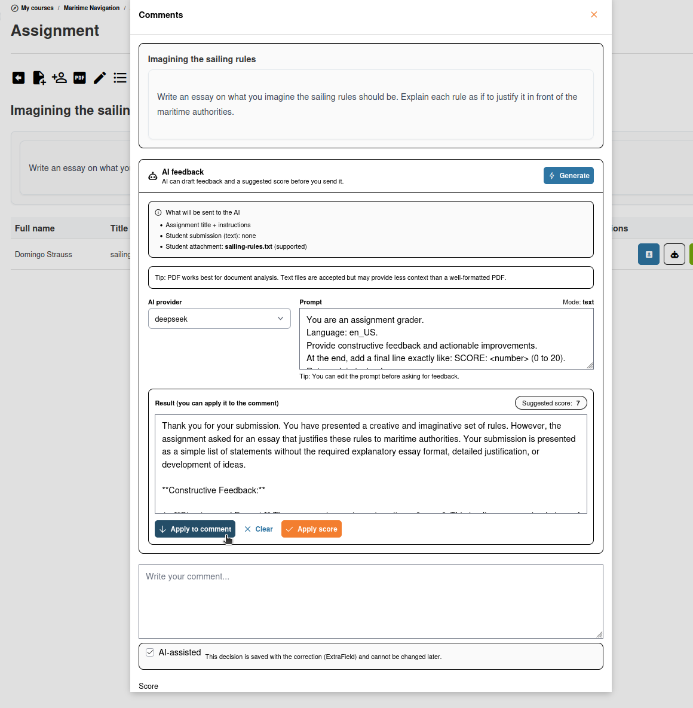

# KI-Bewertung

Die KI-Bewertung unterstützt Sie bei der Beurteilung offener studentischer Einreichungen — Aufsätze, schriftliche Antworten und hochgeladene Aufgaben — indem sie KI-generierte Notenvorschläge und Feedback bereitstellt.

## Wo die KI-Bewertung erscheint

Die KI-Bewertung ist in zwei Kontexten verfügbar:

* **Offene Übungsfragen** — Wenn Sie Freitextfragen in einer Übung manuell bewerten
* **Aufgabeneinreichungen** — Wenn Sie studentische Veröffentlichungen im Werkzeug Aufgaben prüfen und bewerten

Achten Sie auf die Schaltfläche **KI-Bewertung** (gekennzeichnet durch ein Robotersymbol ) in der Bewertungsoberfläche.

## So funktioniert es

1. Öffnen Sie eine Einreichung oder Antwort, die bewertet werden muss
2. Klicken Sie auf die Schaltfläche **KI-Bewertung**
3. Die KI analysiert die Antwort der lernenden Person und erzeugt:
   * Ein **vorgeschlagenes Ergebnis** auf Grundlage der Qualität und Relevanz der Antwort
   * **Feedback-Kommentare**, die Stärken und Schwächen der Antwort erläutern
4. Prüfen Sie die Vorschläge der KI
5. **Übernehmen, ändern oder verwerfen** Sie Ergebnis und Feedback
6. Speichern Sie Ihre endgültige Note

## Wichtige Hinweise

* **Die KI-Bewertung ist ein Vorschlag** — Die endgültige Entscheidung liegt stets bei Ihnen. Die KI liefert einen Ausgangspunkt, den Sie anhand Ihres fachlichen Urteils anpassen können.
* **Eine Prüfung ist unerlässlich** — Die KI kann den Kontext falsch deuten, Nuancen übersehen oder falsch bewerten. Prüfen Sie die vorgeschlagene Note stets, bevor Sie sie bestätigen.
* **Am besten mit klaren Kriterien** — Je genauer Ihre Aufgabenanweisungen und Ihr Bewertungsraster sind, desto besser fallen die Vorschläge der KI aus.

## Kennzeichnung KI-generierter Inhalte

Von der KI erzeugte Kommentare sind mit einem Hinweis gekennzeichnet, der angibt, dass sie mithilfe künstlicher Intelligenz erstellt wurden. Diese Transparenz hilft Lernenden, die Herkunft der Bewertung zu verstehen.

## Tipps

* **Für große Kurse nutzen** — Die KI-Bewertung ist besonders wertvoll, wenn Sie viele Einreichungen prüfen müssen, da sie die erste Beurteilung beschleunigt
* **Ausführliche Aufgabenbeschreibungen bereitstellen** — Klare Anweisungen helfen der KI zu verstehen, wie eine gute Antwort aussieht
* **Erwartungen kalibrieren** — Bewerten Sie zunächst einige Einreichungen manuell, um Ihre Maßstäbe festzulegen, und nutzen Sie anschließend die KI-Bewertung für die übrigen
* **Das Feedback nutzen** — KI-generiertes Feedback kann ein nützlicher Ausgangspunkt für Ihre Kommentare sein, auch wenn Sie das Ergebnis anpassen