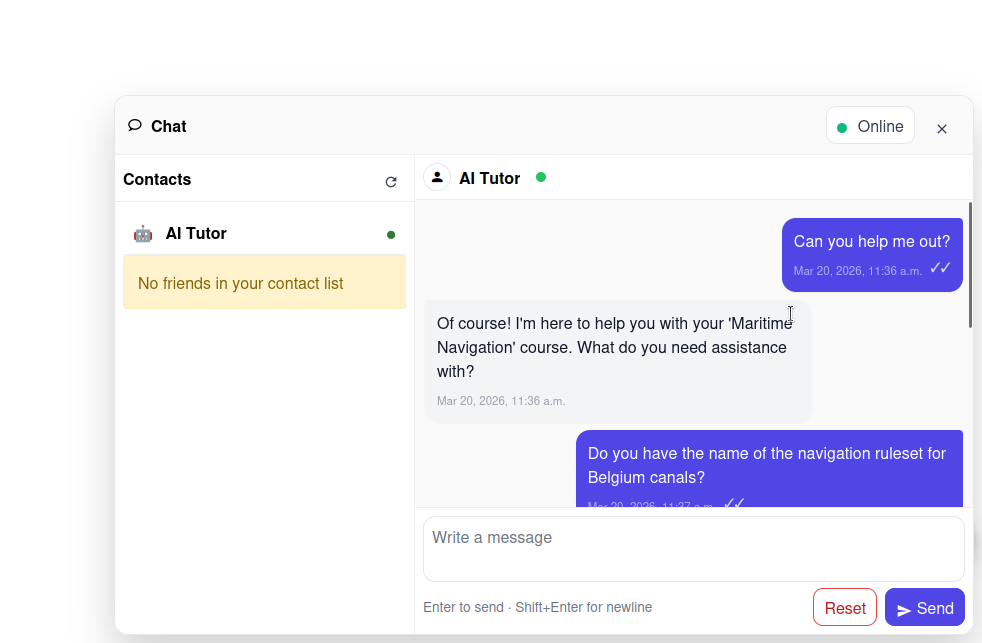

# KI-Tutor

Der KI-Tutor ist ein in Chamilo integrierter Chatbot, mit dem Lernende interagieren können, um sofortige, KI-generierte Antworten zu erhalten. Er funktioniert in zwei Kontexten, jeweils mit einem anderen Schwerpunkt:

* **Innerhalb eines Kurses** — der KI-Tutor ist auf diesen Kurs ausgerichtet: Er beantwortet Fragen zu dessen Inhalten, erklärt behandelte Konzepte und führt Lernende durch das Material.
* **Außerhalb eines Kurses** (auf der allgemeinen Plattform) — der KI-Tutor beantwortet stattdessen allgemeine Fragen zur Plattformnutzung, etwa wie etwas gefunden oder eine Funktion verwendet wird, und nicht Kursinhalte.

## Funktionsweise

Wenn der KI-Tutor für einen Kurs aktiviert ist, sehen Lernende eine Chat-Oberfläche, über die sie Folgendes können:

* **Fragen stellen** zu Kursinhalten
* **Erklärungen erhalten** zu im Kurs behandelten Konzepten
* **Unterstützung erhalten**, ohne auf die Antwort der Lehrkraft warten zu müssen

Innerhalb eines Kurses nutzt der KI-Tutor den Kontext dieses Kurses, um relevante Antworten zu geben. Er soll Ihren Unterricht ergänzen, nicht ersetzen.

## Aktivieren des KI-Tutors

Der KI-Tutor erfordert zwei Konfigurationsebenen:

1. **Plattformebene** — Die Administration muss KI-Helfer aktivieren und mindestens einen KI-Anbieter konfigurieren (siehe [KI-Konfiguration](../../admin-guide/integrations/ai-configuration.md))
2. **Kursebene** — Der KI-Tutor muss in den Kurseinstellungen aktiviert werden (ein einfacher Ein-/Aus-Schalter). Der für den Chat verwendete Anbieter ist der von der Administration konfigurierte.

## Die Chat-Oberfläche

Der KI-Tutor erscheint als **angedocktes Chat-Panel** innerhalb des Kurses. Lernende können:

* Nachrichten eingeben und KI-generierte Antworten erhalten
* ihren Gesprächsverlauf anzeigen
* das Gespräch zurücksetzen, um neu zu beginnen

Die Chat-Oberfläche zeigt den Austausch zwischen dem Lernenden und der KI in einem vertrauten Nachrichtenformat.

## Wichtiges Verhalten

* **Auf den Öffnungskontext beschränkt** — Innerhalb eines Kurses beantwortet der KI-Tutor nur Fragen zu diesem Kurs; wird er außerhalb eines Kurses geöffnet, wechselt er stattdessen zu allgemeinen Fragen zur Plattformnutzung. Der plattformweite Modus (außerhalb eines Kurses) ist ein separater Schalter, den Ihre Administration unabhängig vom kursspezifischen Schalter steuert.
* **Während Prüfungen deaktiviert** — Der KI-Tutor wird automatisch deaktiviert, wenn ein Lernender eine Übung bearbeitet, um Betrug zu verhindern
* **Gespräch pro Lernendem** — Jeder Lernende führt ein eigenes privates Gespräch mit dem KI-Tutor, und der Prompt-Kontext umfasst nur die neuesten Nachrichten
* **Anbieter-Failover** — Wenn der konfigurierte Anbieter ausfällt, wechselt Chamilo zu einem anderen verfügbaren Anbieter, damit der Chat weiter funktioniert

## Für Lehrkräfte

Sie sollten Folgendes beachten:

* Der KI-Tutor gibt nicht immer perfekte Antworten — ermutigen Sie Lernende, wichtige Informationen zu überprüfen
* Sie können die Nutzung des KI-Tutors über das Plattform-Tracking einsehen
* Der KI-Tutor ist eine Ergänzung Ihres Unterrichts, kein Ersatz. Nutzen Sie ihn zusammen mit Foren, Ankündigungen und Direktnachrichten für eine umfassende Unterstützung der Lernenden.

## Tipps

* **Erwartungen setzen** — Teilen Sie den Lernenden zu Beginn des Kurses mit, dass ein KI-Tutor verfügbar ist, und erklären Sie, wie er angemessen genutzt wird
* **Kritisches Denken fördern** — Erinnern Sie Lernende daran, KI-generierte Antworten kritisch zu hinterfragen
* **Für häufig gestellte Fragen nutzen** — Der KI-Tutor eignet sich besonders für häufige Fragen, die Sie sonst wiederholt beantworten müssten