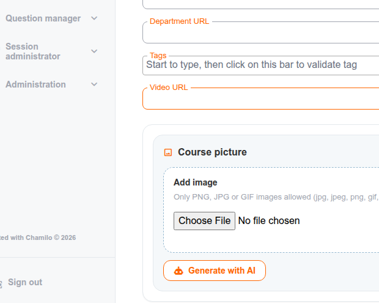
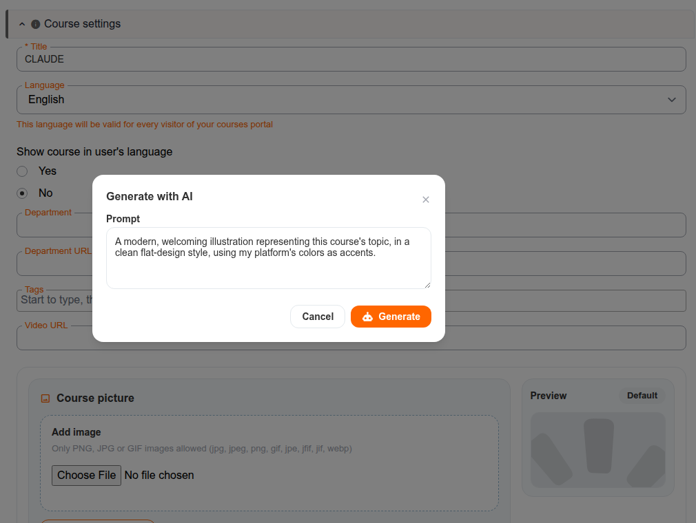

# Kursbild-Generator

Der KI-Kursbild-Generator ermöglicht es Ihnen, direkt auf dem Bildschirm der Kurseinstellungen ein Vorschaubild für Ihren Kurs zu erstellen, anstatt selbst eines zu beschaffen oder zu gestalten. Dies ist das Bild, das für Ihren Kurs in Listen und im [Kurskatalog](../assessing-learners/subscribing-users.md#self-enrollment-via-the-course-catalog) angezeigt wird.

## Auf den Generator zugreifen

Die Schaltfläche **Mit KI generieren**  ist neben dem Feld **Kursbild** verfügbar, sofern:

1. KI-Hilfen auf Plattformebene aktiviert sind
2. Mindestens ein auf Ihrer Plattform konfigurierter KI-Anbieter die Bildgenerierung unterstützt
3. Die Funktion in Ihrem Kurs erlaubt ist (siehe **Einstellungen der KI-Hilfen** in [Kurseinstellungen](../creating-your-course/course-settings.md))

Öffnen Sie die **Einstellungen**  Ihres Kurses und scrollen Sie zum Feld **Kursbild**:

## So generieren Sie ein Bild

1. Klicken Sie auf **Mit KI generieren**
2. Es öffnet sich ein Dialog mit einem Feld **Prompt**, das mit einer Standardbeschreibung vorausgefüllt ist; bearbeiten Sie sie, um die gewünschte Illustration zu beschreiben, oder belassen Sie die Vorgabe unverändert

3. Klicken Sie auf **Generieren** und warten Sie — die Bildgenerierung kann einige Sekunden dauern
4. Das generierte Bild wird automatisch in das Feld **Kursbild** eingesetzt und ersetzt alles, was Sie dort zuvor ausgewählt hatten
5. Sehen Sie es im Bereich **Vorschau** an und klicken Sie anschließend auf die Schaltfläche **Speichern** des Formulars, um es tatsächlich auf Ihren Kurs anzuwenden — das Generieren des Bildes speichert es nicht von selbst

Wenn Ihnen das Ergebnis nicht gefällt, können Sie vor dem Speichern beliebig oft mit einem anderen Prompt erneut generieren.

## Was in den Prompt einfließt

Über das hinaus, was Sie eingeben, fügt Chamilo automatisch Kontext hinzu, damit die KI ein relevantes, zum Erscheinungsbild passendes Bild erzeugt:

* Den Titel Ihres Kurses
* Den ersten Abschnitt Ihrer [Kursbeschreibung](../creating-your-course/course-description.md), sofern Sie eine ausgefüllt haben — damit die KI einen Eindruck vom tatsächlichen Thema erhält
* Das Farbschema Ihrer Plattform (primär, sekundär, tertiär), damit die Illustration Farben verwendet, die zu Ihrem Portal passen

Das Bild wird im flachen, breitformatigen (16:9) Illustrationsstil erzeugt, ohne lesbaren Text, Logos oder fotorealistische Personen — passend zum für ein Kursvorschaubild erwarteten Format.

## Tipps

* **Füllen Sie zuerst eine Kursbeschreibung aus** — da sie in den Prompt einfließt, erhält ein Kurs mit einer echten Beschreibung in der Regel eine relevantere Illustration als einer ohne
* **Seien Sie bei Stil, nicht beim Inhalt, konkret** — Kurstitel und Beschreibung verankern das Thema bereits; nutzen Sie Ihren Prompt für Stilhinweise (Farbstimmung, Metapher, Komposition), anstatt das Thema erneut zu beschreiben
* **Generieren Sie lieber neu, statt sich zu begnügen** — jeder Klick erzeugt ohne zusätzlichen Schritt einen neuen Versuch; probieren Sie ein paar Varianten aus, bevor Sie eine auswählen
* **Denken Sie ans Speichern** — die Schaltfläche füllt nur das Bildfeld aus; navigieren Sie ohne Speichern weg, geht das generierte Bild verloren
* **Wenn die Generierung fehlschlägt, fragen Sie Ihre Administration** — eine deaktivierte Funktion, ein nicht konfigurierter Bildanbieter oder ein ausgeschöpftes monatliches KI-Nutzungskontingent führen hier alle zu einer Fehlermeldung; Ihre Administration kann die [KI-Konfiguration](../../admin-guide/integrations/ai-configuration.md) prüfen