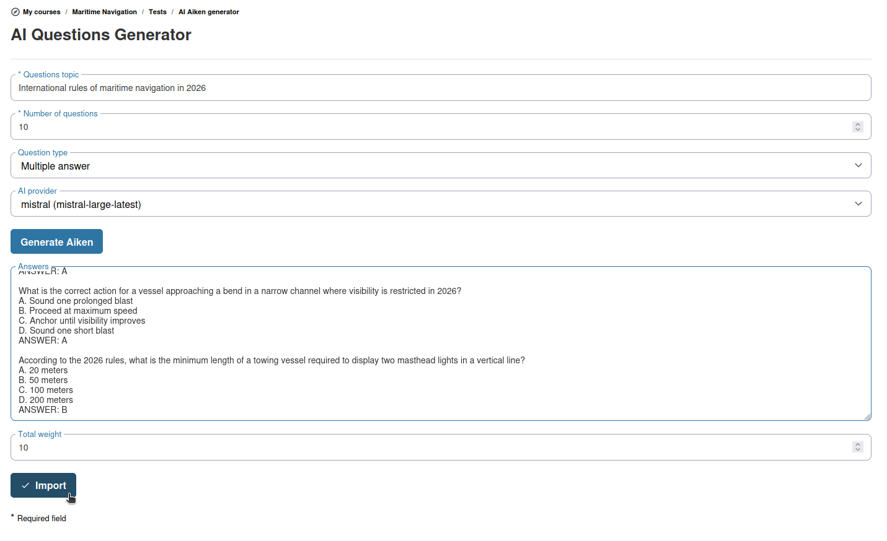
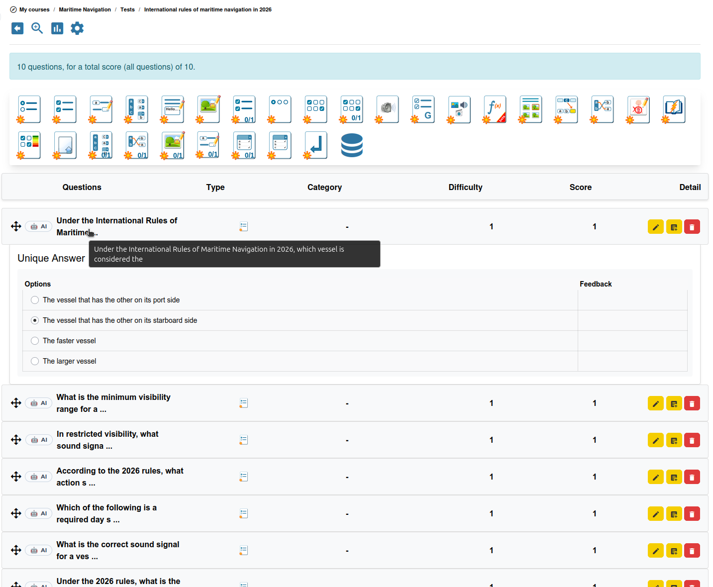

# Übungen-Generator

Der KI-Übungen-Generator hilft Ihnen, Quizfragen automatisch mithilfe künstlicher Intelligenz zu erstellen. Sie geben ein Thema oder Inhalte an, und die KI erzeugt Fragen, die Sie prüfen, bearbeiten und Ihren Übungen hinzufügen können.

## Zugriff auf den Übungen-Generator

Der Übungen-Generator ist beim Erstellen oder Bearbeiten einer Übung verfügbar, sofern:

1. KI-Hilfen auf Plattformebene aktiviert sind
2. Mindestens ein KI-Textanbieter konfiguriert ist

Suchen Sie nach der Schaltfläche oder dem Bereich **AI Generator** in der Oberfläche zur Erstellung von Übungen.

## Fragen erzeugen

Der Generator bietet zwei Modi, die als Registerkarten verfügbar sind:

* **Test from topic** — Fragen aus einer textlichen Themenbeschreibung erzeugen
* **Test from document** — Fragen aus einem Kursdokument erzeugen (nur verfügbar, wenn ein dokumentfähiger Anbieter konfiguriert ist). Wird dieser Modus verwendet, wird das Themenfeld optional und als zusätzlicher Hinweis behandelt.

1. Öffnen Sie das Formular des AI Generator innerhalb einer Übung und wählen Sie den Modus
2. Konfigurieren Sie die Erzeugungsparameter:
   * **Quiz title** — Der Titel der resultierenden Übung
   * **Questions topic** — Beschreiben Sie, worum es in den Fragen gehen soll (oder, im Dokumentmodus, einen optionalen Hinweis)
   * **Number of questions** — Wie viele Fragen erzeugt werden sollen (auf 100 begrenzt)
   * **Question type** — Derzeit wird nur **Multiple answer** angeboten
   * **AI provider** — Wählen Sie aus, welcher KI-Anbieter verwendet werden soll (wird nur angezeigt, wenn mehr als einer konfiguriert ist)
3. Klicken Sie auf **Generate**
4. Die KI erzeugt eine Reihe von Fragen mit Antwortoptionen und markierten richtigen Antworten. Wenn die KI-Kennzeichnung aktiviert ist, werden erzeugte Fragen mit **\[AI-assisted\]** vorangestellt.

## Prüfen und Bearbeiten

Erzeugte Fragen werden als **Vorschläge** dargestellt. Sie sollten:

* **Jede Frage prüfen** auf Richtigkeit und Relevanz
* **Die Formulierung bearbeiten**, falls nötig — passen Sie Fragen, Antwortoptionen und Feedback an
* **Richtige Antworten überprüfen** — stellen Sie sicher, dass die KI die richtigen Antworten erkannt hat
* **Ungeeignete Fragen entfernen** — löschen Sie alle, die Ihren Anforderungen nicht entsprechen
* **Die Bewertung anpassen** — legen Sie für jede Frage angemessene Punktwerte fest

Wenn Sie zufrieden sind, fügen Sie die Fragen Ihrer Übung hinzu.

Beachten Sie, dass einige Modelle trotz unserer spezifischen Formatanforderungen Fragentitel mit einer vorangestellten Nummer zurückgeben. Wir empfehlen nicht, diese Nummer beizubehalten, da sie die Mischung von Fragen in Tests mit zufällig ausgewählten Fragen beeinträchtigt. Außerdem erhalten Sie manchmal nicht so viele Fragen, wie Sie angefordert haben. Prüfen Sie dies daher und erzeugen Sie gegebenenfalls weitere Fragen oder wechseln Sie das Modell, sofern Sie diese Möglichkeit haben.

## Kennzeichnung KI-erzeugter Inhalte

Von KI erzeugte Inhalte werden mit einem Hinweis gekennzeichnet, der angibt, dass sie mithilfe künstlicher Intelligenz erstellt wurden. Diese Transparenz hilft Lernenden, die Herkunft des Materials zu verstehen.

## Tipps

* **Geben Sie konkrete Themen an** — Je konkreter Ihre Themenbeschreibung ist, desto relevanter werden die erzeugten Fragen sein.
* **Prüfen Sie immer** — KI-erzeugte Inhalte können Fehler enthalten. Veröffentlichen Sie Fragen niemals, ohne sie zuvor geprüft zu haben.
* **Nutzen Sie sie als Ausgangspunkt** — Erzeugte Fragen sparen Zeit, sind aber kein fertiges Produkt. Bearbeiten Sie sie so, dass sie zu Ihrem Lehrstil und Ihren Kursinhalten passen.
* **Mischen Sie sie mit manuellen Fragen** — Kombinieren Sie KI-erzeugte Fragen mit manuell erstellten, um die besten Ergebnisse zu erzielen.
* **Probieren Sie verschiedene Anbieter aus** — Wenn mehrere KI-Anbieter verfügbar sind, testen Sie verschiedene, um zu sehen, welcher die besten Fragen für Ihr Fachgebiet erzeugt.