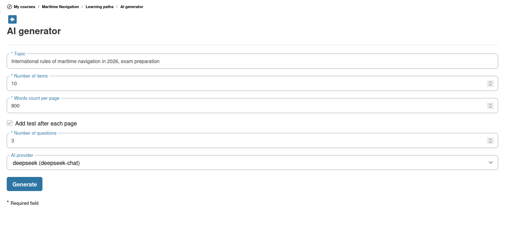

# Lernpfad-Generator

Der KI-Lernpfad-Generator hilft Ihnen, strukturierte Lernsequenzen automatisch zu erstellen. Sie geben ein Thema und Lernziele an, und die KI erzeugt einen Lernpfad-Entwurf mit Abschnitten und Inhaltselementen, den Sie prüfen und anpassen können.

## Zugriff auf den Lernpfad-Generator

Der Lernpfad-Generator ist beim Erstellen eines neuen Lernpfads verfügbar, sofern:

1. KI-Hilfen auf Plattformebene aktiviert sind
2. der Lernpfad-Generator in den Kurseinstellungen aktiviert ist
3. mindestens ein KI-Textanbieter konfiguriert ist

Suchen Sie im Bereich zur Erstellung von Lernpfaden nach dem Abschnitt **KI-Generator**.

## So erzeugen Sie einen Lernpfad

1. Öffnen Sie das Formular des KI-Generators
2. Konfigurieren Sie die Parameter:
   * **Thema** — Der Gegenstand des Lernpfads
   * **Anzahl der Elemente** — Wie viele Inhaltsseiten der Pfad enthalten soll
   * **Wortanzahl pro Seite** — Ungefähre Länge jeder Seite
   * **Test nach jeder Seite hinzufügen** — Wenn aktiviert, erstellt die KI nach jeder Seite zusätzlich ein kurzes Multiple-Choice-Quiz (standardmäßig 2 Fragen, maximal 5)
3. Klicken Sie auf **Erzeugen**
4. Die KI erzeugt einen Lernpfad mit einem Dokumentelement pro Seite und optional einem Quiz-Element nach jedem davon

## Prüfen und Anpassen

Der erzeugte Lernpfad ist ein **Ausgangspunkt**. Sie sollten:

* **Struktur prüfen** — Prüfen Sie, ob die Abschnitte in einer logischen Reihenfolge stehen
* **Inhalte bearbeiten** — Ändern Sie den erzeugten Text, fügen Sie eigene Materialien hinzu und entfernen Sie irrelevante Abschnitte
* **Ressourcen hinzufügen** — Fügen Sie eigene Dokumente, Übungen, Links und weitere Inhalte ein
* **Voraussetzungen festlegen** — Legen Sie fest, welche Abschnitte vor anderen abgeschlossen sein müssen
* **Bewertungen hinzufügen** — Fügen Sie an geeigneten Stellen Übungen ein, um das Verständnis zu prüfen

## Hinweis auf KI-generierte Inhalte

Von KI erzeugte Inhalte werden mit einem Hinweis gekennzeichnet, der angibt, dass sie mithilfe künstlicher Intelligenz erstellt wurden. Diese Transparenz hilft Lernenden, die Herkunft des Materials zu verstehen.

## Tipps

* **Zuerst grob, dann verfeinern** — Erzeugen Sie zunächst eine übergeordnete Struktur und ergänzen Sie anschließend manuell Details und konkrete Ressourcen
* **Für die Kursplanung nutzen** — Auch wenn Sie die erzeugten Inhalte nicht direkt verwenden, kann die von der KI vorgeschlagene Struktur ein nützliches Planungswerkzeug sein
* **Mit der Übungserzeugung kombinieren** — Nutzen Sie nach dem Erzeugen eines Lernpfads den Übungs-Generator, um Bewertungen für jeden Abschnitt zu erstellen