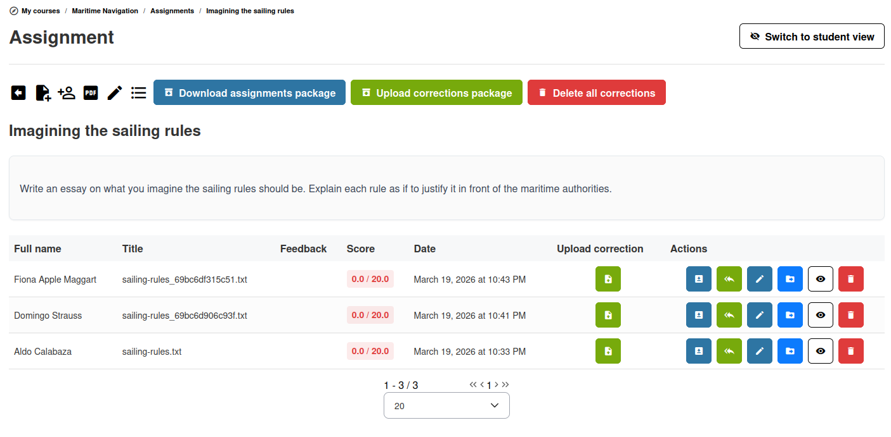
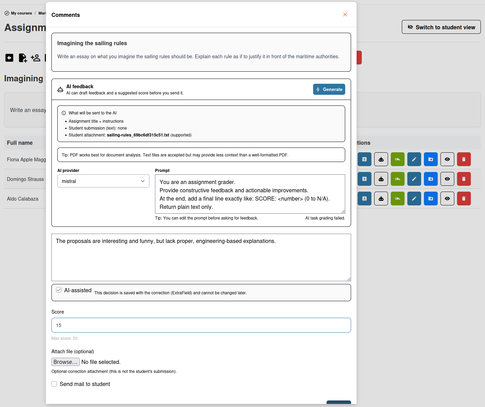

# Aufgaben

Das Aufgaben-Tool (auch „studentische Veröffentlichungen“ genannt) ermöglicht es Ihnen, Arbeiten von Lernenden zu sammeln — Aufsätze, Projekte, Berichte oder jede dateibasierte Einreichung — und sie zu bewerten.

## Eine Aufgabe erstellen

1. Öffnen Sie das Tool **Aufgaben**  auf der Kursstartseite
2. Klicken Sie auf **Eine Aufgabe erstellen**
3. Füllen Sie die Angaben aus:
   * **Aufgabenname** — Der Name der Aufgabe (z. B. „Abschlussprojektbericht“)
   * **Beschreibung** — Anweisungen für die Lernenden, einschließlich dessen, was einzureichen ist und wie es bewertet wird (unterstützt Rich Text)
   * **Höchstpunktzahl** — Auf welcher Gesamtpunktzahl die Aufgabe bewertet wird
   * **Zum Notenbuch hinzufügen** — Als bewertetes Element im Bewertungs-Tool (Notenbuch) hinzufügen, damit es Teil des Erreichens der Kursziele sein kann
   * **Abgabefrist** — Das offizielle (veröffentlichte) Datum und die Uhrzeit, nach denen Einreichungen als verspätet gekennzeichnet werden (Uploads werden weiterhin akzeptiert)
   * **Endet am (vollständig geschlossen)** — Das endgültige Stichtagsdatum und die Uhrzeit, nach denen kein Upload mehr möglich ist
   * **Zum Kalender hinzufügen** — Ein Ereignis erstellen, das auf dieses Abgabedatum der Aufgabe verweist
   * **Einreichungstyp** — Wählen Sie zwischen **Nur Text zulassen**, **Nur Dateien zulassen** oder **Dateien oder Online-Text zulassen**
4. Speichern

Nachdem Sie eine Aufgabe erstellt haben, können Sie außerdem:
* Vorlagendokumente von der Detailseite der Aufgabe aus hochladen
* Die Aufgabe bestimmten Benutzern zuweisen (anstatt allen Benutzern des Kurses)

Und sobald die Lernenden ihre Aufgaben eingereicht haben, können Sie:
* Eine PDF-Liste der Einreichungen exportieren
* Eine Liste nur der Lernenden anzeigen, die ihre Aufgabe nicht eingereicht haben
* Alle Aufgaben in einem großen ZIP herunterladen
* Alle Korrekturen in einem großen ZIP hochladen
* Alle von Ihnen eingereichten Korrekturen löschen (dies löscht nicht die Einreichungen der Lernenden)

## Aufgaben für Gruppen

Wenn der Kurs Gruppen hat, kann das Aufgabenformular **Dies ist eine Aufgabe nach Gruppen** anzeigen. Aktivieren Sie dies, um eine Aufgabe zu erstellen, die über die Gruppen in der ausgewählten **Gruppenkategorie** hinweg geteilt wird. Wenn Gruppenkategorien deaktiviert sind, kann Chamilo die Aufgabe auf alle Gruppen anwenden.

Konfigurieren Sie die gemeinsame Aufgabe über das normale Aufgaben-Tool, nicht von innerhalb einer bestimmten Gruppe aus. Lernende greifen auf dieselbe Aufgabe aus ihrem eigenen Gruppenkontext zu, sodass die Aufgabe nicht einmal pro Gruppe dupliziert werden muss.

Wenn mehrere Gruppenkategorien vorhanden sind, wählen Sie die Kategorie aus, deren Gruppen die Aufgabe erhalten sollen. Die Option wird nicht angeboten, solange Sie sich bereits in einem bestimmten Gruppenkontext befinden.

## Wie Lernende einreichen

Lernende öffnen die Aufgabe und:

1. Klicken auf **Datei hochladen** oder die Einreichungsschaltfläche
2. Wählen eine Datei von ihrem Computer aus (oder schreiben Text direkt, je nach Konfiguration)
3. Fügen einen optionalen Kommentar hinzu
4. Reichen ein

Lernende können sehen, ob sie bereits eingereicht haben, und, falls erlaubt, ihre Einreichung aktualisieren.

### Rich-Text-Einreichungen (HTML)

Wenn Sie **Nur Text zulassen** oder **Dateien oder Online-Text zulassen** konfigurieren, können Lernende eine formatierte Antwort im Online-Editor schreiben, anstatt ein separates Dokument hochzuladen. Chamilo bereinigt das eingereichte HTML und speichert es als `.html`-Einreichungsdatei. Es unterliegt weiterhin den bestehenden Zugriffs- und Fristregeln der Aufgabe.

Verwenden Sie in der Einreichungsliste der Lehrkraft **Vorschau**, um eine verfügbare HTML-Einreichung zu öffnen, oder **Korrigieren und bewerten**, um ihren Inhalt im Überprüfungsdialog zu sehen, bevor Sie Feedback und eine Punktzahl hinzufügen. Das HTML wird sicher dargestellt und nicht als von Lernenden bereitgestelltes Skript ausgeführt. Siehe [PR #9410](https://github.com/chamilo/chamilo-lms/pull/9410).

## Einreichungen überprüfen

Öffnen Sie als Lehrkraft eine Aufgabe, um die Liste aller Einreichungen zu sehen:

* **Name des Lernenden** — Wer eingereicht hat
* **Einreichungsdatum** — Wann die Arbeit eingereicht wurde
* **Datei** — Die eingereichte Datei herunterladen
* **Status** — Ob die Einreichung bewertet wurde
* **Kommentare** — Kommentare, die von der lernenden Person oder von Ihnen hinterlassen wurden

### Eine Aufgabe verfolgen

Lehrkräfte und berechtigte Sitzungstutoren können eine einzelne Aufgabe verfolgen und Benachrichtigungen erhalten, wenn ein Lernender einen Kommentar zu einer ihrer Einreichungen abgibt.

1. Öffnen Sie die Detailseite der Aufgabe über das Werkzeug **Aufgaben**.
2. Wählen Sie **Folgen** (Glockensymbol). Die Schaltfläche wechselt zu **Folge ich**.
3. Wählen Sie erneut **Folge ich**, um das Verfolgen dieser Aufgabe zu beenden.

Die Lehrkraft, die eine neue Aufgabe erstellt, folgt ihr automatisch und kann das Verfolgen später beenden. Das Verfolgen ist für jede Lehrkraft oder jeden Tutor persönlich; es abonniert nicht den gesamten Kurs. Lernende verfügen nicht über diese Steuerung. Benachrichtigungen gehen nur an aktive Follower, die weiterhin die entsprechende Kurs- oder Sitzungsrolle haben; der Autor des Kommentars erhält keine Benachrichtigung für den eigenen Kommentar.

**Wichtig:** Benachrichtigungen werden nur gesendet, wenn die Kurseinstellung `email_to_teachers_on_new_work_feedback` aktiviert ist (Wert `1`, **Ja**). Das Verfolgen einer Aufgabe allein hebt eine deaktivierte Kurseinstellung nicht auf. Dies betrifft Kommentare von Lernenden zu Einreichungen, nicht jede Bearbeitung einer Aufgabe oder jeden Datei-Upload. Die Zustellung hängt außerdem von der Nachrichten-/E-Mail-Konfiguration des Portals ab.

### Eine Einreichung bewerten

1. Klicken Sie auf eine Einreichung, um sie zu öffnen
2. Prüfen Sie die eingereichte Datei
3. Geben Sie eine **Punktzahl** ein
4. Schreiben Sie **Feedback-Kommentare** für den Lernenden
5. Laden Sie optional eine **korrigierte Datei** als Anhang hoch
6. Speichern

### KI-gestützte Bewertung

Wenn auf Ihrer Plattform KI-Werkzeuge konfiguriert sind, sehen Sie beim Prüfen von Einreichungen möglicherweise die Option **KI-Bewertung**. Dabei schlägt ein KI-Modell eine Punktzahl und Feedback für offene Aufgaben vor. Einzelheiten finden Sie unter [KI-Bewertung](../ai-tools/ai-grading.md).

## Einreichungen verwalten

Gruppenaktionen:
* **Aufgabenpaket herunterladen** — Alle Einreichungen als einzelne ZIP-Datei zur Offline-Prüfung herunterladen
* **Korrekturpaket hochladen** — Wenn Sie alle Einreichungen in einer einzelnen ZIP-Datei heruntergeladen, die Dateien auf Ihrem Computer an Ort und Stelle bearbeitet und erneut gezippt haben, können Sie die ZIP-Datei als Korrekturpaket senden. Ändern Sie die Dateinamen nicht, sonst funktioniert es nicht.
* **Verspätete Einreichungen** — Einreichungen nach der Frist werden gekennzeichnet, können je nach Ihren Einstellungen aber dennoch akzeptiert werden

Aktionen für einzelne Einreichungen:
* **Korrektur hochladen** — Eine Korrektur für einen Lernenden hochladen 
* **Herunterladen** — Die Einreichung eines Lernenden herunterladen
* **Korrigieren und bewerten** — Der Einreichung des Lernenden eine Korrektur und eine Note hinzufügen 
* **Bearbeiten** — Den Dokumenttitel oder das bisherige Feedback zur Einreichung bearbeiten
* **Verschieben** — Eine Einreichung zwischen Aufgabenordnern übertragen (z. B. wenn der Studierende in der falschen Aufgabe eingereicht hat)
* **Sichtbarkeit** — Steuern, ob Lernende die Einreichungen der anderen sehen können

## Verknüpfung mit dem Notenbuch

Aufgabenpunktzahlen können in das Kursnotenbuch (Werkzeug „Bewertungen“) aufgenommen werden. Dadurch fließen Aufgabennoten in die Gesamtnote des Kurses und in die Zertifikatsberechtigung des Lernenden ein. Einzelheiten finden Sie unter [Notenbuch](gradebook.md).

## Einreichungen nach Lernenden gruppiert prüfen

Für Lehrkräfte gruppiert die Aufgabendetailansicht Einreichungen nun nach Studierenden. Die erste Tabelle zeigt jeden Lernenden und die **Anzahl der Einreichungen**; öffnen Sie die Zeile eines Lernenden, um dessen Einreichungen zu prüfen und auf die üblichen Feedback- und Bewertungsaktionen zuzugreifen. So wird die Identität eines Lernenden in der obersten Liste nicht wiederholt, wenn mehrere Einreichungen zulässig sind.

Die Gruppierung ist eine Änderung der Darstellung, keine Änderung der Einreichungsberechtigungen, Fristen oder Bewertung. Siehe [PR zu gruppierten Einreichungen #9424](https://github.com/chamilo/chamilo-lms/pull/9424).

## Erinnerungen nur an ausgewählte Lernende senden

Öffnen Sie **Benutzer ohne Einreichung** in der Aufgabendetailansicht, um Lernende zu prüfen, die noch nicht eingereicht haben. Wählen Sie die konkreten Benutzer aus, die Sie kontaktieren möchten, und wählen Sie **Alle ausgewählten Benutzer erinnern**; bestätigen Sie vor dem Senden. **E-Mail an alle senden** bleibt verfügbar, wenn jeder Lernende ohne Einreichung eine Erinnerung erhalten soll.

Für die selektive Aktion ist eine Auswahl erforderlich. Prüfen Sie die Empfängerliste vor der Bestätigung; das Senden einer Erinnerung ist ein tatsächlicher E-Mail-Vorgang, keine reine Vorschau. Siehe [PR zu selektiven Erinnerungen #9386](https://github.com/chamilo/chamilo-lms/pull/9386).

## Tipps

* **Formulieren Sie Anweisungen konkret** — Beschreiben Sie klar, was Lernende einreichen sollen, das erwartete Format und die Bewertungskriterien
* **Setzen Sie realistische Fristen** — Nutzen Sie das Werkzeug Agenda, damit Fristen im Kurskalender sichtbar sind
* **Nutzen Sie die Funktion für korrigierte Dateien** — Laden Sie kommentierte Versionen studentischer Arbeiten hoch, damit Lernende Ihre konkreten Korrekturen sehen können
* **Aktivieren Sie die Sichtbarkeit unter Peers mit Bedacht** — Wenn Lernende die Arbeiten der anderen sehen können, kann das das Lernen fördern, ist aber nicht für alle Aufgaben angemessen