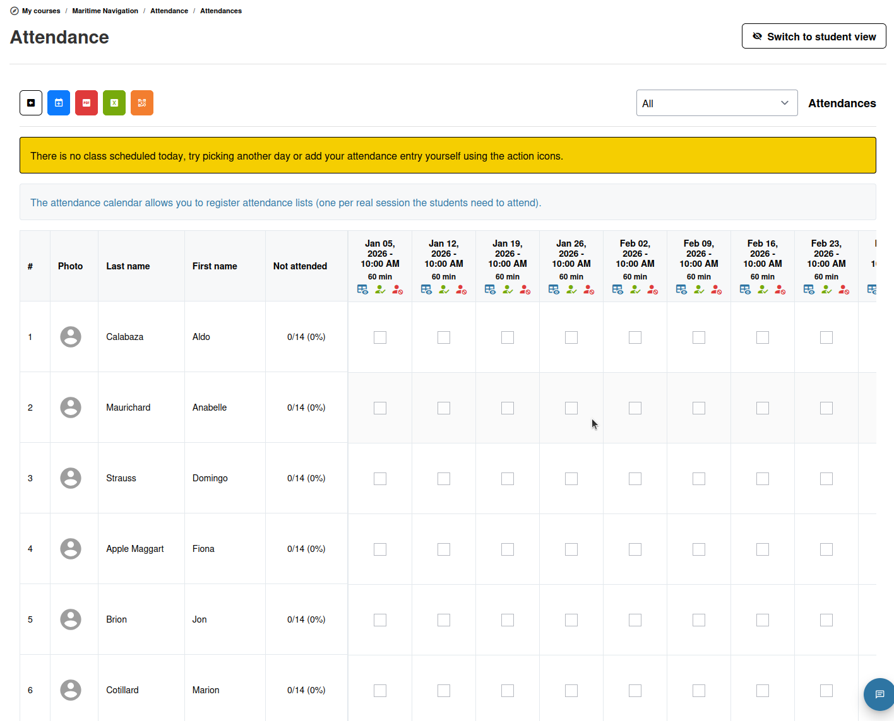

# Anwesenheit

Das Anwesenheitstool ermöglicht es Ihnen, die Anwesenheit von Lernenden bei geplanten Unterrichtssitzungen zu erfassen, ob vor Ort oder online.

## Erstellen eines Anwesenheitsblatts

1. Öffnen Sie das Tool **Anwesenheit** auf der Kursstartseite
2. Klicken Sie auf **Anwesenheit hinzufügen**, um ein Anwesenheitsblatt zu erstellen
3. Geben Sie einen **Titel** für das Anwesenheitsblatt ein (z. B. „Woche 1 – Einführung“)
4. Geben Sie eine **Beschreibung** ein (diese dient hauptsächlich Ihrem eigenen Gebrauch – Lernende sehen die Beschreibung nicht)
5. Speichern

### Erweiterte Einstellungen

1. **Eindeutige Anwesenheit verlangen** ermöglicht es Ihnen, eine lernende Person als vollständig anwesend zu werten, wenn sie auch nur an einem einzigen Termin des Anwesenheitsblatts teilgenommen hat
2. **Notenbuch-Optionen** ermöglichen es Ihnen festzulegen, ob das Anwesenheitsblatt im Bewertungstool (Gradebook) gewertet werden soll.

## Termine hinzufügen

Jedes Anwesenheitsblatt enthält einen oder mehrere Termine (Sitzungen), an denen Sie die Anwesenheit erfassen:

1. Öffnen Sie ein Anwesenheitsblatt oder setzen Sie den Erstellungsprozess fort
2. Klicken Sie auf **Termin hinzufügen** 
3. Wählen Sie Datum und Uhrzeit aus
4. Aktivieren Sie optional **Termin wiederholen**, um eine Wiederholungslogik auszuwählen
5. Geben Sie eine **Dauer** in Minuten für die Veranstaltung an (Standardwert: 60 Minuten)
6. Wählen Sie optional eine **Gruppe** aus, wenn dieser Anwesenheitstermin nur für eine Gruppe von Lernenden gilt
7. Speichern

Sie können demselben Anwesenheitsblatt mehrere Termine hinzufügen (z. B. alle Sitzungen eines Monats).

## Anwesenheit erfassen

Markieren Sie für jeden Termin jede lernende Person als:

* **Anwesend** — Die lernende Person hat teilgenommen (Standardwert für alle Lernenden)
* **Abwesend** — Die lernende Person hat nicht teilgenommen

Klicken Sie auf die Statuszelle neben dem Namen jeder lernenden Person, um zwischen anwesend und abwesend zu wechseln.

Standardmäßig werden alle Lernenden als anwesend markiert, da davon ausgegangen wird, dass in der Regel mehr Personen anwesend als abwesend sind.

Hinweis: Administratoren können die Portalkonfiguration so anpassen, dass Sie erweiterte Anwesenheitstypen auswählen können (verspätet, abwesend mit Begründung usw.), die Ihre Verfahren besser abbilden. In diesem Fall wechselt ein Klick auf das Anwesenheitseingabefeld zwischen allen Anwesenheitstypen.

## Anwesenheitsberichte anzeigen

Das Anwesenheitstool zeigt:

* Eine Übersichtstabelle mit allen Lernenden und allen Terminen
* Den Anwesenheitsprozentsatz jeder lernenden Person (anwesende Sitzungen / Sitzungen insgesamt)
* Farbcodierte Indikatoren zur schnellen Übersicht

## Weiteres

Anwesenheiten verfügen über einige erweiterte Funktionen, die nicht sofort sichtbar sind:
* **Unterschriften** können aktiviert werden, sodass Lernende ihre Anwesenheit im Unterricht über ein von der Lehrkraft geführtes Tablet unterschreiben können
* **Kommentare** können von der Lehrkraft zu jeder Anwesenheit einer lernenden Person hinzugefügt werden
* **PDF-Berichte** können exportiert werden, um gesetzlichen Vorgaben zu entsprechen

## Tipps

* **Verknüpfung mit dem Kursfortschritt** — Nutzen Sie Anwesenheitsdaten zusammen mit dem Tool Kursfortschritt, um Anwesenheit mit der Themenabdeckung in Beziehung zu setzen
* **Daten exportieren** — Exportieren Sie das Anwesenheitsblatt für Verwaltungsunterlagen
* **Erwartungen festlegen** — Wenn die Anwesenheit verpflichtend ist, kommunizieren Sie die Regelung klar in Ihrer Kurseinführung oder in Ankündigungen