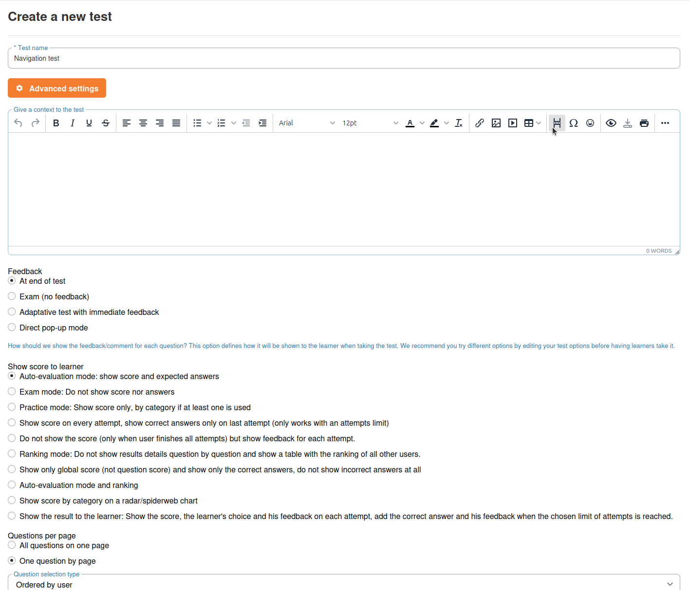
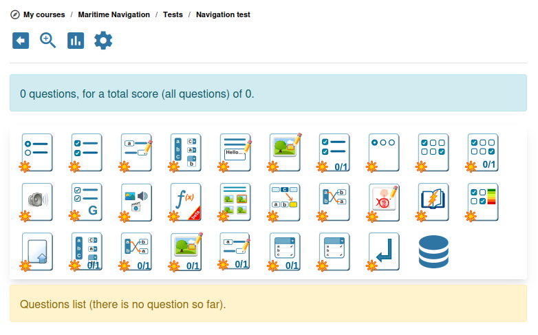

# Übungen

Das Übungs-Werkzeug (auch „Tests“ genannt) ermöglicht es Ihnen, Quizze und Prüfungen mit automatischer Bewertung zu erstellen. Chamilo unterstützt eine große Vielfalt an Fragetypen, von einfachen Multiple-Choice-Fragen bis hin zu interaktiven Hotspot-Fragen.

## Eine Übung erstellen

1. Öffnen Sie das Werkzeug **Übungen**  auf der Kursstartseite
2. Klicken Sie auf **Neue Übung**
3. Geben Sie einen **Titel** und eine optionale **Beschreibung** ein
4. Konfigurieren Sie die Übungseinstellungen (siehe unten)
5. Speichern Sie und fügen Sie anschließend Fragen hinzu

## Übungseinstellungen

### Anzeige und Navigation

| Einstellung | Optionen | Beschreibung |
|---------|---------|-------------|
| **Fragenlayout** | Alle auf einer Seite / Eine pro Seite | Alle Fragen auf einmal oder jeweils eine anzeigen |
| **Fragentitel ausblenden** | Ja / Nein | Ob Fragentitel den Lernenden angezeigt werden |
| **Schaltfläche „Zurück“ anzeigen** | Ja / Nein | Lernenden erlauben, zu vorherigen Fragen zurückzukehren |
| **Rückwärtsnavigation verhindern** | Ja / Nein | Lernende zwingen, die Fragen der Reihe nach zu beantworten, ohne zurückzugehen |

### Zeit und Verfügbarkeit

| Einstellung | Beschreibung |
|---------|-------------|
| **Zeitlimit** | Maximale Zeit (in Minuten) zum Abschließen der Übung. Den Lernenden wird ein Countdown-Timer angezeigt |
| **Startdatum** | Zeitpunkt, ab dem die Übung für Lernende verfügbar ist |
| **Enddatum** | Zeitpunkt, ab dem die Übung nicht mehr verfügbar ist |

### Zugangsbedingungen

Wenn die Administration **Zugangsbedingungen vor einem Test** (`allow_final_exam_access_rule`) aktiviert, zeigt der Bereich **Versuche und Zeitplanung** der erweiterten Einstellungen einen Block **Zugangsbedingungen**. Verwenden Sie ihn, um einen Test, typischerweise eine Abschlussprüfung, geschlossen zu halten, bis die lernende Person bereit ist:

| Einstellung | Beschreibung |
|---------|-------------|
| **Mindestzeit im Kurs vor dem Start des Tests (in Minuten)** | Die lernende Person kann den Test erst starten, wenn sie diese Zeit im Kurs verbracht hat, so wie die Kursberichte sie zählen (dieselbe Zeit wie die Uhr der im Kurs verbrachten Zeit). 0 setzt kein Minimum |
| **Vor dem Start des Tests erforderliches Profilfeld** | Ein Feld des Profils der lernenden Person, etwa eine Studierendenkennung, das zuerst ausgefüllt sein muss. Angeboten werden nur die Textfelder, die Lernende in ihrem eigenen Profil ändern können |
| **Die lernende Person kann sich entscheiden, dieses Feld nicht auszufüllen** | Stellt der lernenden Person zuerst eine Frage (**Vor dem Ausfüllen des Feldes gestellte Frage**). Antwortet sie mit Nein, wird das Feld als abgelehnt markiert und der Test kann starten |

Solange die Bedingungen nicht erfüllt sind, blendet die Startseite des Tests die Schaltfläche **Test starten** aus und teilt der lernenden Person mit, wie viel Zeit sie noch im Kurs verbringen muss und welches Profilfeld auszufüllen ist. Die lernende Person füllt das Feld direkt auf dieser Seite aus: Es akzeptiert nur Ziffern (mindestens 3). Lehrkräfte sind von den Bedingungen nicht betroffen.

Unter den Feldern zeigt **Zugangsbedingungen in JSON** schreibgeschützt die Regel so an, wie sie gespeichert wird. Aktivieren Sie **JSON bearbeiten**, um sie selbst zu schreiben: Die Felder darüber werden dann eingefroren und das JSON wird so gespeichert, wie es geschrieben wurde, einschließlich Schlüsseln, die die Felder nicht bearbeiten (etwa die `source` von Regeln, die von einer älteren Plattform importiert wurden). Das JSON muss ein Objekt mit mindestens `minimum_minutes_before_exam` (eine ganze Zahl von Minuten) und `user_identifier_field_variable` (das Profilfeld oder eine leere Zeichenkette) sein; `allow_user_identifier_opt_out` (true oder false) und `user_identifier_opt_out_prompt` sind optional. Ein leeres JSON entfernt die Bedingungen. Wenn Sie **JSON bearbeiten** deaktivieren, werden die Felder aus einem gültigen JSON gefüllt.

### Versuche und Bewertung

| Einstellung | Beschreibung |
|---------|-------------|
| **Maximale Versuche** | Wie oft eine lernende Person die Übung absolvieren kann (0 = unbegrenzt) |
| **Bestehensgrenze in Prozent** | Die Mindestpunktzahl zum Bestehen (z. B. 70 %). Lernende, die diesen Schwellenwert nicht erreichen, sehen eine Meldung über das Nichtbestehen |
| **Negative Bewertung fortsetzen** | Ob negative Punkte bei einzelnen Fragen die Gesamtpunktzahl unter null senken |

### Feedback

| Einstellung | Optionen |
|---------|---------|
| **Am Ende** | Ergebnisse und richtige Antworten anzeigen, nachdem die lernende Person abgegeben hat |
| **Sofort** | Feedback nach jeder Frage anzeigen (nützlich für Lernübungen) |
| **Prüfungsmodus** | Kein Feedback und keine Ergebnisse anzeigen |

### Meldungen von Lernenden zu Problemen bei Fragen

Aktivieren Sie **Lernenden erlauben, Probleme bei Fragen zu melden**, wenn Lernende unklare, fehlerhafte oder defekte Fragen während eines laufenden Versuchs kennzeichnen sollen. Die Meldeoption wird nur Lernenden und nur bei normalen Frageelementen angezeigt.

Eine lernende Person gibt einen Kommentar in **Ein Problem mit dieser Frage melden** ein. Die Meldung wird dieser Frage und diesem Versuch zugeordnet; sie ändert weder die Antwort noch die Punktzahl der lernenden Person.

### Ergebnisanzeige

Legen Sie fest, was Lernende nach Abschluss der Übung sehen:

* Punktzahl und erwartete Antworten anzeigen
* Nur die Punktzahl anzeigen
* Punktzahl mit Aufschlüsselung nach Kategorien anzeigen
* Rangfolge unter den anderen Lernenden anzeigen
* Nur beim letzten Versuch anzeigen
* Radardiagramm anzeigen

### Abschlussmeldungen

* **Erfolgsmeldung** — Benutzerdefinierter Text, der angezeigt wird, wenn die lernende Person besteht
* **Fehlermeldung** — Benutzerdefinierter Text, der angezeigt wird, wenn die lernende Person den Bestehensprozentsatz nicht erreicht

### Fragenrandomisierung

| Einstellung | Beschreibung |
|---------|-------------|
| **Zufällige Fragenreihenfolge** | Mischt die Reihenfolge der Fragen bei jedem Versuch |
| **Zufällige Antworten** | Mischt die Antwortoptionen innerhalb jeder Frage |
| **Zufällig nach Kategorie** | Wählt zufällige Fragen aus jeder Fragenkategorie aus |

Sie können auch erweiterte Auswahlstrategien konfigurieren, die Kategorien und Randomisierung kombinieren.

## Fragetypen

Chamilo bietet eine umfangreiche Auswahl an Fragetypen, die in mehrere Kategorien unterteilt sind:

### Einfachauswahl

* **Multiple Choice (eine Antwort)** — Die lernende Person wählt eine richtige Antwort aus einer Liste von Optionen
* **Einzelantwort mit Bildern** — Wie oben, jedoch werden die Antwortoptionen als Bilder angezeigt

### Mehrfachauswahl

* **Mehrfachantwort** — Die lernende Person wählt eine oder mehrere richtige Antworten aus
* **Mehrfachantwort (Dropdown)** — Antwortoptionen werden als Dropdown-Menüs dargestellt
* **Wahr/Falsch** — Eine Reihe von Aussagen, die die lernende Person als wahr oder falsch kennzeichnet
* **Wahr/Falsch mit Sicherheitsgrad** — Wahr/Falsch mit einem zusätzlichen Vertrauensniveau, das eine differenziertere Bewertung ermöglicht

### Lückentext

* **Lückentext** — Die lernende Person ergänzt fehlende Wörter in einem Text. Sie definieren die Lücken und die akzeptierten Antworten beim Erstellen der Frage.

### Zuordnung

* **Zuordnung** — Die lernende Person verbindet Elemente aus zwei Spalten
* **Zuordnung (ziehbar)** — Dasselbe Konzept, jedoch mit einer Drag-and-Drop-Oberfläche
* **Ziehbar** — Elemente an die richtigen Positionen ziehen

### Offene Fragen

* **Freie Antwort (Aufsatz)** — Die lernende Person verfasst eine Textantwort. Erfordert eine manuelle Bewertung (oder eine KI-gestützte Bewertung, sofern konfiguriert)
* **Mündlicher Ausdruck** — Die lernende Person nimmt eine Audioantwort mit dem Mikrofon auf
* **Antwort hochladen** — Die lernende Person lädt eine Datei als Antwort hoch

### Hotspot

* **Hotspot** — Die lernende Person klickt auf bestimmte Bereiche eines Bildes, um zu antworten
* **Hotspot-Abgrenzung** — Die lernende Person zeichnet Grenzen um Bereiche auf einem Bild

### Berechnet

* **Berechnete Antwort** — Numerische Fragen mit einer Formel und einem Toleranzbereich. Nützlich für Mathematik- und naturwissenschaftliche Kurse.

### Spezial

* **Leseverständnis** — Tests auf Grundlage der Lektüre eines Textabschnitts
* **Annotation** — Die Lehrkraft lädt ein Bild hoch, und die lernende Person annotiert es
* **Antwort in einem Office-Dokument** — Wenn das OnlyOffice-Plugin aktiviert ist, beantwortet die lernende Person die Frage, indem sie ein eingebettetes Office-Dokument (Word, Excel, PowerPoint) bearbeitet. Die Antwort wird als separate Datei unter der Übung gespeichert, sodass sie zusammen mit dem übrigen Versuch geprüft werden kann.

## Fragen zu einer Übung hinzufügen

1. Öffnen Sie die Übung und klicken Sie auf **Frage hinzufügen**
2. Wählen Sie den Fragetyp aus
3. Geben Sie den **Fragetext** ein (unterstützt formatierten Text mit Bildern und Formatierung)
4. Definieren Sie die **Antworten** und deren Bewertung:
   * Geben Sie für jede Antwortoption an, ob sie richtig ist und wie viele Punkte sie wert ist
   * Sie können falschen Antworten negative Punkte zuweisen, um Raten zu erschweren
5. Fügen Sie optional **Feedback** hinzu — Erläuterungen, die der lernenden Person nach der Beantwortung angezeigt werden
6. Legen Sie den **Schwierigkeitsgrad** und die **Kategorie** fest (nützlich für die Zufallsauswahl und die Berichterstattung)
7. Speichern

## Offene Fragen korrigieren

Offene Fragen (offene Frage, mündlicher Ausdruck, Datei-Upload, Annotation und Antworten in Office-Dokumenten) werden manuell korrigiert. Öffnen Sie den Versuch der lernenden Person über die Ergebnisse der Übung im Korrekturmodus: Unter jeder dieser Antworten legt das Feld **Korrektur durch die Lehrkraft** die Punktzahl und einen **Kommentar der Lehrkraft** fest.

Wenn **Audio-Feedback zu eingereichten Antworten** (`exercise.allow_teacher_comment_audio`) in den Plattformeinstellungen aktiviert ist, bietet das Feld außerdem einen **Audiokommentar**: Klicken Sie auf **Aufnahme starten**, sprechen Sie, klicken Sie dann auf **Aufnahme beenden** und hören Sie sich das Ergebnis vor dem Speichern an. Die Aufnahme wird mit der Korrektur gespeichert, über **Als Entwurf speichern** oder **Korrektur speichern**. Eine neue Aufnahme ersetzt die vorherige. Die lernende Person hört sie neben dem schriftlichen Kommentar, wenn die Übung Feedback anzeigt.

## Berichte von Lernenden prüfen

Öffnen Sie eine Frage im Frageneditor und klappen Sie **Berichte von Lernenden** auf. Jeder Bericht zeigt die lernende Person, die Uhrzeit, die Übung, sofern verfügbar, und den eingereichten Kommentar. Wenn Chamilo den Bericht mit dem Versuch verknüpfen kann, verwenden Sie **Versuch anzeigen**, um die umgebenden Antworten zu prüfen, bevor Sie die Frage korrigieren.

## Verlauf der Antwortänderungen (technisch)

Chamilo 3.1 kann Änderungen an Antworten während eines Übungsversuchs aufzeichnen, einschließlich des modernen Vue-Players und der anwendbaren älteren Abläufe zum Speichern von Antworten. Das Protokoll wird separat in `track_e_attempt_log` gespeichert und bewahrt frühere Antwortzustände, ohne endgültige Antworten oder Punktzahlen zu verändern.

Dies ist ein interner Prüfdatensatz, **kein** zusätzlicher Fragenwert und kein allgemeiner Viewer für den Antwortverlauf in der Lehrendenoberfläche. Die Bereitstellung dieser Funktion erfordert die zugehörige Chamilo-Datenbankmigration. Siehe [Exercise answer history #9277](https://github.com/chamilo/chamilo-lms/pull/9277).

## Fragenkategorien

Sie können Fragen in Kategorien organisieren (z. B. „Modul 1“, „Wortschatz“, „Fortgeschritten“). Kategorien sind nützlich für:

* die Organisation großer Fragenbanken
* die zufällige Auswahl nach Kategorie (z. B. „5 Fragen aus Modul 1, 3 aus Modul 2“)
* die Anzeige von Punktzahlen nach Kategorie in Berichten

## Wiederverwendung von Fragen

Fragen können innerhalb desselben Kurses in mehreren Übungen wiederverwendet werden. Beim Hinzufügen einer Frage können Sie eine neue erstellen oder eine vorhandene Frage aus der Fragenbank auswählen.

## Übungen importieren

Chamilo unterstützt den Import von Übungen aus externen Formaten:

* **IMS QTI / Common Cartridge** — das Standardformat für E-Learning-Quizze
* **Moodle-Format** — Import von Quizzen aus Moodle-Exporten

Zum Importieren suchen Sie im Übungswerkzeug nach der Option **Importieren** und laden Ihre Datei hoch.

### IMS-QTI-2-Interoperabilität

Chamilo 3.1 unterstützt eine definierte Teilmenge der IMS-QTI-2-Fragetypen. Neuere Verbesserungen betreffen **Zuordnung** (`matchInteraction`), einschließlich korrekter Zuordnungen, und **Lückentext**, einschließlich getippter Lücken (`textEntryInteraction`), Dropdown-Lücken (`inlineChoiceInteraction`) und deren Bewertung je Lücke, sofern sie im importierten Paket abgebildet sind.

Der QTI-2-Exporter unterstützt Einfachauswahl, Mehrfachauswahl, exakte Kombination, Freitextantwort, Zuordnung (einschließlich ziehbarer Zuordnung), Reihenfolgen und Lückentextfragen. Mehrfachantwortfragen verwenden QTI `choiceInteraction` mit `maxChoices="0"`, sodass Lernende mehr als eine Option auswählen können. Fragen zur exakten Kombination vergeben die volle Punktzahl nur, wenn genau die richtigen Auswahlmöglichkeiten gewählt wurden, und werden beim Import wieder als Fragen zur exakten Kombination übernommen.

**Eindeutige Antwort mit Unbekannt (Typ 10)** verwendet eine QTI-2.1-`choiceInteraction` mit einer einzigen Antwort. Chamilo enthält die feste Auswahl **Weiß nicht** mit null Punkten und eine optionale `assessmentItem`-Bezeichnung `chamilo:unique-answer-unknown`. Wenn ein von Chamilo erzeugtes Paket wieder in Chamilo importiert wird, stellt diese Bezeichnung Typ 10 und seine feste Antwort wieder her. Nicht gekennzeichnete Einfachauswahlfragen werden als gewöhnliche eindeutige Antwort (Typ 1) importiert, auch wenn eine Auswahl „Weiß nicht“ lautet. Andere QTI-Werkzeuge können die Bezeichnung ignorieren oder entfernen; prüfen Sie daher nach Übertragungen den Fragetyp und die Bewertung.

Zuordnung und ziehbare Zuordnung verwenden beide QTI `matchInteraction`. Für die ziehbare Zuordnung fügt Chamilo die optionale `assessmentItem`-Bezeichnung `chamilo:matching-draggable` hinzu. **QTI-2.1-Roundtrips von Chamilo zu Chamilo bewahren die ziehbare Zuordnung (Typ 19)**, wenn diese Bezeichnung vorhanden ist; gewöhnliche oder nicht gekennzeichnete Zuordnungselemente werden als Standardzuordnung (Typ 4) importiert. Andere QTI-Werkzeuge können die optionale Bezeichnung ignorieren oder entfernen, sodass die ziehbare Darstellung bei der Übertragung über ein anderes Werkzeug nicht garantiert ist.

**Reihenfolge (Typ 18)** wird mit QTI 2.1 `orderInteraction` und einer geordneten Antwort exportiert und importiert. Ein Roundtrip von Chamilo zu Chamilo bewahrt die korrekte Reihenfolge, die horizontale oder vertikale Ausrichtung und die Teilpunkte je Position. QTI-Werkzeuge können andere Bewertungsregeln verwenden oder diese positionsbezogene Bewertung weglassen; prüfen Sie daher die importierten Gewichtungen und die Gesamtpunktzahl, bevor Sie eine Bewertung einsetzen.

Nicht unterstützte Fragetypen können beim Export oder Import übersprungen werden; vergleichen Sie daher nach jeder Übertragung die Anzahl der Fragen und die Bewertung.

Testen Sie bei kritischen Bewertungen das exportierte Archiv, indem Sie es in einen Nicht-Produktionskurs importieren und die Fragen und Antworten prüfen, bevor Sie es mit Lernenden verwenden. Dies ist **keine** Garantie für eine vollständige QTI-2-Abdeckung aller Fragetypen oder Pakete.

## Höchstpunktzahl jeder Frage ein- oder ausblenden

Öffnen Sie die Konfiguration einer Übung und suchen Sie **Höchstpunktzahl je Frage während des Tests anzeigen**. Aktivieren Sie die Option, wenn Lernende während einer Übung die maximal verfügbare Punktzahl jeder Frage sehen sollen; deaktivieren Sie sie, wenn diese Information während des Versuchs ausgeblendet werden soll.

Dies steuert die Darstellung im Übungsplayer, nicht die Bewertung der Fragen. Der konfigurierte Wert bleibt beim Duplizieren der Übung erhalten und gilt sowohl für den modernen Player als auch für den unterstützten älteren Übungsablauf. Siehe [question maximum score PR #9362](https://github.com/chamilo/chamilo-lms/pull/9362).

## Erstellen einer verknüpften Kopie einer Übung

Verwenden Sie in der Übungsliste bei einer Übung, für die diese Aktion verfügbar ist, **Verknüpfte Übung erstellen** und bestätigen Sie anschließend. Dadurch wird eine weitere Übung erstellt, die mit dem ursprünglichen Fragensatz verknüpft ist, und keine vollständig unabhängige Kopie. Verwenden Sie eine normale unabhängige Kopie, wenn die Fragen bearbeitet werden müssen, ohne verwandte Übungen zu beeinflussen.

Prüfen Sie vor dem Bearbeiten verknüpfter Fragen, welche anderen Übungen sie wiederverwenden, damit eine gemeinsame Änderung nicht unbeabsichtigt eine andere Bewertung verändert. Die Aktion zum Erstellen einer verknüpften Kopie wird nur bei geeigneten Übungen angezeigt. Siehe [verknüpfte Übungskopie PR #9350](https://github.com/chamilo/chamilo-lms/pull/9350).

## Tipps

* **Fragetypen mischen** — Kombinieren Sie Multiple-Choice-, Lückentext- und offene Fragen für eine umfassende Bewertung
* **Kategorien verwenden** — Organisieren Sie Fragen nach Themen, um eine gezielte Zufallsauswahl zu ermöglichen
* **Bestehensgrenze festlegen** — Geben Sie den Lernenden ein klares Ziel vor und verknüpfen Sie es über das Notenbuch mit der Zertifikatserstellung
* **Sofortiges Feedback zum Üben nutzen** — Erstellen Sie unbenotete Übungsaufgaben mit sofortigem Feedback, damit Lernende aus ihren Fehlern lernen können
* **Zur Integrität zufällig anordnen** — Aktivieren Sie eine zufällige Fragenreihenfolge und zufällige Antworten, um die Wahrscheinlichkeit des Abschreibens zu verringern